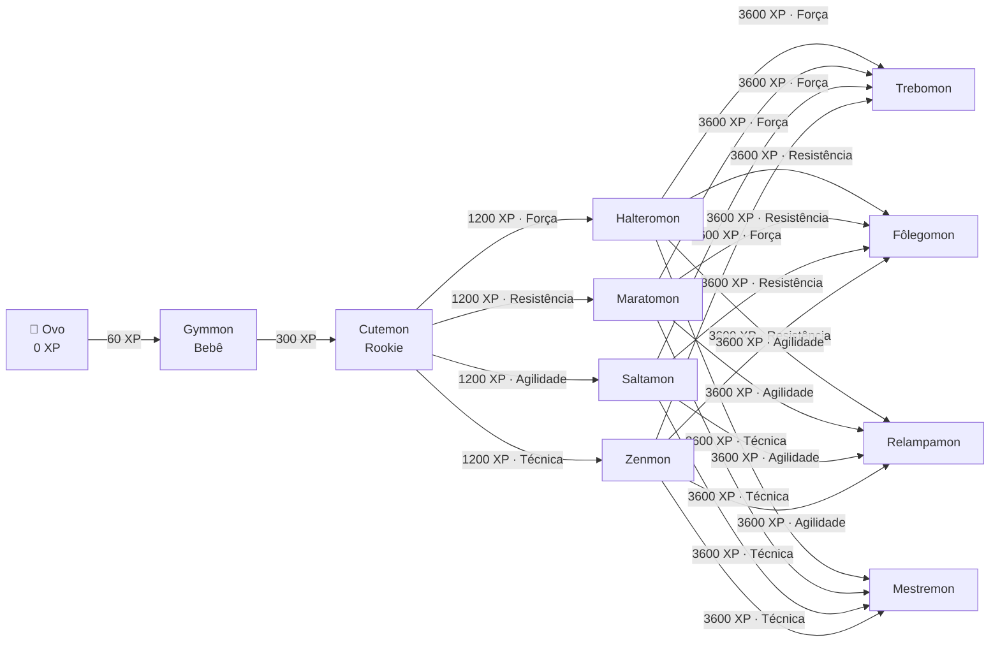
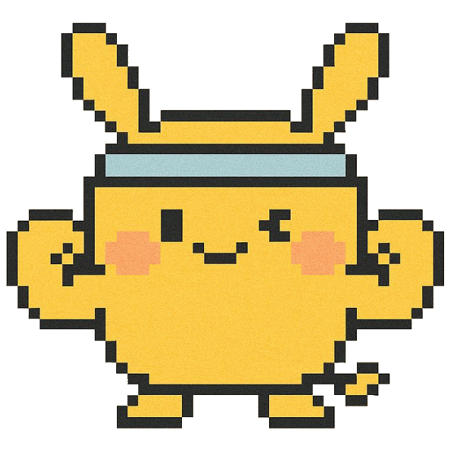
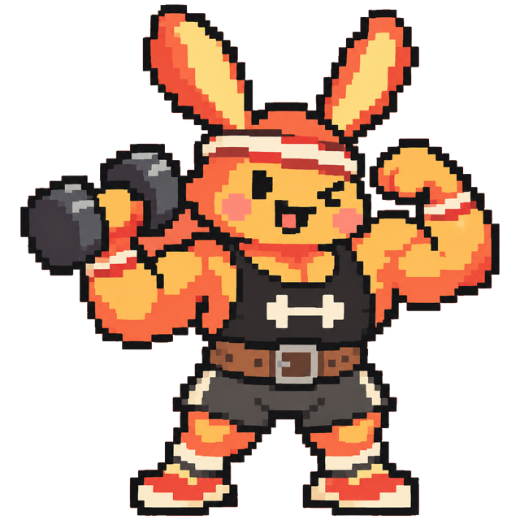
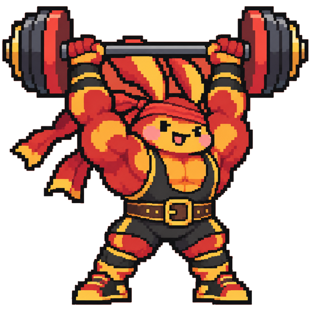
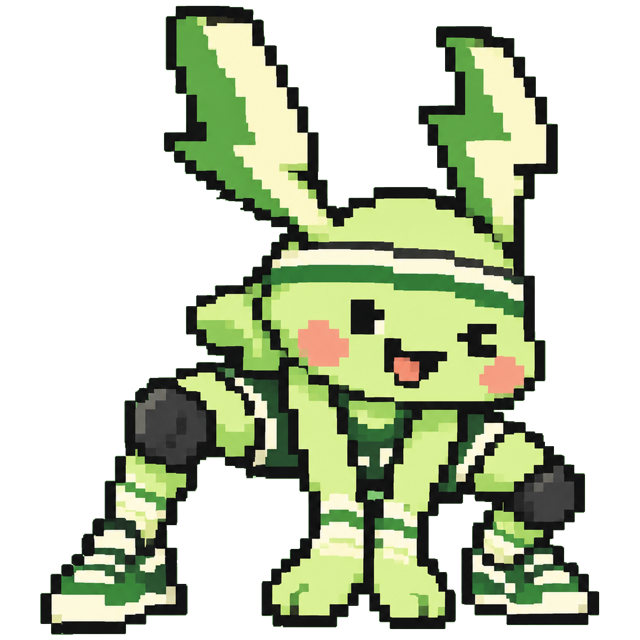

# Árvore de evolução

## Estágios

| Estágio | XP total | Forma |
|---|---|---|
| Ovo | 0 |  |
| Bebê | 60 |  Gymmon |
| Rookie | 300 |  Cutemon |

## Galhos (Champion → Ultimate)

| Atributo | Champion · 1200 XP | Ultimate · 3600 XP |
|---|---|---|
| 💪 Força |  Halteromon |  Trebomon |
| ❤️ Resistência |  Maratomon |  Fôlegomon |
| ⚡ Agilidade |  Saltamon |  Relampamon |
| ✨ Técnica |  Zenmon |  Mestremon |

## Como o galho é escolhido

- Ao chegar em **Champion** (1200 XP), vence o atributo que você mais treinou **desde que virou Rookie**.
- Ao chegar em **Ultimate** (3600 XP), vence o atributo mais treinado **durante a fase Champion**. Dá para trocar de linha: um Halteromon que passou a fase correndo vira Fôlegomon.
- Empate fica com a ordem Força → Resistência → Agilidade → Técnica.

## Atividade → atributos

| Atividade | Força | Resistência | Agilidade | Técnica |
|---|---|---|---|---|
| Musculação | 80% | | | 20% |
| Crossfit | 40% | 40% | 20% | |
| Corrida | | 80% | 20% | |
| Caminhada | | 100% | | |
| Bike | 20% | 80% | | |
| Natação | | 60% | | 40% |
| Vôlei | | | 60% | 40% |
| Futebol | | 50% | 50% | |
| Lutas | 30% | | 40% | 30% |
| Dança | | | 50% | 50% |
| Yoga | | | | 100% |
| Outro | 25% | 25% | 25% | 25% |

XP de cada atividade = duração × gasto típico (MET) × esforço; acima de 150 XP no dia rende 1/3, com teto de 300 XP/dia. Treinando todo dia, o Champion chega em ~5 semanas e o Ultimate em ~3–4 meses.
