# Árvore de evolução dos bros

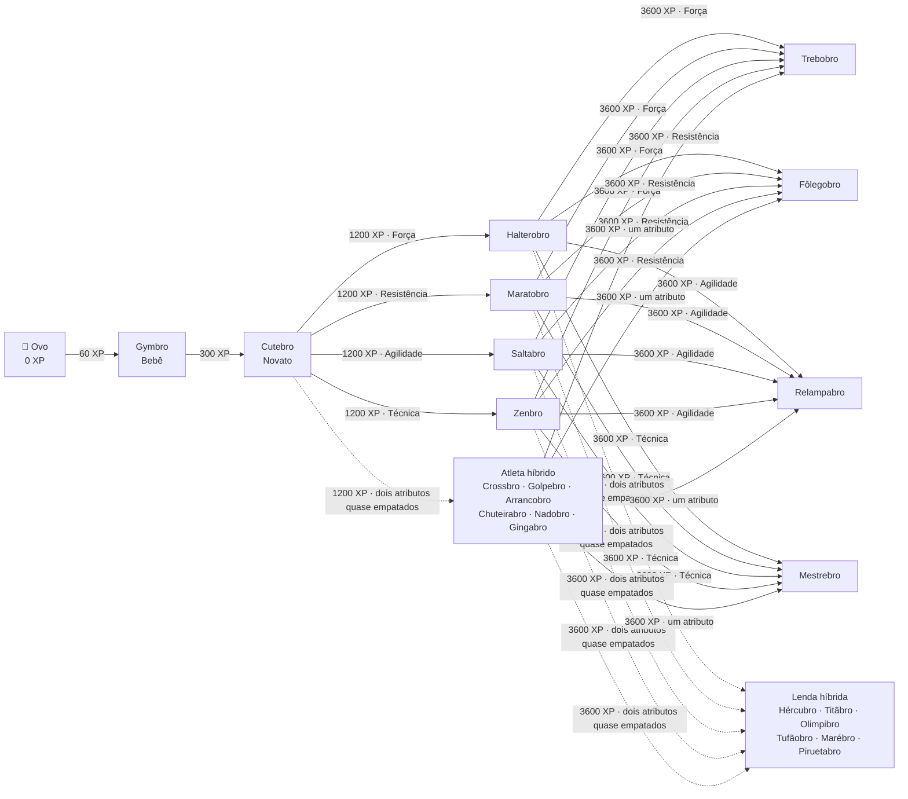

Linha cheia: forma normal (o atributo mais treinado). Pontilhada: forma híbrida (o segundo atributo tem pelo menos 90% do primeiro).

## Estágios

| Estágio | XP total | Forma |
|---|---|---|
| Ovo | 0 | 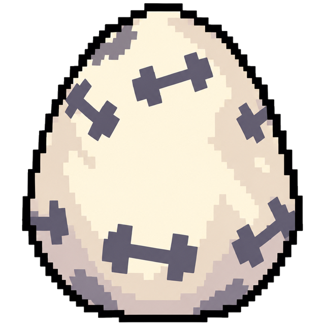 |
| Bebê | 60 |  Gymbro |
| Novato | 300 | 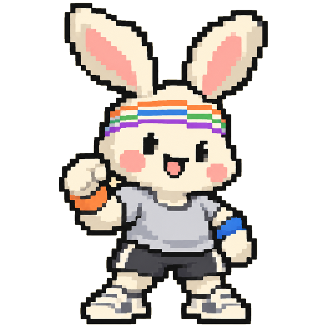 Cutebro |

## Galhos (Atleta → Lenda)

| Atributo | Atleta · 1200 XP | Lenda · 3600 XP |
|---|---|---|
| 💪 Força |  Halterobro |  Trebobro |
| ❤️ Resistência | 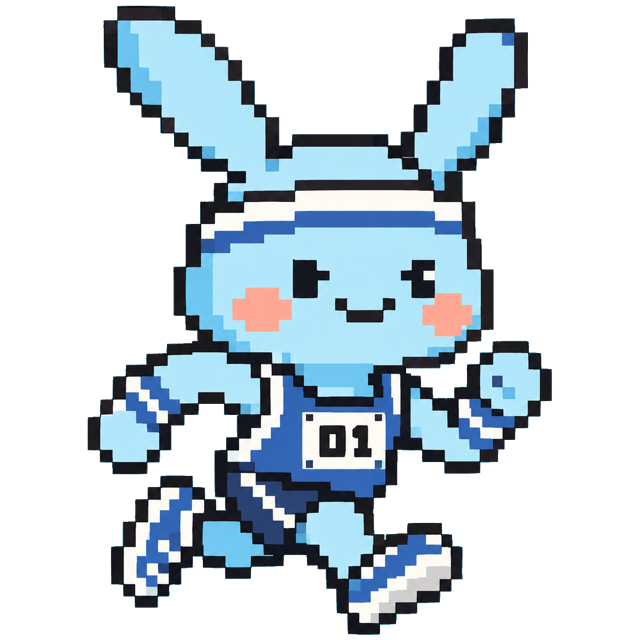 Maratobro | 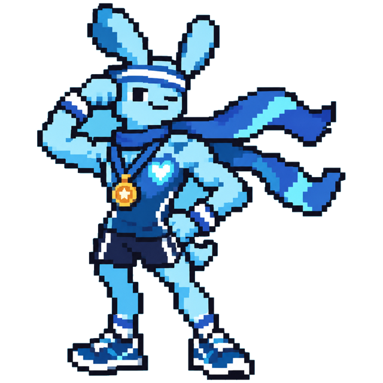 Fôlegobro |
| ⚡ Agilidade |  Saltabro | 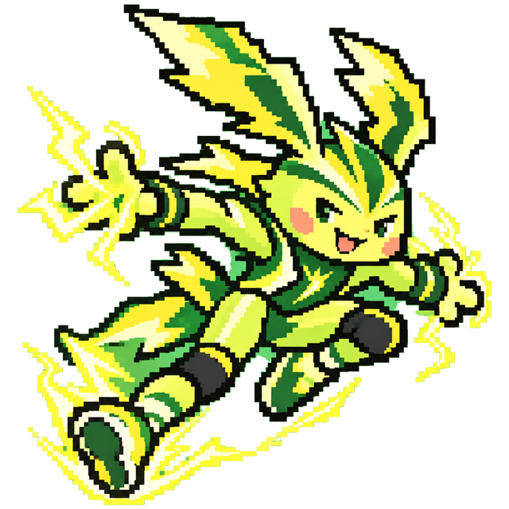 Relampabro |
| ✨ Técnica | 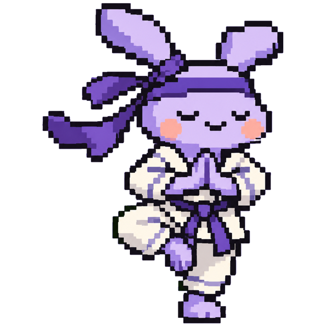 Zenbro | 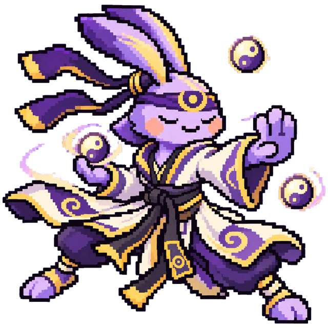 Mestrebro |

## Formas híbridas

Quando os **dois atributos mais treinados** da fase ficam quase empatados (o segundo com pelo menos 90% do primeiro), o bro vira a forma híbrida da dupla: mistura as duas roupas e o corpo dos dois treinos. Na Lenda híbrida, uma aura com as duas cores envolve o bro.

| Dupla | Atleta · 1200 XP | Lenda · 3600 XP |
|---|---|---|
| 💪 Força + ❤️ Resistência |  Crossbro | 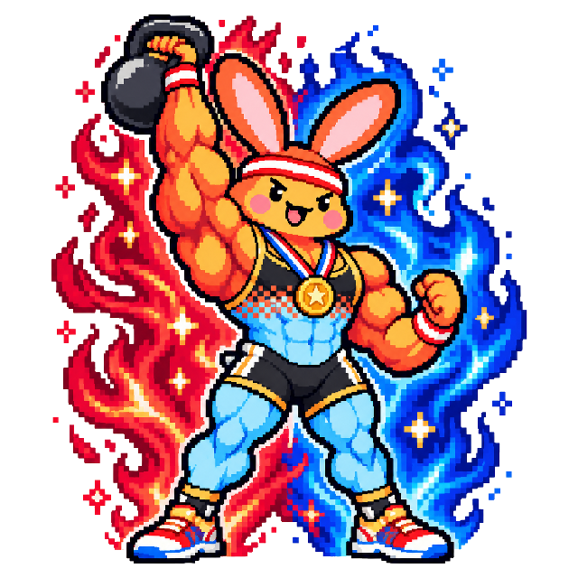 Hércubro |
| 💪 Força + ⚡ Agilidade | 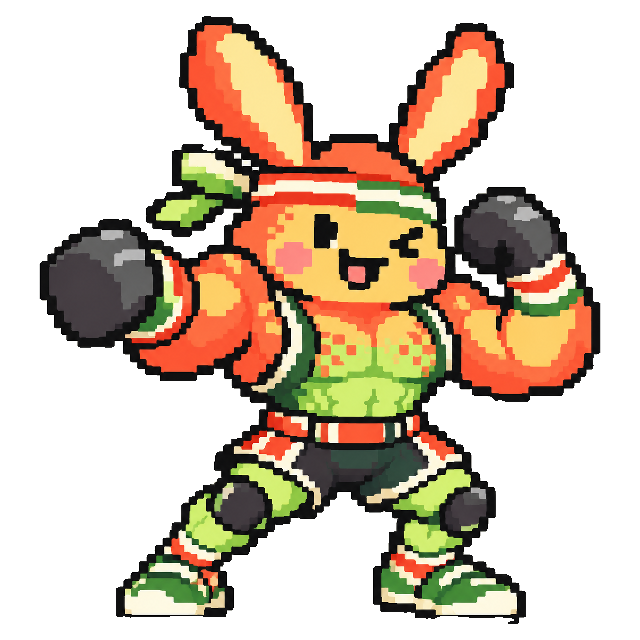 Golpebro | 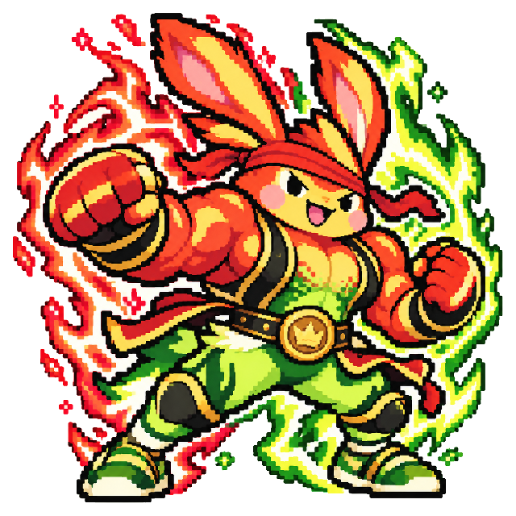 Titãbro |
| 💪 Força + ✨ Técnica | 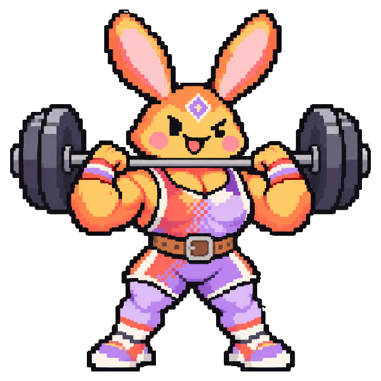 Arrancobro | 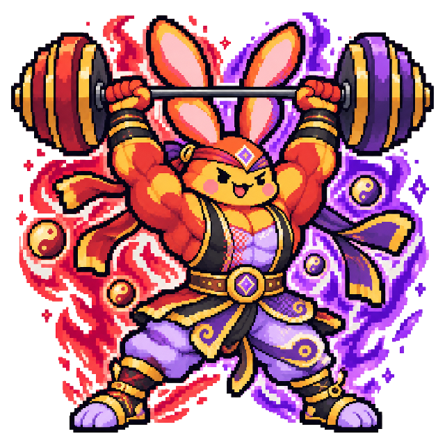 Olimpibro |
| ❤️ Resistência + ⚡ Agilidade | 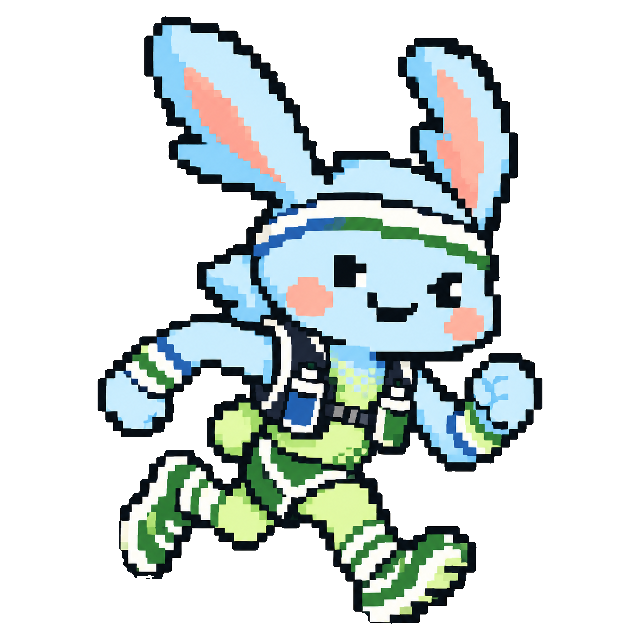 Chuteirabro |  Tufãobro |
| ❤️ Resistência + ✨ Técnica | 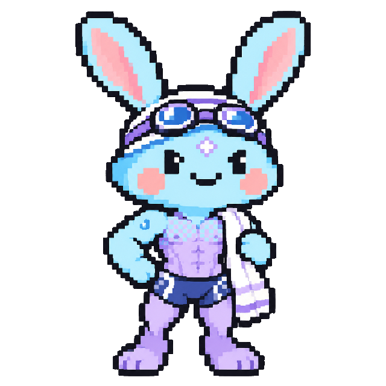 Nadobro | 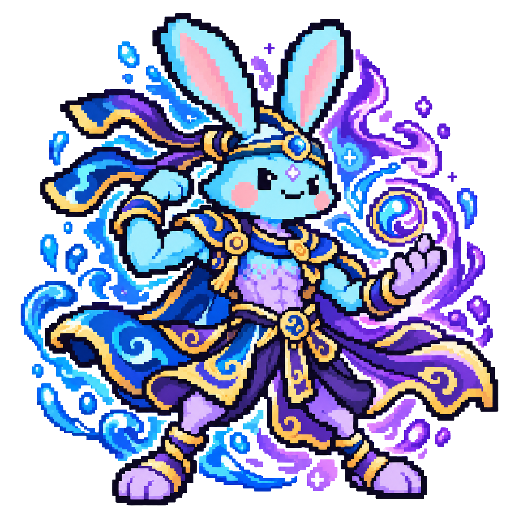 Marébro |
| ⚡ Agilidade + ✨ Técnica |  Gingabro | 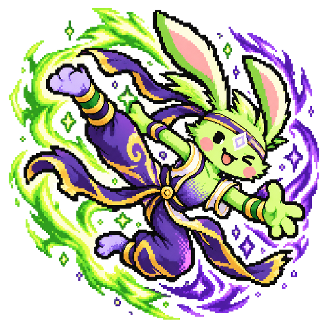 Piruetabro |

## Como o galho é escolhido

- Ao chegar em **Atleta** (1200 XP), vence o atributo que você mais treinou **desde que virou Novato**.
- Ao chegar em **Lenda** (3600 XP), vence o atributo mais treinado **durante a fase Atleta**. Dá para trocar de linha: um Halterobro que passou a fase correndo vira Fôlegobro.
- Empate fica com a ordem Força → Resistência → Agilidade → Técnica.
- **Híbrido:** nas duas viradas, se o segundo atributo da fase tiver pelo menos 90% do primeiro, sai a forma híbrida da dupla em vez da normal (ex.: quem passa a fase jogando futebol, metade Resistência e metade Agilidade, vira Chuteirabro). Também dá para entrar ou sair do híbrido na Lenda: um Crossbro que passou a fase só correndo vira Fôlegobro.
- Crossfit sozinho já tende a híbrido (40% Força, 40% Resistência): quem só faz crossfit vira Crossbro e depois Hércubro.

## Atividade → atributos

| Atividade | Força | Resistência | Agilidade | Técnica |
|---|---|---|---|---|
| Musculação | 80% | | | 20% |
| Crossfit | 40% | 40% | 20% | |
| Corrida | | 80% | 20% | |
| Caminhada | | 100% | | |
| Bike | 20% | 80% | | |
| Natação | | 60% | | 40% |
| Vôlei | | | 60% | 40% |
| Futebol | | 50% | 50% | |
| Lutas | 30% | | 40% | 30% |
| Dança | | | 50% | 50% |
| Yoga | | | | 100% |
| Outro | 25% | 25% | 25% | 25% |

XP de cada atividade = duração × gasto típico (MET) × esforço; acima de 150 XP no dia rende 1/3, com teto de 300 XP/dia. Treinando todo dia, o Atleta chega em ~5 semanas e a Lenda em ~3–4 meses.

## Espécies

A espécie é decidida quando o ovo choca (60 XP, de 1 a 4 treinos), pela **atividade** dos treinos que o chocaram: a atividade com **mais da metade dos minutos** treinados no ovo define o animal. Sem atividade principal (uma mistura) ou com "Outro", nasce o **Coelho**. Os minutos contam, não o XP: senão a corrida, que rende quase o dobro de XP por minuto, venceria a musculação. Urso e Rato dividem musculação e crossfit; o sorteio entre os dois é fixo pelo id do bro. Depois de nascer, a espécie fica gravada no bro. A forma (Atleta, Lenda, híbrido) continua saindo dos atributos.

| Espécie | Atividades no app | No Apple Saúde (tipo exato do treino) |
|---|---|---|
| Urso e Rato | Musculação, Crossfit | Força tradicional e funcional, core, cross training, HIIT, cardio misto, pular corda, escada, step |
| Lobo | Corrida, Bike, Natação | Corrida, atletismo, ciclismo, handbike, cadeira de rodas (corrida), natação, hidroginástica, remo, canoagem e remo de pé, esqui cross-country, triatlo, elíptico, mergulho |
| Cachorro | Caminhada, Futebol | Caminhada, trilha, cadeira de rodas (passeio), futebol, futebol americano e australiano, rúgbi, basquete, handebol, hóquei, lacrosse, beisebol, softbol, críquete, polo aquático, frisbee, brincar, hipismo, caça |
| Esquilo | Vôlei | Vôlei, escalada, ginástica, tênis, tênis de mesa, badminton, squash, raquetebol, pickleball, patinação, snowboard, esqui alpino, esportes na neve, surfe, esportes aquáticos |
| Gato | Lutas, Dança | Artes marciais, boxe, kickboxing, luta, esgrima, dança (cardio e social), barre |
| Coruja | Yoga | Yoga, pilates, flexibilidade, mente e corpo, tai chi, preparação e recuperação, desaquecimento, golfe, arco e flecha, boliche, curling, vela, pesca |
| Coelho | Outro, ou mistura sem atividade principal | Outro, jogos de fitness, transição |

Treinos importados do Apple Saúde usam o tipo exato (tênis vira Esquilo, golfe vira Coruja); os registrados no app usam a categoria. Todas as 84 atividades que o iPhone e o Apple Watch gravam têm um animal (`GymBros/Bros/Hatch.swift`).

Para incluir uma espécie (`Species.all` em `GymBros/Bros/Game.swift`): id, nome, nomes das 10 formas e dos 12 híbridos, as atividades em `GymBros/Bros/Hatch.swift` e as artes `sprite_<id>_<forma>` no app e no widget.

| Espécie | Nasce de | Bebê → Novato | Atletas (Força / Resistência / Agilidade / Técnica) | Lendas |
|---|---|---|---|---|
| Coelho | Outro ou mistura | Gymbro → Cutebro | Halterobro / Maratobro / Saltabro / Zenbro | Trebobro / Fôlegobro / Relampabro / Mestrebro |
| Urso | Musculação, Crossfit | Pelucibro → Ursabro | Supinobro / Trilhabro / Rolabro / Sumobro | Grizzlibro / Montanhabro / Avalanchebro / Kodiabro |
| Rato | Musculação, Crossfit | Queijibro → Ratibro | Marombabro / Rodibro / Fuxibro / Labiribro | Ratazanabro / Esteirabro / Sombrabro / Engenhobro |
| Lobo | Corrida, Bike, Natação | Uivibro → Lobinbro | Alfabro / Trotebro / Caçabro / Matilhabro | Fenribro / Luabro / Ventobro / Ancestrabro |
| Cachorro | Caminhada, Futebol | Filhotibro → Caramelbro | Pitbulbro / Galgobro / Frisbeebro / Pastorbro | Mastibro / Huskybro / Agilitybro / Guiabro |
| Esquilo | Vôlei | Nozibro → Esquilbro | Quebranozbro / Galhobro / Pulabro / Acrobabro | Carvalhobro / Florestabro / Voadorbro / Parkourbro |
| Gato | Lutas, Dança | Novelbro → Bichanobro | Garrabro / Rondabro / Telhadobro / Ronrobro | Jubabro / Panterabro / Linxbro / Esfingebro |
| Coruja | Yoga | Penugbro → Corujabro | Rapinabro / Noturnbro / Planabro / Sabiobro | Harpiabro / Luarbro / Rasantebro / Oraculobro |

Só nascem espécies com as 10 artes no app; as demais ficam cadastradas esperando a arte. Prontas: todas as 8.

Cada espécie também tem as 12 formas híbridas, cada uma com nome próprio: nenhum nome se repete no jogo (ex.: Força + Resistência é **Crossbro** no coelho, **Burpeebro** no urso e **Viralatabro** no cachorro). A lista completa está no `HIBRIDOS.md`. As artes ficam em `sprite_<id>_champion_<a>_<b>` e `sprite_<id>_ultimate_<a>_<b>`; sem a arte, o bro segue a forma normal do atributo dominante. Os prompts estão no `HIBRIDOS.md` e o passo a passo para gerar e instalar, em `tools/README.md`. Prontas: todas as 96.

### Galeria dos híbridos

**Atletas**

| Espécie | Força + Resistência | Força + Agilidade | Força + Técnica | Resistência + Agilidade | Resistência + Técnica | Agilidade + Técnica |
|---|---|---|---|---|---|---|
| Coelho |  Crossbro |  Golpebro |  Arrancobro |  Chuteirabro |  Nadobro |  Gingabro |
| Urso | 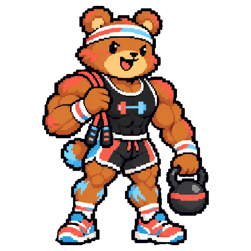 Burpeebro |  Patadabro |  Arremessobro |  Mateirobro |  Salmãobro |  Meialuabro |
| Rato | 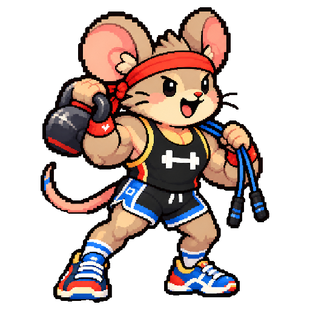 Bigodefitbro |  Mordidabro | 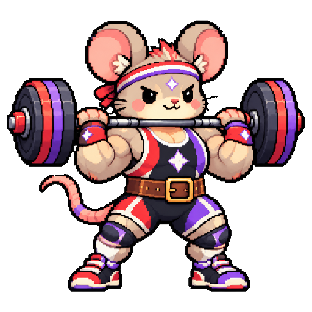 Gorgonzolabro | 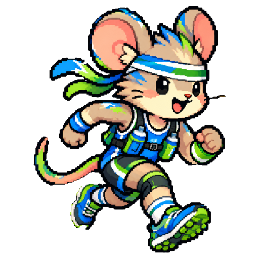 Bueirobro | 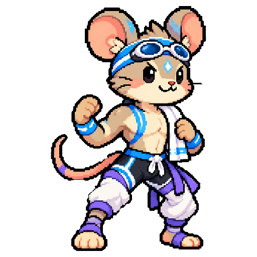 Esgotobro |  Arraiabro |
| Lobo | 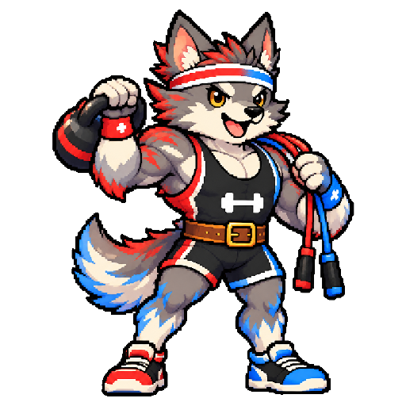 Caninobro |  Investidabro | 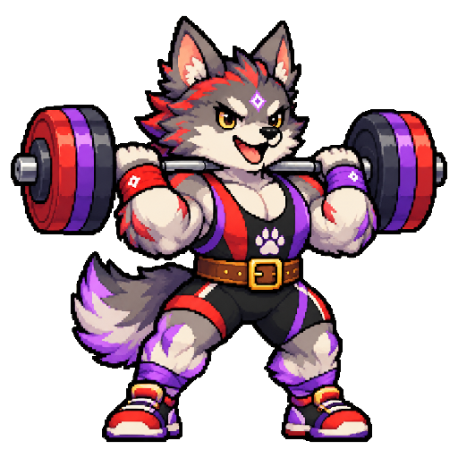 Cumebro | 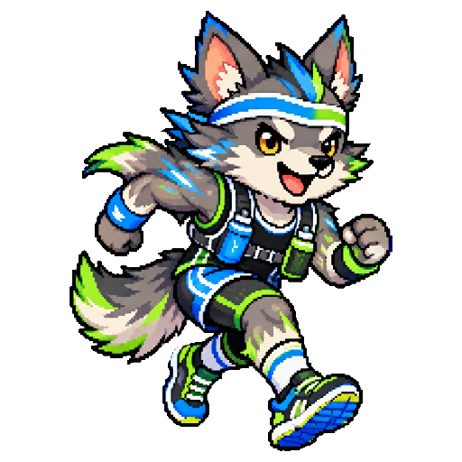 Rastrobro |  Riachobro |  Crepúsculobro |
| Cachorro | 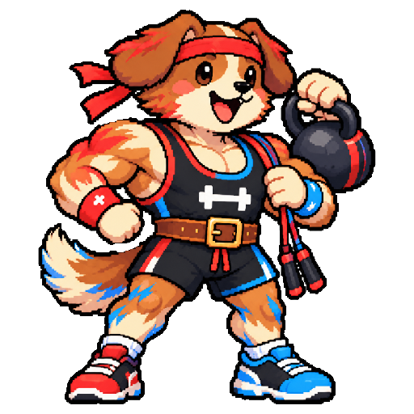 Viralatabro |  Boxerbro | 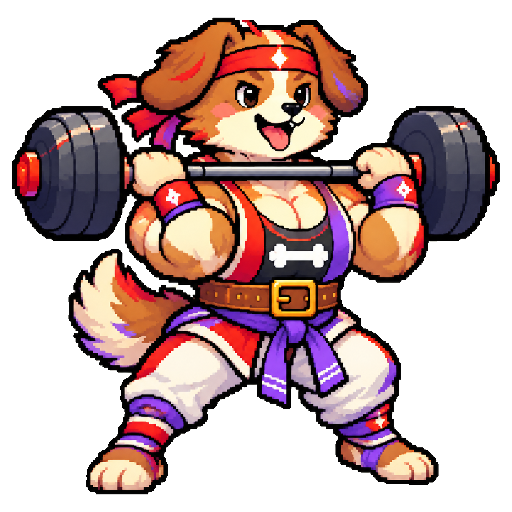 Bulldogbro |  Gandulabro |  Labradorbro |  Poodlebro |
| Esquilo | 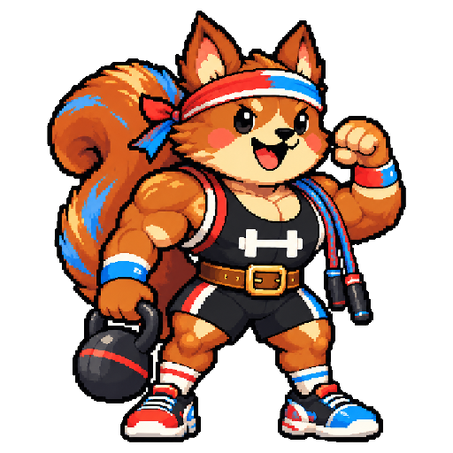 Bolotabro |  Ouriçobro |  Torabro |  Copabro | 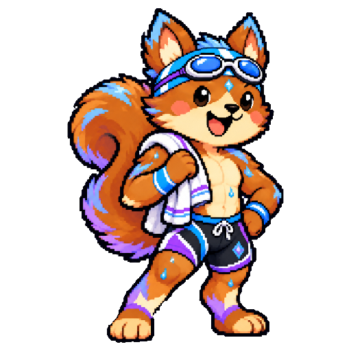 Cachoeirabro | 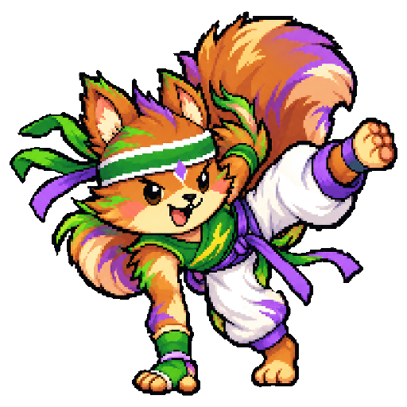 Cipóbro |
| Gato | 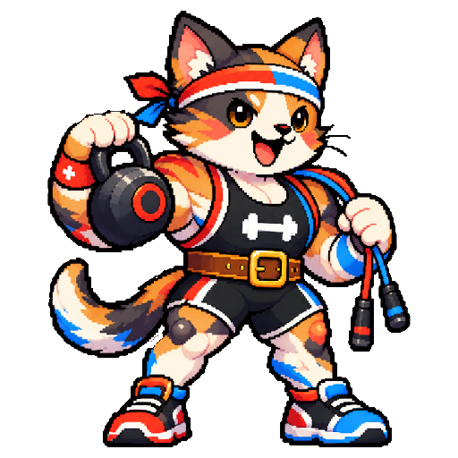 Miaufitbro |  Unhadabro | 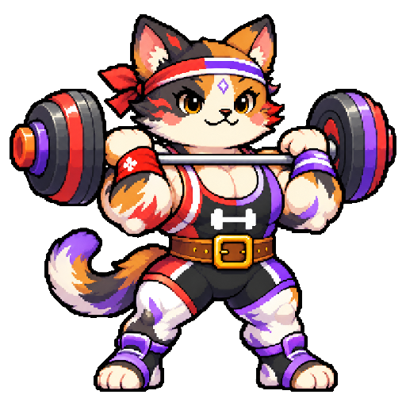 Pumabro | 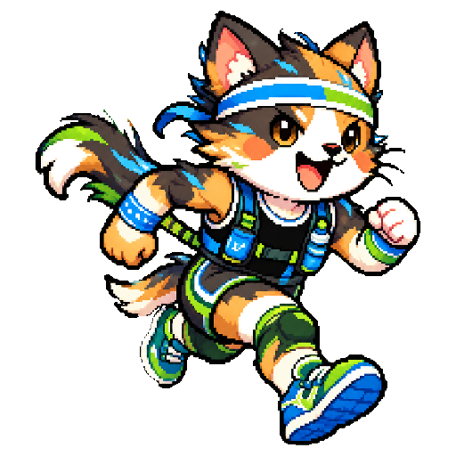 Gatunobro | 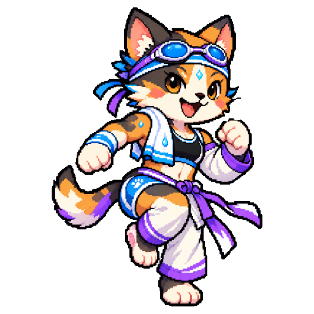 Molhadobro | 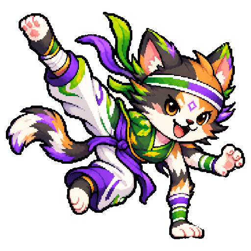 Muretabro |
| Coruja | 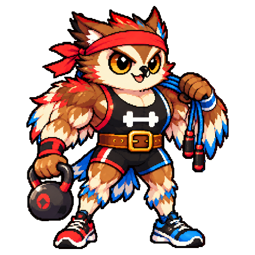 Madrugabro |  Bicadabro | 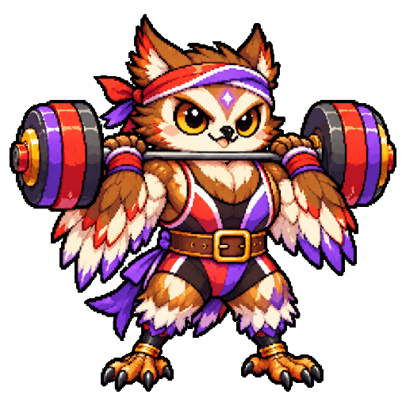 Mochobro | 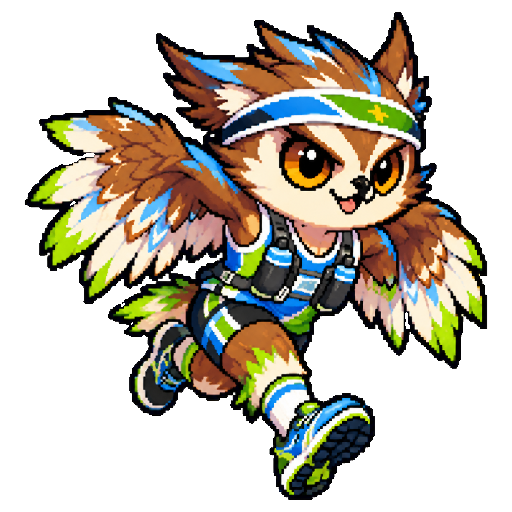 Revoadabro |  Martimbro |  Plumabro |

**Lendas**

| Espécie | Força + Resistência | Força + Agilidade | Força + Técnica | Resistência + Agilidade | Resistência + Técnica | Agilidade + Técnica |
|---|---|---|---|---|---|---|
| Coelho |  Hércubro |  Titãbro |  Olimpibro |  Tufãobro |  Marébro |  Piruetabro |
| Urso |  Colossobro |  Brutobro | 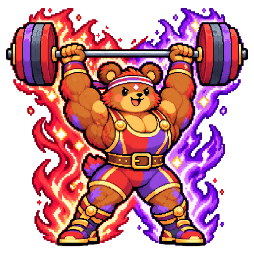 Gigantebro | 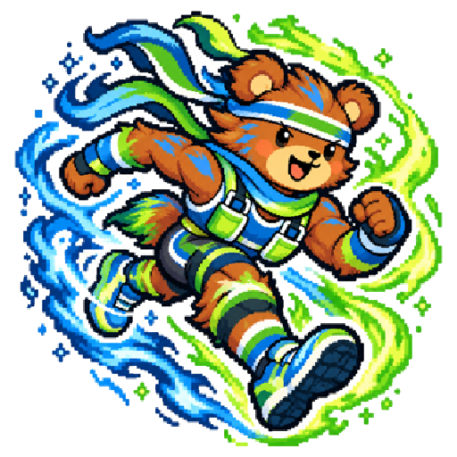 Nevascabro | 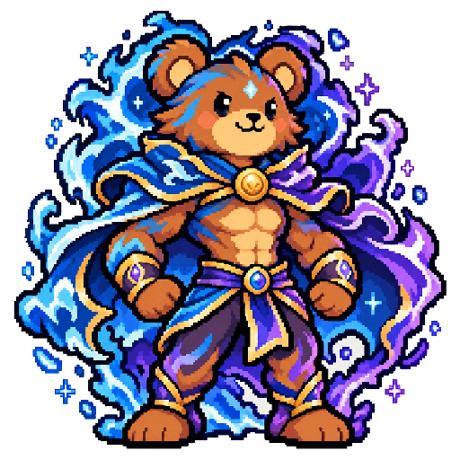 Polarbro |  Aurorabro |
| Rato |  Metrôbro | 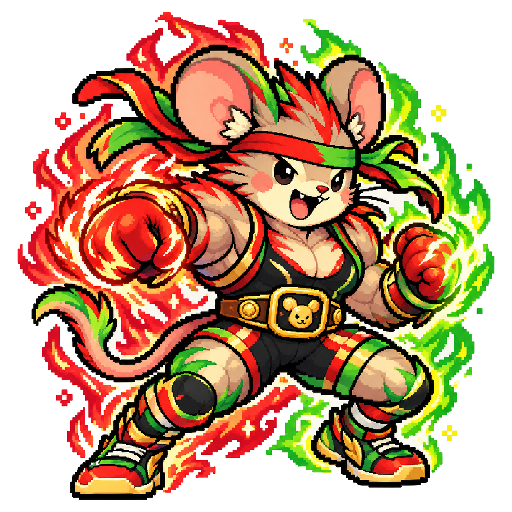 Presabro |  Parmesãobro | 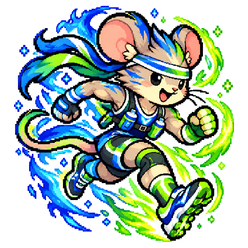 Ventaniabro | 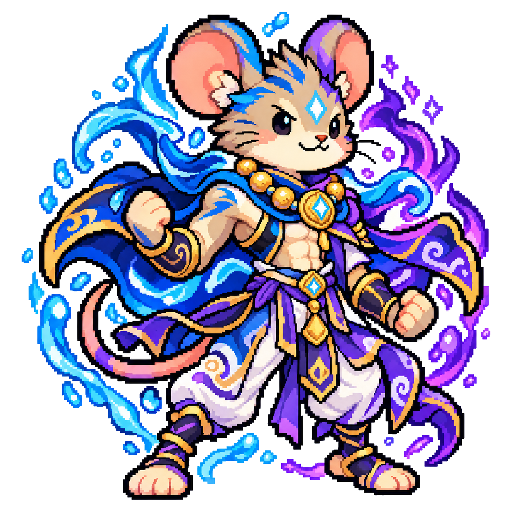 Correntezabro | 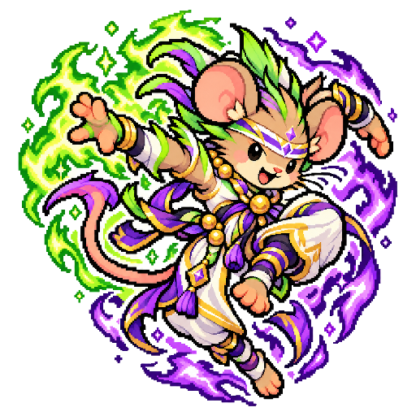 Piãobro |
| Lobo | 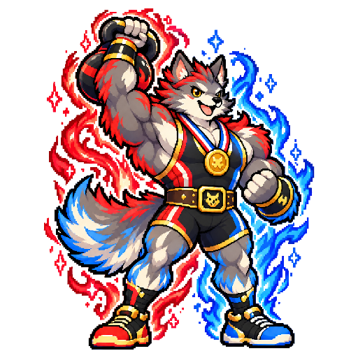 Lobisombro |  Ragnarbro | 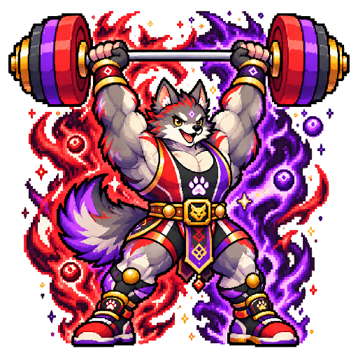 Cordilheirabro | 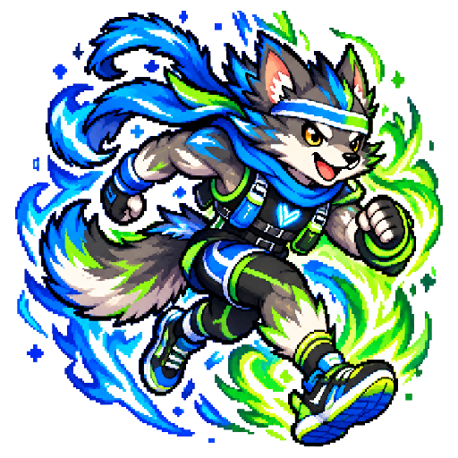 Vendavalbro |  Fiordebro |  Eclipsebro |
| Cachorro | 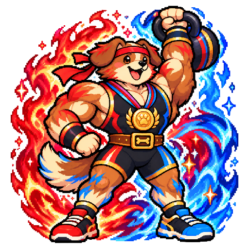 Cérberobro |  Dobermanbro | 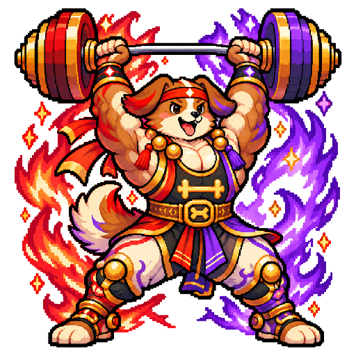 Sãobernardobro |  Salukibro |  Terranovabro |  Borderbro |
| Esquilo |  Sequoiabro |  Espinheirobro |  Jequitibro |  Redemoinhobro |  Cascatabro |  Trapezistabro |
| Gato |  Tigrebro |  Smilodonbro |  Leãobro |  Guepardobro |  Onçabro |  Bastetbro |
| Coruja |  Grifobro |  Falcãobro |  Atenabro |  Ciclonebro |  Albatrozbro |  Fênixbro |
