# Árvore de evolução dos bros

Estrutura comum a todas as espécies. Os nomes mudam por espécie: o Novato do Coelho é o Cutebro, o do Urso é o Ursabro, e assim por diante. Os nomes de cada uma estão em [Árvore por espécie](#árvore-por-espécie).

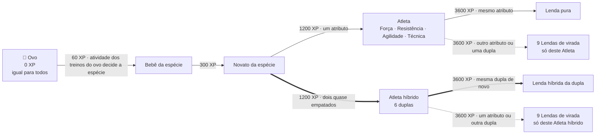

**A evolução é linear: cada forma tem um único pai.** Nenhuma Lenda é alcançada por dois Atletas diferentes.

Linha cheia: forma normal e Lenda pura (a fase Atleta seguiu o mesmo atributo). Pontilhada: **Lenda de virada** (o bro mudou de treino na fase Atleta). Dupla: linha híbrida. Todas as Lendas chegam com 3600 XP.

## Estágios

| Estágio | XP total | Forma |
|---|---|---|
| Ovo | 0 |  |
| Bebê | 60 | <br>Gymbro |
| Novato | 300 | <br>Cutebro |

## Galhos (Atleta → Lenda)

| Atributo | Atleta · 1200 XP | Lenda · 3600 XP |
|---|---|---|
| 💪 Força | <br>Halterobro | <br>Trebobro |
| ❤️ Resistência | <br>Maratobro | <br>Fôlegobro |
| ⚡ Agilidade | <br>Saltabro | <br>Relampabro |
| ✨ Técnica | <br>Zenbro | <br>Mestrebro |

## Formas híbridas

Quando os **dois atributos mais treinados** da fase Novato ficam quase empatados (o segundo com pelo menos 90% do primeiro), o bro vira o Atleta híbrido da dupla: mistura as duas roupas e o corpo dos dois treinos. Se a mesma dupla empatar de novo na fase Atleta, ele vira a Lenda híbrida da dupla, envolta numa aura com as duas cores.

| Dupla | Atleta · 1200 XP | Lenda · 3600 XP |
|---|---|---|
| 💪 Força + ❤️ Resistência | <br>Crossbro | <br>Hércubro |
| 💪 Força + ⚡ Agilidade | <br>Golpebro | <br>Titãbro |
| 💪 Força + ✨ Técnica | <br>Arrancobro | <br>Olimpibro |
| ❤️ Resistência + ⚡ Agilidade | <br>Chuteirabro | <br>Tufãobro |
| ❤️ Resistência + ✨ Técnica | <br>Nadobro | <br>Marébro |
| ⚡ Agilidade + ✨ Técnica | <br>Gingabro | <br>Piruetabro |

## Como o galho é escolhido

- Ao chegar em **Atleta** (1200 XP), vence o atributo que você mais treinou **desde que virou Novato**. Se o segundo tiver pelo menos 90% do primeiro, sai o **Atleta híbrido** da dupla.
- Ao chegar em **Lenda** (3600 XP), o bro **continua a linha do Atleta**. O resultado da fase Atleta tem **10 saídas possíveis**, iguais às da virada para Atleta: um dos 4 atributos sozinho, ou uma das 6 duplas quase empatada (o segundo com pelo menos 90% do primeiro).
  - Se a fase repetir o tipo do Atleta → **Lenda pura** (Halterobro que seguiu na Força → Trebobro; Crossbro que seguiu empatando Força e Resistência → Hércubro).
  - Qualquer outra saída → uma **Lenda de virada** só daquele Atleta (Halterobro que passou a fase correndo → Estivabro; Halterobro que empatou Força e Resistência → Strongmanbro, não Hércubro).
- Todo Atleta, normal ou híbrido, tem as mesmas 10 saídas: 1 pura e 9 viradas. Nenhuma Lenda é alcançada por dois Atletas.
- Empate fica com a ordem Força → Resistência → Agilidade → Técnica.
- Crossfit sozinho já tende a híbrido (40% Força, 40% Resistência): quem só faz crossfit vira Crossbro e depois Hércubro.

## Lendas de virada

A **virada** é uma **troca de rumo**: o bro construiu uma base (o Atleta) e depois passou a fase Atleta treinando outra coisa, seja um atributo só, seja uma dupla empatada. Por isso nenhuma virada é igual à forma "do nada": o Halterobro que empatou Força e Resistência vira Strongmanbro (um levantador que ganhou fôlego), não o Hércubro (que já nasceu Crossbro). Por isso a ordem importa: Força → Resistência (o marombeiro que começou a correr) é outro bro, diferente de Resistência → Força (o corredor que começou a levantar peso).

Visual: a Lenda pura da linha de origem com o equipamento e o porte do treino novo. O Estivabro é o Trebobro (corpo de levantador) de tênis de corrida, número no peito e fôlego de maratonista.

Cada espécie tem 10 Atletas × 10 saídas = **100 Lendas**: 10 puras (as que já existem) e **90 viradas**. São 720 viradas no jogo. Enquanto a arte de uma virada não existe, o bro vira a Lenda pura da linha dele (Halterobro → Trebobro, Crossbro → Hércubro), e a evolução continua linear.

Os nomes de todas as espécies estão em [Árvore por espécie](#árvore-por-espécie) (nomes propostos, arte pendente). Arte em `sprite_<id>_ultimate_<origem>_to_<saída>`, com origem e saída sendo um atributo ou uma dupla (coelho sem prefixo: `sprite_ultimate_forca_to_resistencia`, `sprite_ultimate_forca_to_forca_resistencia`, `sprite_ultimate_forca_resistencia_to_agilidade`).

## Árvore por espécie

O ovo é igual para todos. Ao chocar, os treinos do ovo decidem a espécie (ver [Espécies](#espécies)), e daí em diante cada espécie tem a própria linha. Uma Lenda só pode ser alcançada pelo Atleta da linha dela, dentro da mesma espécie.

Cada espécie tem um diagrama do Novato até os 10 Atletas, a matriz (linha = Atleta de origem, coluna = resultado da fase Atleta) e um diagrama por Atleta com as 10 Lendas dele. **Negrito** é a Lenda pura. As 720 Lendas de virada têm nomes únicos e ainda não têm arte.

### Coelho

Nasce de: Outro ou mistura.  Gymbro →  Cutebro

```mermaid
flowchart LR
    O[🥚 Ovo] -->|60 XP · Outro ou mistura| B[Gymbro<br/>Bebê]
    B -->|300 XP| N[Cutebro<br/>Novato]
    N -->|1200 XP · Força| C0[Halterobro]
    C0 ==>|Força| L0_0[Trebobro<br/>pura]
    C0 -.->|Resistência| L0_1[Estivabro]
    C0 -.->|Agilidade| L0_2[Catapultabro]
    C0 -.->|Técnica| L0_3[Ferreirobro]
    C0 -.->|Força + Resistência| L0_4[Strongmanbro]
    C0 -.->|Força + Agilidade| L0_5[Discobro]
    C0 -.->|Força + Técnica| L0_6[Levantadorbro]
    C0 -.->|Resistência + Agilidade| L0_7[Bobsledbro]
    C0 -.->|Resistência + Técnica| L0_8[Fardobro]
    C0 -.->|Agilidade + Técnica| L0_9[Lutalivrebro]
    N -->|1200 XP · Resistência| C1[Maratobro]
    C1 -.->|Força| L1_0[Alpinistabro]
    C1 ==>|Resistência| L1_1[Fôlegobro<br/>pura]
    C1 -.->|Agilidade| L1_2[Sprintbro]
    C1 -.->|Técnica| L1_3[Ritmobro]
    C1 -.->|Força + Resistência| L1_4[Ironbro]
    C1 -.->|Força + Agilidade| L1_5[Ciclocrossbro]
    C1 -.->|Força + Técnica| L1_6[Montanhismobro]
    C1 -.->|Resistência + Agilidade| L1_7[Orientaçãobro]
    C1 -.->|Resistência + Técnica| L1_8[Águasabertasbro]
    C1 -.->|Agilidade + Técnica| L1_9[Marchabro]
    N -->|1200 XP · Agilidade| C2[Saltabro]
    C2 -.->|Força| L2_0[Coicebro]
    C2 -.->|Resistência| L2_1[Fundistabro]
    C2 ==>|Agilidade| L2_2[Relampabro<br/>pura]
    C2 -.->|Técnica| L2_3[Malabarbro]
    C2 -.->|Força + Resistência| L2_4[Decatlobro]
    C2 -.->|Força + Agilidade| L2_5[Saltovarabro]
    C2 -.->|Força + Técnica| L2_6[Trampolimbro]
    C2 -.->|Resistência + Agilidade| L2_7[Barreirasbro]
    C2 -.->|Resistência + Técnica| L2_8[Pentatlobro]
    C2 -.->|Agilidade + Técnica| L2_9[Patinaçãobro]
    N -->|1200 XP · Técnica| C3[Zenbro]
    C3 -.->|Força| L3_0[Samuraibro]
    C3 -.->|Resistência| L3_1[Peregrinobro]
    C3 -.->|Agilidade| L3_2[Ninjabro]
    C3 ==>|Técnica| L3_3[Mestrebro<br/>pura]
    C3 -.->|Força + Resistência| L3_4[Shaolinbro]
    C3 -.->|Força + Agilidade| L3_5[Aikidobro]
    C3 -.->|Força + Técnica| L3_6[Calistenibro]
    C3 -.->|Resistência + Agilidade| L3_7[Taichibro]
    C3 -.->|Resistência + Técnica| L3_8[Apneiabro]
    C3 -.->|Agilidade + Técnica| L3_9[Circensebro]
    N ==>|1200 XP · Força + Resistência| C4[Crossbro]
    C4 -.->|Força| L4_0[Kettlebro]
    C4 -.->|Resistência| L4_1[Triatlobro]
    C4 -.->|Agilidade| L4_2[Spartanbro]
    C4 -.->|Técnica| L4_3[Remobro]
    C4 ==>|Força + Resistência| L4_4[Hércubro<br/>pura]
    C4 -.->|Força + Agilidade| L4_5[Hyroxbro]
    C4 -.->|Força + Técnica| L4_6[Arrancadabro]
    C4 -.->|Resistência + Agilidade| L4_7[Lamaçalbro]
    C4 -.->|Resistência + Técnica| L4_8[Ergômetrobro]
    C4 -.->|Agilidade + Técnica| L4_9[Murphbro]
    N ==>|1200 XP · Força + Agilidade| C5[Golpebro]
    C5 -.->|Força| L5_0[Boxeadorbro]
    C5 -.->|Resistência| L5_1[Muaythaibro]
    C5 -.->|Agilidade| L5_2[Taekwondobro]
    C5 -.->|Técnica| L5_3[Judobro]
    C5 -.->|Força + Resistência| L5_4[Octógonobro]
    C5 ==>|Força + Agilidade| L5_5[Titãbro<br/>pura]
    C5 -.->|Força + Técnica| L5_6[Jiujitsubro]
    C5 -.->|Resistência + Agilidade| L5_7[Kickboxbro]
    C5 -.->|Resistência + Técnica| L5_8[Kravbro]
    C5 -.->|Agilidade + Técnica| L5_9[Wushubro]
    N ==>|1200 XP · Força + Técnica| C6[Arrancobro]
    C6 -.->|Força| L6_0[Powerbro]
    C6 -.->|Resistência| L6_1[Escaladabro]
    C6 -.->|Agilidade| L6_2[Dardobro]
    C6 -.->|Técnica| L6_3[Argolabro]
    C6 -.->|Força + Resistência| L6_4[Atlasbro]
    C6 -.->|Força + Agilidade| L6_5[Martelãobro]
    C6 ==>|Força + Técnica| L6_6[Olimpibro<br/>pura]
    C6 -.->|Resistência + Agilidade| L6_7[Heptatlobro]
    C6 -.->|Resistência + Técnica| L6_8[Skiffbro]
    C6 -.->|Agilidade + Técnica| L6_9[Barrafixabro]
    N ==>|1200 XP · Resistência + Agilidade| C7[Chuteirabro]
    C7 -.->|Força| L7_0[Rugbibro]
    C7 -.->|Resistência| L7_1[Ultrabro]
    C7 -.->|Agilidade| L7_2[Driblebro]
    C7 -.->|Técnica| L7_3[Basquetebro]
    C7 -.->|Força + Resistência| L7_4[Zagueirobro]
    C7 -.->|Força + Agilidade| L7_5[Atacantebro]
    C7 -.->|Força + Técnica| L7_6[Cabeceiobro]
    C7 ==>|Resistência + Agilidade| L7_7[Tufãobro<br/>pura]
    C7 -.->|Resistência + Técnica| L7_8[Volantebro]
    C7 -.->|Agilidade + Técnica| L7_9[Futsalbro]
    N ==>|1200 XP · Resistência + Técnica| C8[Nadobro]
    C8 -.->|Força| L8_0[Canoabro]
    C8 -.->|Resistência| L8_1[Travessiabro]
    C8 -.->|Agilidade| L8_2[Surfbro]
    C8 -.->|Técnica| L8_3[Sincronabro]
    C8 -.->|Força + Resistência| L8_4[Polobro]
    C8 -.->|Força + Agilidade| L8_5[Plataformabro]
    C8 -.->|Força + Técnica| L8_6[Caiaquebro]
    C8 -.->|Resistência + Agilidade| L8_7[Salvabro]
    C8 ==>|Resistência + Técnica| L8_8[Marébro<br/>pura]
    C8 -.->|Agilidade + Técnica| L8_9[Golfinhobro]
    N ==>|1200 XP · Agilidade + Técnica| C9[Gingabro]
    C9 -.->|Força| L9_0[Capoeirabro]
    C9 -.->|Resistência| L9_1[Sambabro]
    C9 -.->|Agilidade| L9_2[Breakbro]
    C9 -.->|Técnica| L9_3[Balébro]
    C9 -.->|Força + Resistência| L9_4[Frevobro]
    C9 -.->|Força + Agilidade| L9_5[Maculelêbro]
    C9 -.->|Força + Técnica| L9_6[Mastrobro]
    C9 -.->|Resistência + Agilidade| L9_7[Zumbabro]
    C9 -.->|Resistência + Técnica| L9_8[Tangobro]
    C9 ==>|Agilidade + Técnica| L9_9[Piruetabro<br/>pura]
```

| Atleta \ fase | 💪 Força | ❤️ Resistência | ⚡ Agilidade | ✨ Técnica | 💪❤️ Força + Resistência | 💪⚡ Força + Agilidade | 💪✨ Força + Técnica | ❤️⚡ Resistência + Agilidade | ❤️✨ Resistência + Técnica | ⚡✨ Agilidade + Técnica |
|---|---|---|---|---|---|---|---|---|---|---|
| <br>💪 Halterobro | <br>**Trebobro** | Estivabro | Catapultabro | Ferreirobro | Strongmanbro | Discobro | Levantadorbro | Bobsledbro | Fardobro | Lutalivrebro |
| <br>❤️ Maratobro | Alpinistabro | <br>**Fôlegobro** | Sprintbro | Ritmobro | Ironbro | Ciclocrossbro | Montanhismobro | Orientaçãobro | Águasabertasbro | Marchabro |
| <br>⚡ Saltabro | Coicebro | Fundistabro | <br>**Relampabro** | Malabarbro | Decatlobro | Saltovarabro | Trampolimbro | Barreirasbro | Pentatlobro | Patinaçãobro |
| <br>✨ Zenbro | Samuraibro | Peregrinobro | Ninjabro | <br>**Mestrebro** | Shaolinbro | Aikidobro | Calistenibro | Taichibro | Apneiabro | Circensebro |
| <br>💪❤️ Crossbro | Kettlebro | Triatlobro | Spartanbro | Remobro | <br>**Hércubro** | Hyroxbro | Arrancadabro | Lamaçalbro | Ergômetrobro | Murphbro |
| <br>💪⚡ Golpebro | Boxeadorbro | Muaythaibro | Taekwondobro | Judobro | Octógonobro | <br>**Titãbro** | Jiujitsubro | Kickboxbro | Kravbro | Wushubro |
| <br>💪✨ Arrancobro | Powerbro | Escaladabro | Dardobro | Argolabro | Atlasbro | Martelãobro | <br>**Olimpibro** | Heptatlobro | Skiffbro | Barrafixabro |
| <br>❤️⚡ Chuteirabro | Rugbibro | Ultrabro | Driblebro | Basquetebro | Zagueirobro | Atacantebro | Cabeceiobro | <br>**Tufãobro** | Volantebro | Futsalbro |
| <br>❤️✨ Nadobro | Canoabro | Travessiabro | Surfbro | Sincronabro | Polobro | Plataformabro | Caiaquebro | Salvabro | <br>**Marébro** | Golfinhobro |
| <br>⚡✨ Gingabro | Capoeirabro | Sambabro | Breakbro | Balébro | Frevobro | Maculelêbro | Mastrobro | Zumbabro | Tangobro | <br>**Piruetabro** |

#### 💪 Halterobro → 10 Lendas

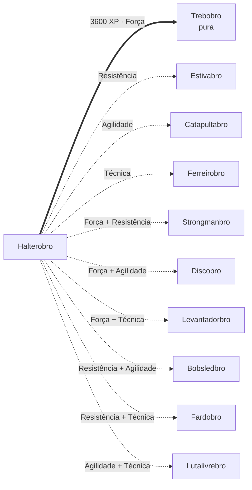

#### ❤️ Maratobro → 10 Lendas

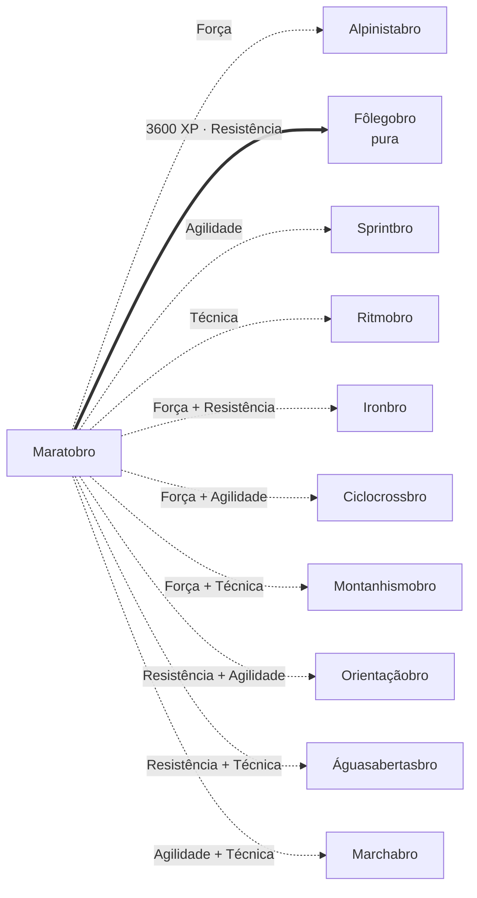

#### ⚡ Saltabro → 10 Lendas

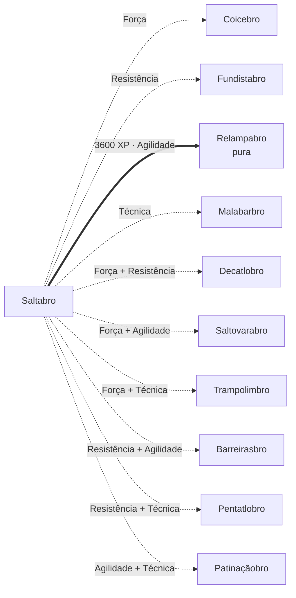

#### ✨ Zenbro → 10 Lendas

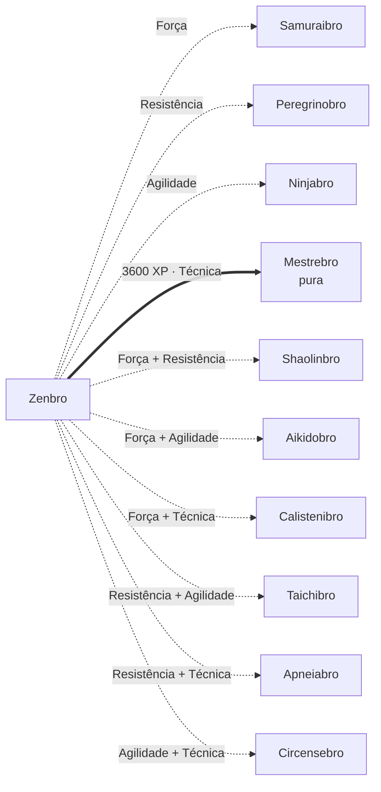

#### 💪❤️ Crossbro → 10 Lendas

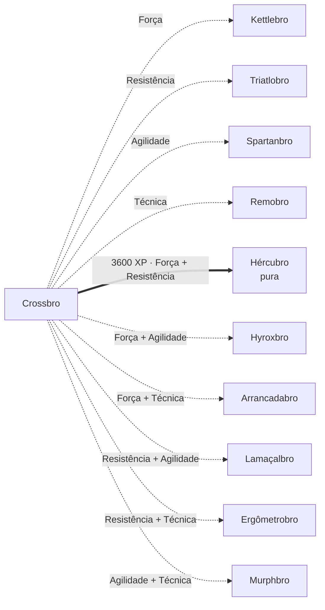

#### 💪⚡ Golpebro → 10 Lendas

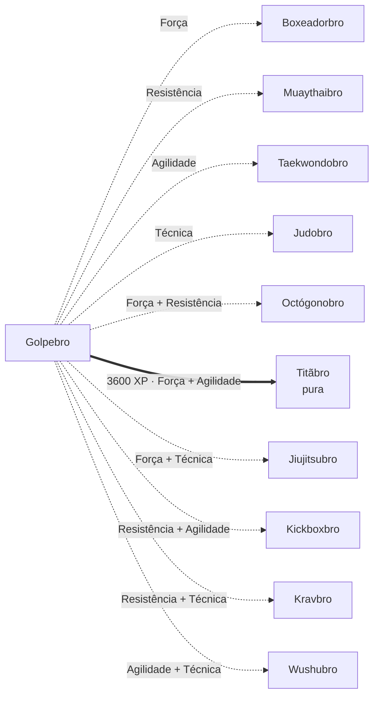

#### 💪✨ Arrancobro → 10 Lendas

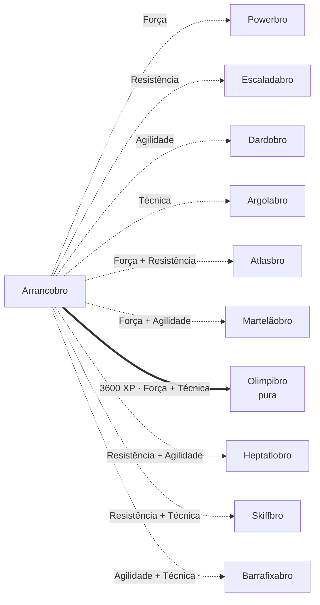

#### ❤️⚡ Chuteirabro → 10 Lendas

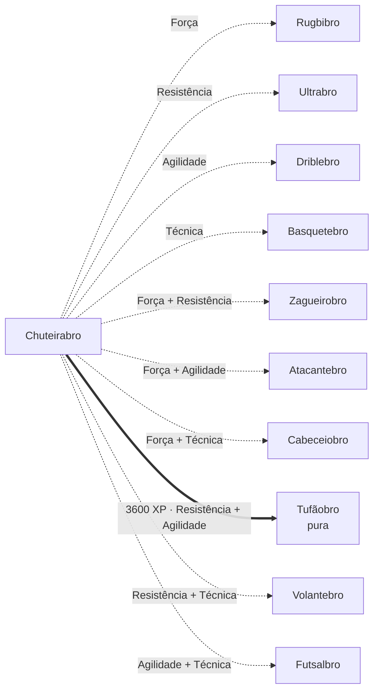

#### ❤️✨ Nadobro → 10 Lendas

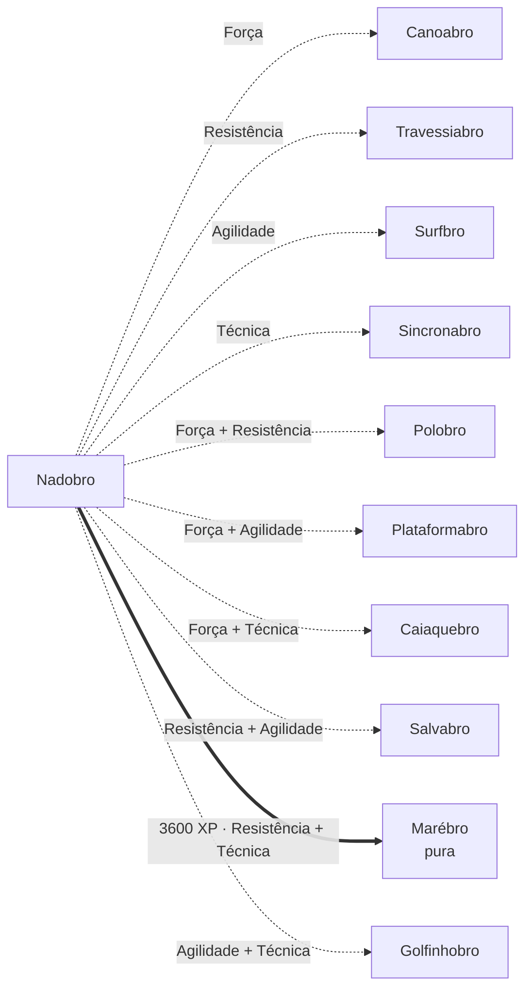

#### ⚡✨ Gingabro → 10 Lendas

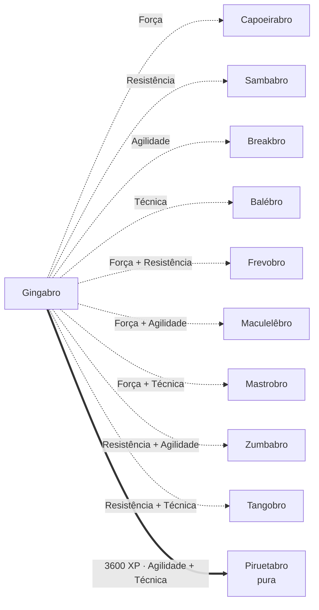

### Urso

Nasce de: Musculação, Crossfit.  Pelucibro →  Ursabro

```mermaid
flowchart LR
    O[🥚 Ovo] -->|60 XP · Musculação, Crossfit| B[Pelucibro<br/>Bebê]
    B -->|300 XP| N[Ursabro<br/>Novato]
    N -->|1200 XP · Força| C0[Supinobro]
    C0 ==>|Força| L0_0[Grizzlibro<br/>pura]
    C0 -.->|Resistência| L0_1[Lenhadorbro]
    C0 -.->|Agilidade| L0_2[Derrubabro]
    C0 -.->|Técnica| L0_3[Forjabro]
    C0 -.->|Força + Resistência| L0_4[Carretabro]
    C0 -.->|Força + Agilidade| L0_5[Abalobro]
    C0 -.->|Força + Técnica| L0_6[Bigornabro]
    C0 -.->|Resistência + Agilidade| L0_7[Expediçãobro]
    C0 -.->|Resistência + Técnica| L0_8[Ermobro]
    C0 -.->|Agilidade + Técnica| L0_9[Valsabro]
    N -->|1200 XP · Resistência| C1[Trilhabro]
    C1 -.->|Força| L1_0[Carregadorbro]
    C1 ==>|Resistência| L1_1[Montanhabro<br/>pura]
    C1 -.->|Agilidade| L1_2[Corredeirobro]
    C1 -.->|Técnica| L1_3[Pescadorbro]
    C1 -.->|Força + Resistência| L1_4[Mochilãobro]
    C1 -.->|Força + Agilidade| L1_5[Desfiladeirobro]
    C1 -.->|Força + Técnica| L1_6[Serrabro]
    C1 -.->|Resistência + Agilidade| L1_7[Clareirabro]
    C1 -.->|Resistência + Técnica| L1_8[Acampabro]
    C1 -.->|Agilidade + Técnica| L1_9[Veredabro]
    N -->|1200 XP · Agilidade| C2[Rolabro]
    C2 -.->|Força| L2_0[Esmagabro]
    C2 -.->|Resistência| L2_1[Escaladorbro]
    C2 ==>|Agilidade| L2_2[Avalanchebro<br/>pura]
    C2 -.->|Técnica| L2_3[Equilibrabro]
    C2 -.->|Força + Resistência| L2_4[Barrancobro]
    C2 -.->|Força + Agilidade| L2_5[Estouradabro]
    C2 -.->|Força + Técnica| L2_6[Pedreirabro]
    C2 -.->|Resistência + Agilidade| L2_7[Ladeirabro]
    C2 -.->|Resistência + Técnica| L2_8[Encostabro]
    C2 -.->|Agilidade + Técnica| L2_9[Pinotebro]
    N -->|1200 XP · Técnica| C3[Sumobro]
    C3 -.->|Força| L3_0[Yokozunabro]
    C3 -.->|Resistência| L3_1[Monjebro]
    C3 -.->|Agilidade| L3_2[Circobro]
    C3 ==>|Técnica| L3_3[Kodiabro<br/>pura]
    C3 -.->|Força + Resistência| L3_4[Dohyobro]
    C3 -.->|Força + Agilidade| L3_5[Empurrãobro]
    C3 -.->|Força + Técnica| L3_6[Mawashibro]
    C3 -.->|Resistência + Agilidade| L3_7[Shikobro]
    C3 -.->|Resistência + Técnica| L3_8[Chankobro]
    C3 -.->|Agilidade + Técnica| L3_9[Kimonobro]
    N ==>|1200 XP · Força + Resistência| C4[Burpeebro]
    C4 -.->|Força| L4_0[Pesadãobro]
    C4 -.->|Resistência| L4_1[Andançabro]
    C4 -.->|Agilidade| L4_2[Atropelabro]
    C4 -.->|Técnica| L4_3[Machadobro]
    C4 ==>|Força + Resistência| L4_4[Colossobro<br/>pura]
    C4 -.->|Força + Agilidade| L4_5[Agachabro]
    C4 -.->|Força + Técnica| L4_6[Supinãobro]
    C4 -.->|Resistência + Agilidade| L4_7[Circuitobro]
    C4 -.->|Resistência + Técnica| L4_8[Barcabro]
    C4 -.->|Agilidade + Técnica| L4_9[Polichinelobro]
    N ==>|1200 XP · Força + Agilidade| C5[Patadabro]
    C5 -.->|Força| L5_0[Marretabro]
    C5 -.->|Resistência| L5_1[Debandabro]
    C5 -.->|Agilidade| L5_2[Arranhãobro]
    C5 -.->|Técnica| L5_3[Pancadabro]
    C5 -.->|Força + Resistência| L5_4[Estrondobro]
    C5 ==>|Força + Agilidade| L5_5[Brutobro<br/>pura]
    C5 -.->|Força + Técnica| L5_6[Tapabro]
    C5 -.->|Resistência + Agilidade| L5_7[Correriabro]
    C5 -.->|Resistência + Técnica| L5_8[Rugidobro]
    C5 -.->|Agilidade + Técnica| L5_9[Esquivãobro]
    N ==>|1200 XP · Força + Técnica| C6[Arremessobro]
    C6 -.->|Força| L6_0[Pedregulhobro]
    C6 -.->|Resistência| L6_1[Rochabro]
    C6 -.->|Agilidade| L6_2[Lançadorbro]
    C6 -.->|Técnica| L6_3[Martelobro]
    C6 -.->|Força + Resistência| L6_4[Toradabro]
    C6 -.->|Força + Agilidade| L6_5[Lancebro]
    C6 ==>|Força + Técnica| L6_6[Gigantebro<br/>pura]
    C6 -.->|Resistência + Agilidade| L6_7[Bumerangbro]
    C6 -.->|Resistência + Técnica| L6_8[Arpãobro]
    C6 -.->|Agilidade + Técnica| L6_9[Malabarismobro]
    N ==>|1200 XP · Resistência + Agilidade| C7[Mateirobro]
    C7 -.->|Força| L7_0[Tratorbro]
    C7 -.->|Resistência| L7_1[Bivaquebro]
    C7 -.->|Agilidade| L7_2[Desbravabro]
    C7 -.->|Técnica| L7_3[Trilheirobro]
    C7 -.->|Força + Resistência| L7_4[Sertanejobro]
    C7 -.->|Força + Agilidade| L7_5[Facãobro]
    C7 -.->|Força + Técnica| L7_6[Cabanabro]
    C7 ==>|Resistência + Agilidade| L7_7[Nevascabro<br/>pura]
    C7 -.->|Resistência + Técnica| L7_8[Mapabro]
    C7 -.->|Agilidade + Técnica| L7_9[Escoteirobro]
    N ==>|1200 XP · Resistência + Técnica| C8[Salmãobro]
    C8 -.->|Força| L8_0[Represabro]
    C8 -.->|Resistência| L8_1[Contracorrentebro]
    C8 -.->|Agilidade| L8_2[Cardumebro]
    C8 -.->|Técnica| L8_3[Anzolbro]
    C8 -.->|Força + Resistência| L8_4[Rioacimabro]
    C8 -.->|Força + Agilidade| L8_5[Pescadabro]
    C8 -.->|Força + Técnica| L8_6[Redebro]
    C8 -.->|Resistência + Agilidade| L8_7[Piracemabro]
    C8 ==>|Resistência + Técnica| L8_8[Polarbro<br/>pura]
    C8 -.->|Agilidade + Técnica| L8_9[Saltãobro]
    N ==>|1200 XP · Agilidade + Técnica| C9[Meialuabro]
    C9 -.->|Força| L9_0[Rodopiobro]
    C9 -.->|Resistência| L9_1[Geleirabro]
    C9 -.->|Agilidade| L9_2[Cambalhotabro]
    C9 -.->|Técnica| L9_3[Bambolêbro]
    C9 -.->|Força + Resistência| L9_4[Rodavivabro]
    C9 -.->|Força + Agilidade| L9_5[Tesourabro]
    C9 -.->|Força + Técnica| L9_6[Bençãobro]
    C9 -.->|Resistência + Agilidade| L9_7[Armadabro]
    C9 -.->|Resistência + Técnica| L9_8[Berimbaubro]
    C9 ==>|Agilidade + Técnica| L9_9[Aurorabro<br/>pura]
```

| Atleta \ fase | 💪 Força | ❤️ Resistência | ⚡ Agilidade | ✨ Técnica | 💪❤️ Força + Resistência | 💪⚡ Força + Agilidade | 💪✨ Força + Técnica | ❤️⚡ Resistência + Agilidade | ❤️✨ Resistência + Técnica | ⚡✨ Agilidade + Técnica |
|---|---|---|---|---|---|---|---|---|---|---|
| 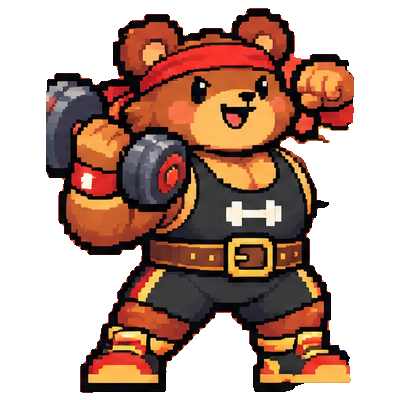<br>💪 Supinobro | 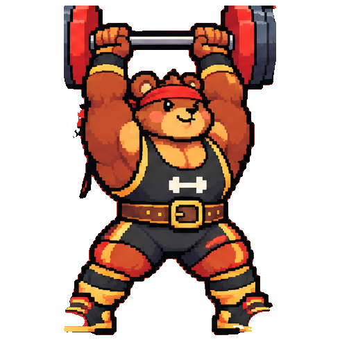<br>**Grizzlibro** | Lenhadorbro | Derrubabro | Forjabro | Carretabro | Abalobro | Bigornabro | Expediçãobro | Ermobro | Valsabro |
| <br>❤️ Trilhabro | Carregadorbro | 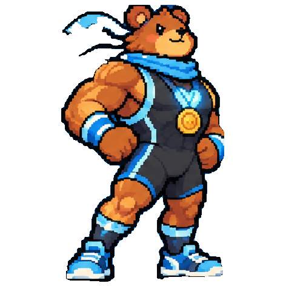<br>**Montanhabro** | Corredeirobro | Pescadorbro | Mochilãobro | Desfiladeirobro | Serrabro | Clareirabro | Acampabro | Veredabro |
| 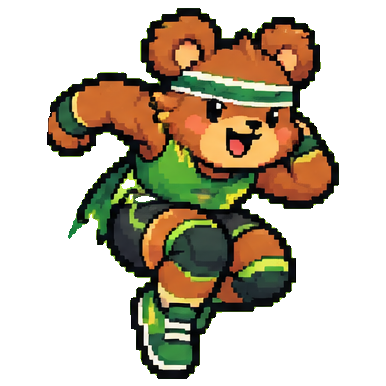<br>⚡ Rolabro | Esmagabro | Escaladorbro | 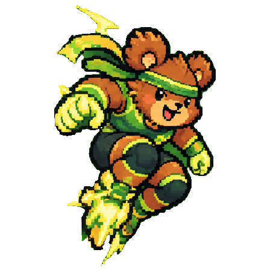<br>**Avalanchebro** | Equilibrabro | Barrancobro | Estouradabro | Pedreirabro | Ladeirabro | Encostabro | Pinotebro |
| <br>✨ Sumobro | Yokozunabro | Monjebro | Circobro | <br>**Kodiabro** | Dohyobro | Empurrãobro | Mawashibro | Shikobro | Chankobro | Kimonobro |
| <br>💪❤️ Burpeebro | Pesadãobro | Andançabro | Atropelabro | Machadobro | <br>**Colossobro** | Agachabro | Supinãobro | Circuitobro | Barcabro | Polichinelobro |
| <br>💪⚡ Patadabro | Marretabro | Debandabro | Arranhãobro | Pancadabro | Estrondobro | <br>**Brutobro** | Tapabro | Correriabro | Rugidobro | Esquivãobro |
| <br>💪✨ Arremessobro | Pedregulhobro | Rochabro | Lançadorbro | Martelobro | Toradabro | Lancebro | <br>**Gigantebro** | Bumerangbro | Arpãobro | Malabarismobro |
| <br>❤️⚡ Mateirobro | Tratorbro | Bivaquebro | Desbravabro | Trilheirobro | Sertanejobro | Facãobro | Cabanabro | <br>**Nevascabro** | Mapabro | Escoteirobro |
| <br>❤️✨ Salmãobro | Represabro | Contracorrentebro | Cardumebro | Anzolbro | Rioacimabro | Pescadabro | Redebro | Piracemabro | <br>**Polarbro** | Saltãobro |
| <br>⚡✨ Meialuabro | Rodopiobro | Geleirabro | Cambalhotabro | Bambolêbro | Rodavivabro | Tesourabro | Bençãobro | Armadabro | Berimbaubro | <br>**Aurorabro** |

#### 💪 Supinobro → 10 Lendas

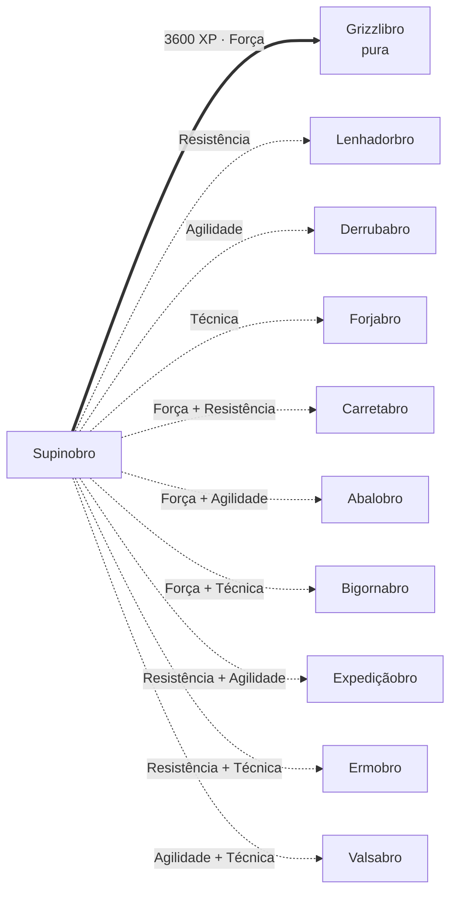

#### ❤️ Trilhabro → 10 Lendas

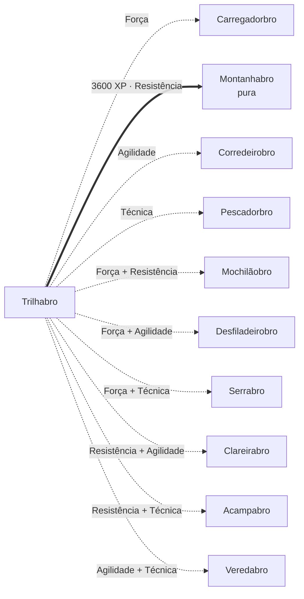

#### ⚡ Rolabro → 10 Lendas

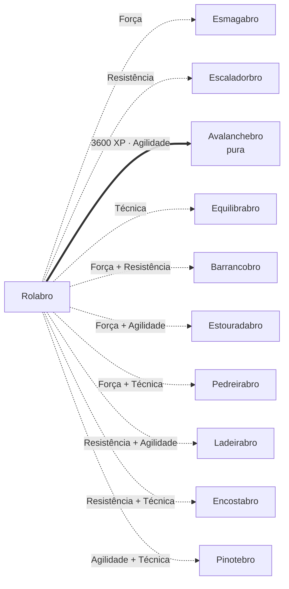

#### ✨ Sumobro → 10 Lendas

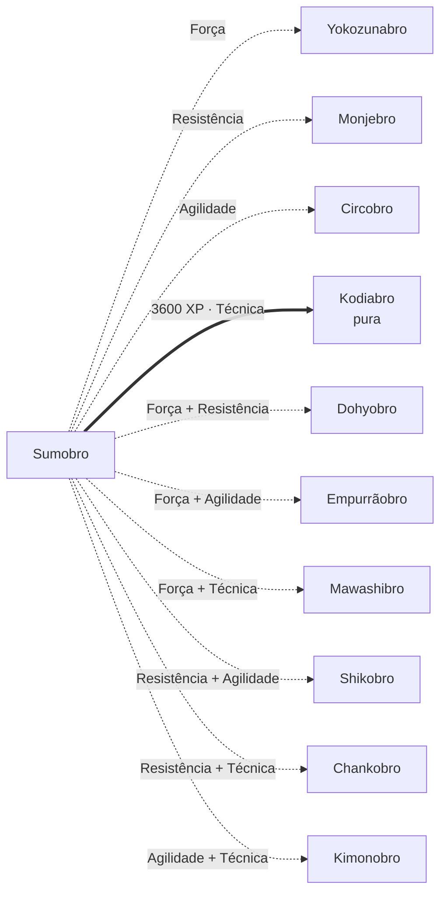

#### 💪❤️ Burpeebro → 10 Lendas

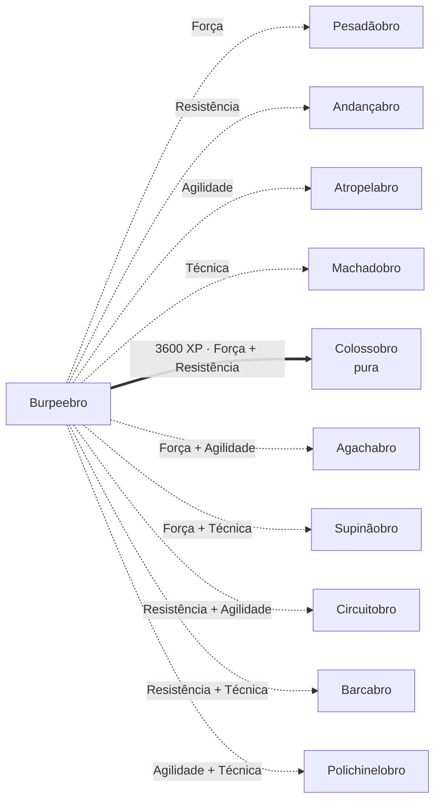

#### 💪⚡ Patadabro → 10 Lendas

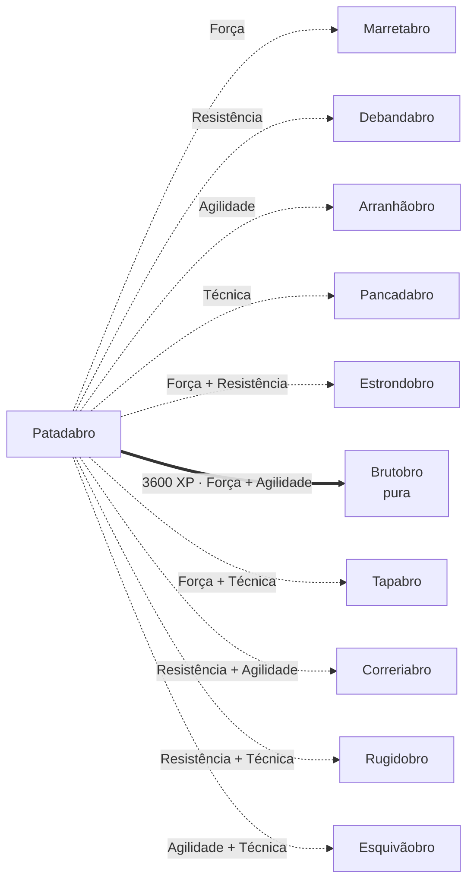

#### 💪✨ Arremessobro → 10 Lendas

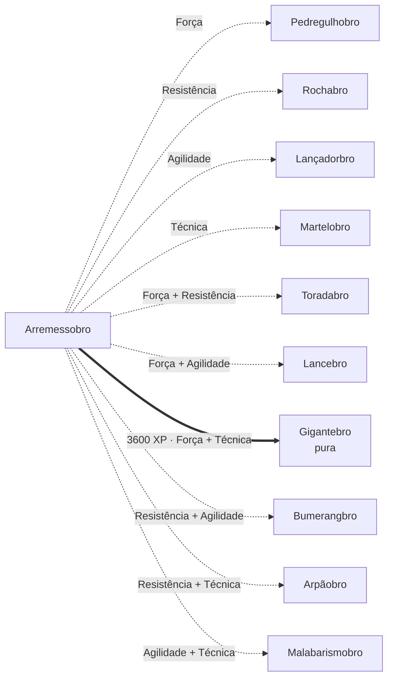

#### ❤️⚡ Mateirobro → 10 Lendas

```mermaid
flowchart LR
    C[Mateirobro]
    C -.->|Força| L0[Tratorbro]
    C -.->|Resistência| L1[Bivaquebro]
    C -.->|Agilidade| L2[Desbravabro]
    C -.->|Técnica| L3[Trilheirobro]
    C -.->|Força + Resistência| L4[Sertanejobro]
    C -.->|Força + Agilidade| L5[Facãobro]
    C -.->|Força + Técnica| L6[Cabanabro]
    C ==>|3600 XP · Resistência + Agilidade| L7[Nevascabro<br/>pura]
    C -.->|Resistência + Técnica| L8[Mapabro]
    C -.->|Agilidade + Técnica| L9[Escoteirobro]
```

#### ❤️✨ Salmãobro → 10 Lendas

```mermaid
flowchart LR
    C[Salmãobro]
    C -.->|Força| L0[Represabro]
    C -.->|Resistência| L1[Contracorrentebro]
    C -.->|Agilidade| L2[Cardumebro]
    C -.->|Técnica| L3[Anzolbro]
    C -.->|Força + Resistência| L4[Rioacimabro]
    C -.->|Força + Agilidade| L5[Pescadabro]
    C -.->|Força + Técnica| L6[Redebro]
    C -.->|Resistência + Agilidade| L7[Piracemabro]
    C ==>|3600 XP · Resistência + Técnica| L8[Polarbro<br/>pura]
    C -.->|Agilidade + Técnica| L9[Saltãobro]
```

#### ⚡✨ Meialuabro → 10 Lendas

```mermaid
flowchart LR
    C[Meialuabro]
    C -.->|Força| L0[Rodopiobro]
    C -.->|Resistência| L1[Geleirabro]
    C -.->|Agilidade| L2[Cambalhotabro]
    C -.->|Técnica| L3[Bambolêbro]
    C -.->|Força + Resistência| L4[Rodavivabro]
    C -.->|Força + Agilidade| L5[Tesourabro]
    C -.->|Força + Técnica| L6[Bençãobro]
    C -.->|Resistência + Agilidade| L7[Armadabro]
    C -.->|Resistência + Técnica| L8[Berimbaubro]
    C ==>|3600 XP · Agilidade + Técnica| L9[Aurorabro<br/>pura]
```

### Rato

Nasce de: Musculação, Crossfit.  Queijibro →  Ratibro

```mermaid
flowchart LR
    O[🥚 Ovo] -->|60 XP · Musculação, Crossfit| B[Queijibro<br/>Bebê]
    B -->|300 XP| N[Ratibro<br/>Novato]
    N -->|1200 XP · Força| C0[Marombabro]
    C0 ==>|Força| L0_0[Ratazanabro<br/>pura]
    C0 -.->|Resistência| L0_1[Carroçabro]
    C0 -.->|Agilidade| L0_2[Ratoeirabro]
    C0 -.->|Técnica| L0_3[Queijeirobro]
    C0 -.->|Força + Resistência| L0_4[Bombadãobro]
    C0 -.->|Força + Agilidade| L0_5[Muquebro]
    C0 -.->|Força + Técnica| L0_6[Anilhabro]
    C0 -.->|Resistência + Agilidade| L0_7[Legdaybro]
    C0 -.->|Resistência + Técnica| L0_8[Shapebro]
    C0 -.->|Agilidade + Técnica| L0_9[Posebro]
    N -->|1200 XP · Resistência| C1[Rodibro]
    C1 -.->|Força| L1_0[Roedorbro]
    C1 ==>|Resistência| L1_1[Esteirabro<br/>pura]
    C1 -.->|Agilidade| L1_2[Disparabro]
    C1 -.->|Técnica| L1_3[Relojoeirobro]
    C1 -.->|Força + Resistência| L1_4[Carretelbro]
    C1 -.->|Força + Agilidade| L1_5[Turbinabro]
    C1 -.->|Força + Técnica| L1_6[Engrenagembro]
    C1 -.->|Resistência + Agilidade| L1_7[Hamsterbro]
    C1 -.->|Resistência + Técnica| L1_8[Pedivelabro]
    C1 -.->|Agilidade + Técnica| L1_9[Giroscópiobro]
    N -->|1200 XP · Agilidade| C2[Fuxibro]
    C2 -.->|Força| L2_0[Furtabro]
    C2 -.->|Resistência| L2_1[Fugitivobro]
    C2 ==>|Agilidade| L2_2[Sombrabro<br/>pura]
    C2 -.->|Técnica| L2_3[Ladinobro]
    C2 -.->|Força + Resistência| L2_4[Fuçabro]
    C2 -.->|Força + Agilidade| L2_5[Trombadinhabro]
    C2 -.->|Força + Técnica| L2_6[Gazuabro]
    C2 -.->|Resistência + Agilidade| L2_7[Pinguelabro]
    C2 -.->|Resistência + Técnica| L2_8[Fofocabro]
    C2 -.->|Agilidade + Técnica| L2_9[Xeretabro]
    N -->|1200 XP · Técnica| C3[Labiribro]
    C3 -.->|Força| L3_0[Alavancabro]
    C3 -.->|Resistência| L3_1[Cartógrafobro]
    C3 -.->|Agilidade| L3_2[Ilusionistabro]
    C3 ==>|Técnica| L3_3[Engenhobro<br/>pura]
    C3 -.->|Força + Resistência| L3_4[Minotaurobro]
    C3 -.->|Força + Agilidade| L3_5[Alçapãobro]
    C3 -.->|Força + Técnica| L3_6[Engenheirobro]
    C3 -.->|Resistência + Agilidade| L3_7[Corredorbro]
    C3 -.->|Resistência + Técnica| L3_8[Novelobro]
    C3 -.->|Agilidade + Técnica| L3_9[Enigmabro]
    N ==>|1200 XP · Força + Resistência| C4[Bigodefitbro]
    C4 -.->|Força| L4_0[Wheybro]
    C4 -.->|Resistência| L4_1[Esteirinhabro]
    C4 -.->|Agilidade| L4_2[Escapabro]
    C4 -.->|Técnica| L4_3[Encanadorbro]
    C4 ==>|Força + Resistência| L4_4[Metrôbro<br/>pura]
    C4 -.->|Força + Agilidade| L4_5[Bigodãobro]
    C4 -.->|Força + Técnica| L4_6[Barbearbro]
    C4 -.->|Resistência + Agilidade| L4_7[Fiapobro]
    C4 -.->|Resistência + Técnica| L4_8[Pelagembro]
    C4 -.->|Agilidade + Técnica| L4_9[Costeletabro]
    N ==>|1200 XP · Força + Agilidade| C5[Mordidabro]
    C5 -.->|Força| L5_0[Dentuçobro]
    C5 -.->|Resistência| L5_1[Rodinhabro]
    C5 -.->|Agilidade| L5_2[Beliscabro]
    C5 -.->|Técnica| L5_3[Chaveirobro]
    C5 -.->|Força + Resistência| L5_4[Roedeirobro]
    C5 ==>|Força + Agilidade| L5_5[Presabro<br/>pura]
    C5 -.->|Força + Técnica| L5_6[Incisivobro]
    C5 -.->|Resistência + Agilidade| L5_7[Beliscãobro]
    C5 -.->|Resistência + Técnica| L5_8[Molarbro]
    C5 -.->|Agilidade + Técnica| L5_9[Dentadinhabro]
    N ==>|1200 XP · Força + Técnica| C6[Gorgonzolabro]
    C6 -.->|Força| L6_0[Provolonebro]
    C6 -.->|Resistência| L6_1[Cargueirobro]
    C6 -.->|Agilidade| L6_2[Estilingbro]
    C6 -.->|Técnica| L6_3[Briebro]
    C6 -.->|Força + Resistência| L6_4[Cheddarbro]
    C6 -.->|Força + Agilidade| L6_5[Ralabro]
    C6 ==>|Força + Técnica| L6_6[Parmesãobro<br/>pura]
    C6 -.->|Resistência + Agilidade| L6_7[Coalhobro]
    C6 -.->|Resistência + Técnica| L6_8[Fonduebro]
    C6 -.->|Agilidade + Técnica| L6_9[Camembertbro]
    N ==>|1200 XP · Resistência + Agilidade| C7[Bueirobro]
    C7 -.->|Força| L7_0[Porãobro]
    C7 -.->|Resistência| L7_1[Tubulaçãobro]
    C7 -.->|Agilidade| L7_2[Grelhabro]
    C7 -.->|Técnica| L7_3[Atalhobro]
    C7 -.->|Força + Resistência| L7_4[Tampãobro]
    C7 -.->|Força + Agilidade| L7_5[Grelhãobro]
    C7 -.->|Força + Técnica| L7_6[Manilhabro]
    C7 ==>|Resistência + Agilidade| L7_7[Ventaniabro<br/>pura]
    C7 -.->|Resistência + Técnica| L7_8[Galeriabro]
    C7 -.->|Agilidade + Técnica| L7_9[Sarjetabro]
    N ==>|1200 XP · Resistência + Técnica| C8[Esgotobro]
    C8 -.->|Força| L8_0[Comportabro]
    C8 -.->|Resistência| L8_1[Canalbro]
    C8 -.->|Agilidade| L8_2[Enxurradabro]
    C8 -.->|Técnica| L8_3[Válvulabro]
    C8 -.->|Força + Resistência| L8_4[Adutorabro]
    C8 -.->|Força + Agilidade| L8_5[Descargabro]
    C8 -.->|Força + Técnica| L8_6[Registrobro]
    C8 -.->|Resistência + Agilidade| L8_7[Escoamentobro]
    C8 ==>|Resistência + Técnica| L8_8[Correntezabro<br/>pura]
    C8 -.->|Agilidade + Técnica| L8_9[Sifãobro]
    N ==>|1200 XP · Agilidade + Técnica| C9[Arraiabro]
    C9 -.->|Força| L9_0[Quadrilhabro]
    C9 -.->|Resistência| L9_1[Quermessebro]
    C9 -.->|Agilidade| L9_2[Forróbro]
    C9 -.->|Técnica| L9_3[Sanfonabro]
    C9 -.->|Força + Resistência| L9_4[Paudesebobro]
    C9 -.->|Força + Agilidade| L9_5[Rojãobro]
    C9 -.->|Força + Técnica| L9_6[Pamonhabro]
    C9 -.->|Resistência + Agilidade| L9_7[Fogueteirobro]
    C9 -.->|Resistência + Técnica| L9_8[Bandeirinhabro]
    C9 ==>|Agilidade + Técnica| L9_9[Piãobro<br/>pura]
```

| Atleta \ fase | 💪 Força | ❤️ Resistência | ⚡ Agilidade | ✨ Técnica | 💪❤️ Força + Resistência | 💪⚡ Força + Agilidade | 💪✨ Força + Técnica | ❤️⚡ Resistência + Agilidade | ❤️✨ Resistência + Técnica | ⚡✨ Agilidade + Técnica |
|---|---|---|---|---|---|---|---|---|---|---|
| 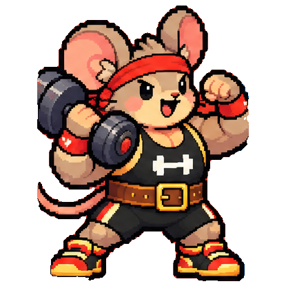<br>💪 Marombabro | 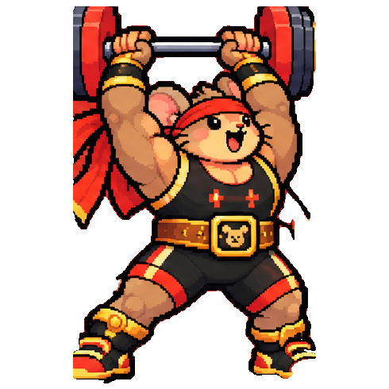<br>**Ratazanabro** | Carroçabro | Ratoeirabro | Queijeirobro | Bombadãobro | Muquebro | Anilhabro | Legdaybro | Shapebro | Posebro |
| 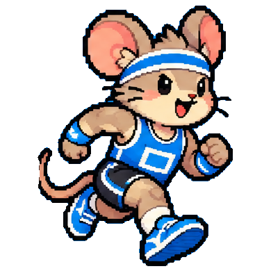<br>❤️ Rodibro | Roedorbro | 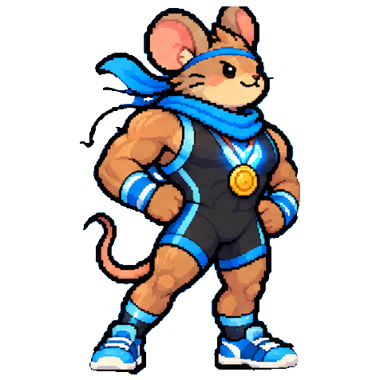<br>**Esteirabro** | Disparabro | Relojoeirobro | Carretelbro | Turbinabro | Engrenagembro | Hamsterbro | Pedivelabro | Giroscópiobro |
| 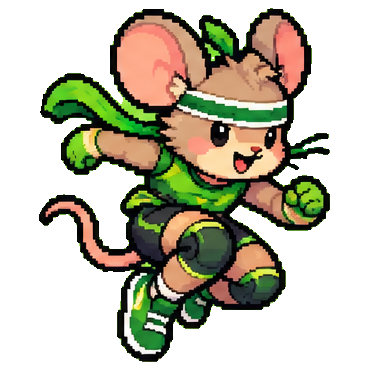<br>⚡ Fuxibro | Furtabro | Fugitivobro | 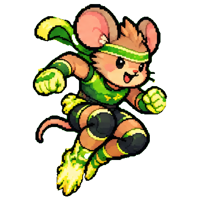<br>**Sombrabro** | Ladinobro | Fuçabro | Trombadinhabro | Gazuabro | Pinguelabro | Fofocabro | Xeretabro |
| <br>✨ Labiribro | Alavancabro | Cartógrafobro | Ilusionistabro | 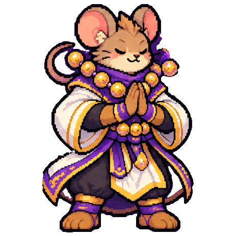<br>**Engenhobro** | Minotaurobro | Alçapãobro | Engenheirobro | Corredorbro | Novelobro | Enigmabro |
| <br>💪❤️ Bigodefitbro | Wheybro | Esteirinhabro | Escapabro | Encanadorbro | <br>**Metrôbro** | Bigodãobro | Barbearbro | Fiapobro | Pelagembro | Costeletabro |
| <br>💪⚡ Mordidabro | Dentuçobro | Rodinhabro | Beliscabro | Chaveirobro | Roedeirobro | <br>**Presabro** | Incisivobro | Beliscãobro | Molarbro | Dentadinhabro |
| <br>💪✨ Gorgonzolabro | Provolonebro | Cargueirobro | Estilingbro | Briebro | Cheddarbro | Ralabro | <br>**Parmesãobro** | Coalhobro | Fonduebro | Camembertbro |
| <br>❤️⚡ Bueirobro | Porãobro | Tubulaçãobro | Grelhabro | Atalhobro | Tampãobro | Grelhãobro | Manilhabro | <br>**Ventaniabro** | Galeriabro | Sarjetabro |
| <br>❤️✨ Esgotobro | Comportabro | Canalbro | Enxurradabro | Válvulabro | Adutorabro | Descargabro | Registrobro | Escoamentobro | <br>**Correntezabro** | Sifãobro |
| <br>⚡✨ Arraiabro | Quadrilhabro | Quermessebro | Forróbro | Sanfonabro | Paudesebobro | Rojãobro | Pamonhabro | Fogueteirobro | Bandeirinhabro | <br>**Piãobro** |

#### 💪 Marombabro → 10 Lendas

```mermaid
flowchart LR
    C[Marombabro]
    C ==>|3600 XP · Força| L0[Ratazanabro<br/>pura]
    C -.->|Resistência| L1[Carroçabro]
    C -.->|Agilidade| L2[Ratoeirabro]
    C -.->|Técnica| L3[Queijeirobro]
    C -.->|Força + Resistência| L4[Bombadãobro]
    C -.->|Força + Agilidade| L5[Muquebro]
    C -.->|Força + Técnica| L6[Anilhabro]
    C -.->|Resistência + Agilidade| L7[Legdaybro]
    C -.->|Resistência + Técnica| L8[Shapebro]
    C -.->|Agilidade + Técnica| L9[Posebro]
```

#### ❤️ Rodibro → 10 Lendas

```mermaid
flowchart LR
    C[Rodibro]
    C -.->|Força| L0[Roedorbro]
    C ==>|3600 XP · Resistência| L1[Esteirabro<br/>pura]
    C -.->|Agilidade| L2[Disparabro]
    C -.->|Técnica| L3[Relojoeirobro]
    C -.->|Força + Resistência| L4[Carretelbro]
    C -.->|Força + Agilidade| L5[Turbinabro]
    C -.->|Força + Técnica| L6[Engrenagembro]
    C -.->|Resistência + Agilidade| L7[Hamsterbro]
    C -.->|Resistência + Técnica| L8[Pedivelabro]
    C -.->|Agilidade + Técnica| L9[Giroscópiobro]
```

#### ⚡ Fuxibro → 10 Lendas

```mermaid
flowchart LR
    C[Fuxibro]
    C -.->|Força| L0[Furtabro]
    C -.->|Resistência| L1[Fugitivobro]
    C ==>|3600 XP · Agilidade| L2[Sombrabro<br/>pura]
    C -.->|Técnica| L3[Ladinobro]
    C -.->|Força + Resistência| L4[Fuçabro]
    C -.->|Força + Agilidade| L5[Trombadinhabro]
    C -.->|Força + Técnica| L6[Gazuabro]
    C -.->|Resistência + Agilidade| L7[Pinguelabro]
    C -.->|Resistência + Técnica| L8[Fofocabro]
    C -.->|Agilidade + Técnica| L9[Xeretabro]
```

#### ✨ Labiribro → 10 Lendas

```mermaid
flowchart LR
    C[Labiribro]
    C -.->|Força| L0[Alavancabro]
    C -.->|Resistência| L1[Cartógrafobro]
    C -.->|Agilidade| L2[Ilusionistabro]
    C ==>|3600 XP · Técnica| L3[Engenhobro<br/>pura]
    C -.->|Força + Resistência| L4[Minotaurobro]
    C -.->|Força + Agilidade| L5[Alçapãobro]
    C -.->|Força + Técnica| L6[Engenheirobro]
    C -.->|Resistência + Agilidade| L7[Corredorbro]
    C -.->|Resistência + Técnica| L8[Novelobro]
    C -.->|Agilidade + Técnica| L9[Enigmabro]
```

#### 💪❤️ Bigodefitbro → 10 Lendas

```mermaid
flowchart LR
    C[Bigodefitbro]
    C -.->|Força| L0[Wheybro]
    C -.->|Resistência| L1[Esteirinhabro]
    C -.->|Agilidade| L2[Escapabro]
    C -.->|Técnica| L3[Encanadorbro]
    C ==>|3600 XP · Força + Resistência| L4[Metrôbro<br/>pura]
    C -.->|Força + Agilidade| L5[Bigodãobro]
    C -.->|Força + Técnica| L6[Barbearbro]
    C -.->|Resistência + Agilidade| L7[Fiapobro]
    C -.->|Resistência + Técnica| L8[Pelagembro]
    C -.->|Agilidade + Técnica| L9[Costeletabro]
```

#### 💪⚡ Mordidabro → 10 Lendas

```mermaid
flowchart LR
    C[Mordidabro]
    C -.->|Força| L0[Dentuçobro]
    C -.->|Resistência| L1[Rodinhabro]
    C -.->|Agilidade| L2[Beliscabro]
    C -.->|Técnica| L3[Chaveirobro]
    C -.->|Força + Resistência| L4[Roedeirobro]
    C ==>|3600 XP · Força + Agilidade| L5[Presabro<br/>pura]
    C -.->|Força + Técnica| L6[Incisivobro]
    C -.->|Resistência + Agilidade| L7[Beliscãobro]
    C -.->|Resistência + Técnica| L8[Molarbro]
    C -.->|Agilidade + Técnica| L9[Dentadinhabro]
```

#### 💪✨ Gorgonzolabro → 10 Lendas

```mermaid
flowchart LR
    C[Gorgonzolabro]
    C -.->|Força| L0[Provolonebro]
    C -.->|Resistência| L1[Cargueirobro]
    C -.->|Agilidade| L2[Estilingbro]
    C -.->|Técnica| L3[Briebro]
    C -.->|Força + Resistência| L4[Cheddarbro]
    C -.->|Força + Agilidade| L5[Ralabro]
    C ==>|3600 XP · Força + Técnica| L6[Parmesãobro<br/>pura]
    C -.->|Resistência + Agilidade| L7[Coalhobro]
    C -.->|Resistência + Técnica| L8[Fonduebro]
    C -.->|Agilidade + Técnica| L9[Camembertbro]
```

#### ❤️⚡ Bueirobro → 10 Lendas

```mermaid
flowchart LR
    C[Bueirobro]
    C -.->|Força| L0[Porãobro]
    C -.->|Resistência| L1[Tubulaçãobro]
    C -.->|Agilidade| L2[Grelhabro]
    C -.->|Técnica| L3[Atalhobro]
    C -.->|Força + Resistência| L4[Tampãobro]
    C -.->|Força + Agilidade| L5[Grelhãobro]
    C -.->|Força + Técnica| L6[Manilhabro]
    C ==>|3600 XP · Resistência + Agilidade| L7[Ventaniabro<br/>pura]
    C -.->|Resistência + Técnica| L8[Galeriabro]
    C -.->|Agilidade + Técnica| L9[Sarjetabro]
```

#### ❤️✨ Esgotobro → 10 Lendas

```mermaid
flowchart LR
    C[Esgotobro]
    C -.->|Força| L0[Comportabro]
    C -.->|Resistência| L1[Canalbro]
    C -.->|Agilidade| L2[Enxurradabro]
    C -.->|Técnica| L3[Válvulabro]
    C -.->|Força + Resistência| L4[Adutorabro]
    C -.->|Força + Agilidade| L5[Descargabro]
    C -.->|Força + Técnica| L6[Registrobro]
    C -.->|Resistência + Agilidade| L7[Escoamentobro]
    C ==>|3600 XP · Resistência + Técnica| L8[Correntezabro<br/>pura]
    C -.->|Agilidade + Técnica| L9[Sifãobro]
```

#### ⚡✨ Arraiabro → 10 Lendas

```mermaid
flowchart LR
    C[Arraiabro]
    C -.->|Força| L0[Quadrilhabro]
    C -.->|Resistência| L1[Quermessebro]
    C -.->|Agilidade| L2[Forróbro]
    C -.->|Técnica| L3[Sanfonabro]
    C -.->|Força + Resistência| L4[Paudesebobro]
    C -.->|Força + Agilidade| L5[Rojãobro]
    C -.->|Força + Técnica| L6[Pamonhabro]
    C -.->|Resistência + Agilidade| L7[Fogueteirobro]
    C -.->|Resistência + Técnica| L8[Bandeirinhabro]
    C ==>|3600 XP · Agilidade + Técnica| L9[Piãobro<br/>pura]
```

### Lobo

Nasce de: Corrida, Bike, Natação.  Uivibro →  Lobinbro

```mermaid
flowchart LR
    O[🥚 Ovo] -->|60 XP · Corrida, Bike, Natação| B[Uivibro<br/>Bebê]
    B -->|300 XP| N[Lobinbro<br/>Novato]
    N -->|1200 XP · Força| C0[Alfabro]
    C0 ==>|Força| L0_0[Fenribro<br/>pura]
    C0 -.->|Resistência| L0_1[Nômadebro]
    C0 -.->|Agilidade| L0_2[Emboscabro]
    C0 -.->|Técnica| L0_3[Líderbro]
    C0 -.->|Força + Resistência| L0_4[Chefebro]
    C0 -.->|Força + Agilidade| L0_5[Dominantebro]
    C0 -.->|Força + Técnica| L0_6[Monarcabro]
    C0 -.->|Resistência + Agilidade| L0_7[Batalhãobro]
    C0 -.->|Resistência + Técnica| L0_8[Patriarcabro]
    C0 -.->|Agilidade + Técnica| L0_9[Comandantebro]
    N -->|1200 XP · Resistência| C1[Trotebro]
    C1 -.->|Força| L1_0[Tundrabro]
    C1 ==>|Resistência| L1_1[Luabro<br/>pura]
    C1 -.->|Agilidade| L1_2[Perseguebro]
    C1 -.->|Técnica| L1_3[Andarilhobro]
    C1 -.->|Força + Resistência| L1_4[Galopebro]
    C1 -.->|Força + Agilidade| L1_5[Disparadabro]
    C1 -.->|Força + Técnica| L1_6[Compassobro]
    C1 -.->|Resistência + Agilidade| L1_7[Estradeirobro]
    C1 -.->|Resistência + Técnica| L1_8[Viajantebro]
    C1 -.->|Agilidade + Técnica| L1_9[Passadabro]
    N -->|1200 XP · Agilidade| C2[Caçabro]
    C2 -.->|Força| L2_0[Predadorbro]
    C2 -.->|Resistência| L2_1[Rastreadorbro]
    C2 ==>|Agilidade| L2_2[Ventobro<br/>pura]
    C2 -.->|Técnica| L2_3[Espreitabro]
    C2 -.->|Força + Resistência| L2_4[Abatebro]
    C2 -.->|Força + Agilidade| L2_5[Mordedorbro]
    C2 -.->|Força + Técnica| L2_6[Armadilhabro]
    C2 -.->|Resistência + Agilidade| L2_7[Perseguiçãobro]
    C2 -.->|Resistência + Técnica| L2_8[Paciênciabro]
    C2 -.->|Agilidade + Técnica| L2_9[Tocaiadorbro]
    N -->|1200 XP · Técnica| C3[Matilhabro]
    C3 -.->|Força| L3_0[Guardiãobro]
    C3 -.->|Resistência| L3_1[Xamãbro]
    C3 -.->|Agilidade| L3_2[Fantasmabro]
    C3 ==>|Técnica| L3_3[Ancestrabro<br/>pura]
    C3 -.->|Força + Resistência| L3_4[Alcateiabro]
    C3 -.->|Força + Agilidade| L3_5[Cercobro]
    C3 -.->|Força + Técnica| L3_6[Estrategistabro]
    C3 -.->|Resistência + Agilidade| L3_7[Revezabro]
    C3 -.->|Resistência + Técnica| L3_8[Anciãobro]
    C3 -.->|Agilidade + Técnica| L3_9[Coroabro]
    N ==>|1200 XP · Força + Resistência| C4[Caninobro]
    C4 -.->|Força| L4_0[Dentadabro]
    C4 -.->|Resistência| L4_1[Errantebro]
    C4 -.->|Agilidade| L4_2[Avançobro]
    C4 -.->|Técnica| L4_3[Clãbro]
    C4 ==>|Força + Resistência| L4_4[Lobisombro<br/>pura]
    C4 -.->|Força + Agilidade| L4_5[Presadorbro]
    C4 -.->|Força + Técnica| L4_6[Caninãobro]
    C4 -.->|Resistência + Agilidade| L4_7[Rosnadobro]
    C4 -.->|Resistência + Técnica| L4_8[Uivadorbro]
    C4 -.->|Agilidade + Técnica| L4_9[Focinhobro]
    N ==>|1200 XP · Força + Agilidade| C5[Investidabro]
    C5 -.->|Força| L5_0[Aríetebro]
    C5 -.->|Resistência| L5_1[Saquebro]
    C5 -.->|Agilidade| L5_2[Relancebro]
    C5 -.->|Técnica| L5_3[Mandíbulabro]
    C5 -.->|Força + Resistência| L5_4[Cargabro]
    C5 ==>|Força + Agilidade| L5_5[Ragnarbro<br/>pura]
    C5 -.->|Força + Técnica| L5_6[Certeirobro]
    C5 -.->|Resistência + Agilidade| L5_7[Estourobro]
    C5 -.->|Resistência + Técnica| L5_8[Mirabro]
    C5 -.->|Agilidade + Técnica| L5_9[Fintabro]
    N ==>|1200 XP · Força + Técnica| C6[Cumebro]
    C6 -.->|Força| L6_0[Picobro]
    C6 -.->|Resistência| L6_1[Escarpabro]
    C6 -.->|Agilidade| L6_2[Despenhadeirobro]
    C6 -.->|Técnica| L6_3[Rapelbro]
    C6 -.->|Força + Resistência| L6_4[Glaciarbro]
    C6 -.->|Força + Agilidade| L6_5[Desabamentobro]
    C6 ==>|Força + Técnica| L6_6[Cordilheirabro<br/>pura]
    C6 -.->|Resistência + Agilidade| L6_7[Cristabro]
    C6 -.->|Resistência + Técnica| L6_8[Neblinabro]
    C6 -.->|Agilidade + Técnica| L6_9[Penhascobro]
    N ==>|1200 XP · Resistência + Agilidade| C7[Rastrobro]
    C7 -.->|Força| L7_0[Estepebro]
    C7 -.->|Resistência| L7_1[Pistabro]
    C7 -.->|Agilidade| L7_2[Farejabro]
    C7 -.->|Técnica| L7_3[Batedorbro]
    C7 -.->|Força + Resistência| L7_4[Pegadabro]
    C7 -.->|Força + Agilidade| L7_5[Cheirobro]
    C7 -.->|Força + Técnica| L7_6[Rastreiobro]
    C7 ==>|Resistência + Agilidade| L7_7[Vendavalbro<br/>pura]
    C7 -.->|Resistência + Técnica| L7_8[Sendeirobro]
    C7 -.->|Agilidade + Técnica| L7_9[Indíciobro]
    N ==>|1200 XP · Resistência + Técnica| C8[Riachobro]
    C8 -.->|Força| L8_0[Geiserbro]
    C8 -.->|Resistência| L8_1[Nascentebro]
    C8 -.->|Agilidade| L8_2[Cascalhobro]
    C8 -.->|Técnica| L8_3[Remansobro]
    C8 -.->|Força + Resistência| L8_4[Margembro]
    C8 -.->|Força + Agilidade| L8_5[Vaubro]
    C8 -.->|Força + Técnica| L8_6[Seixobro]
    C8 -.->|Resistência + Agilidade| L8_7[Torrentebro]
    C8 ==>|Resistência + Técnica| L8_8[Fiordebro<br/>pura]
    C8 -.->|Agilidade + Técnica| L8_9[Reflexobro]
    N ==>|1200 XP · Agilidade + Técnica| C9[Crepúsculobro]
    C9 -.->|Força| L9_0[Lunarbro]
    C9 -.->|Resistência| L9_1[Penumbrabro]
    C9 -.->|Agilidade| L9_2[Entardecerbro]
    C9 -.->|Técnica| L9_3[Ocasobro]
    C9 -.->|Força + Resistência| L9_4[Anoitecerbro]
    C9 -.->|Força + Agilidade| L9_5[Luscofuscobro]
    C9 -.->|Força + Técnica| L9_6[Estrelabro]
    C9 -.->|Resistência + Agilidade| L9_7[Poentebro]
    C9 -.->|Resistência + Técnica| L9_8[Orvalhobro]
    C9 ==>|Agilidade + Técnica| L9_9[Eclipsebro<br/>pura]
```

| Atleta \ fase | 💪 Força | ❤️ Resistência | ⚡ Agilidade | ✨ Técnica | 💪❤️ Força + Resistência | 💪⚡ Força + Agilidade | 💪✨ Força + Técnica | ❤️⚡ Resistência + Agilidade | ❤️✨ Resistência + Técnica | ⚡✨ Agilidade + Técnica |
|---|---|---|---|---|---|---|---|---|---|---|
| 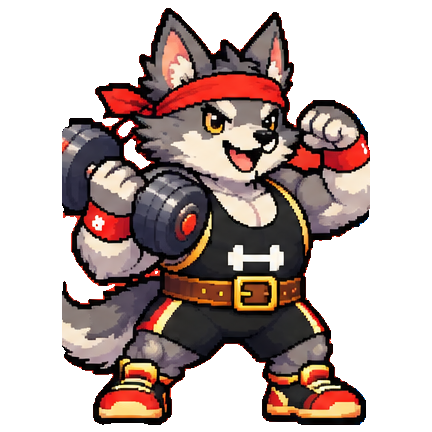<br>💪 Alfabro | 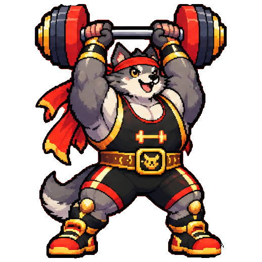<br>**Fenribro** | Nômadebro | Emboscabro | Líderbro | Chefebro | Dominantebro | Monarcabro | Batalhãobro | Patriarcabro | Comandantebro |
| <br>❤️ Trotebro | Tundrabro | 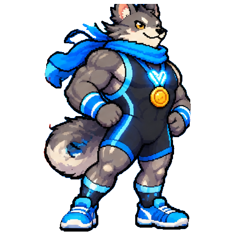<br>**Luabro** | Perseguebro | Andarilhobro | Galopebro | Disparadabro | Compassobro | Estradeirobro | Viajantebro | Passadabro |
| 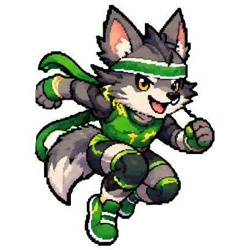<br>⚡ Caçabro | Predadorbro | Rastreadorbro | 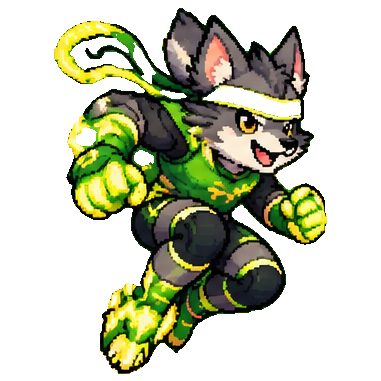<br>**Ventobro** | Espreitabro | Abatebro | Mordedorbro | Armadilhabro | Perseguiçãobro | Paciênciabro | Tocaiadorbro |
| <br>✨ Matilhabro | Guardiãobro | Xamãbro | Fantasmabro | <br>**Ancestrabro** | Alcateiabro | Cercobro | Estrategistabro | Revezabro | Anciãobro | Coroabro |
| <br>💪❤️ Caninobro | Dentadabro | Errantebro | Avançobro | Clãbro | <br>**Lobisombro** | Presadorbro | Caninãobro | Rosnadobro | Uivadorbro | Focinhobro |
| <br>💪⚡ Investidabro | Aríetebro | Saquebro | Relancebro | Mandíbulabro | Cargabro | <br>**Ragnarbro** | Certeirobro | Estourobro | Mirabro | Fintabro |
| <br>💪✨ Cumebro | Picobro | Escarpabro | Despenhadeirobro | Rapelbro | Glaciarbro | Desabamentobro | <br>**Cordilheirabro** | Cristabro | Neblinabro | Penhascobro |
| <br>❤️⚡ Rastrobro | Estepebro | Pistabro | Farejabro | Batedorbro | Pegadabro | Cheirobro | Rastreiobro | <br>**Vendavalbro** | Sendeirobro | Indíciobro |
| <br>❤️✨ Riachobro | Geiserbro | Nascentebro | Cascalhobro | Remansobro | Margembro | Vaubro | Seixobro | Torrentebro | <br>**Fiordebro** | Reflexobro |
| <br>⚡✨ Crepúsculobro | Lunarbro | Penumbrabro | Entardecerbro | Ocasobro | Anoitecerbro | Luscofuscobro | Estrelabro | Poentebro | Orvalhobro | <br>**Eclipsebro** |

#### 💪 Alfabro → 10 Lendas

```mermaid
flowchart LR
    C[Alfabro]
    C ==>|3600 XP · Força| L0[Fenribro<br/>pura]
    C -.->|Resistência| L1[Nômadebro]
    C -.->|Agilidade| L2[Emboscabro]
    C -.->|Técnica| L3[Líderbro]
    C -.->|Força + Resistência| L4[Chefebro]
    C -.->|Força + Agilidade| L5[Dominantebro]
    C -.->|Força + Técnica| L6[Monarcabro]
    C -.->|Resistência + Agilidade| L7[Batalhãobro]
    C -.->|Resistência + Técnica| L8[Patriarcabro]
    C -.->|Agilidade + Técnica| L9[Comandantebro]
```

#### ❤️ Trotebro → 10 Lendas

```mermaid
flowchart LR
    C[Trotebro]
    C -.->|Força| L0[Tundrabro]
    C ==>|3600 XP · Resistência| L1[Luabro<br/>pura]
    C -.->|Agilidade| L2[Perseguebro]
    C -.->|Técnica| L3[Andarilhobro]
    C -.->|Força + Resistência| L4[Galopebro]
    C -.->|Força + Agilidade| L5[Disparadabro]
    C -.->|Força + Técnica| L6[Compassobro]
    C -.->|Resistência + Agilidade| L7[Estradeirobro]
    C -.->|Resistência + Técnica| L8[Viajantebro]
    C -.->|Agilidade + Técnica| L9[Passadabro]
```

#### ⚡ Caçabro → 10 Lendas

```mermaid
flowchart LR
    C[Caçabro]
    C -.->|Força| L0[Predadorbro]
    C -.->|Resistência| L1[Rastreadorbro]
    C ==>|3600 XP · Agilidade| L2[Ventobro<br/>pura]
    C -.->|Técnica| L3[Espreitabro]
    C -.->|Força + Resistência| L4[Abatebro]
    C -.->|Força + Agilidade| L5[Mordedorbro]
    C -.->|Força + Técnica| L6[Armadilhabro]
    C -.->|Resistência + Agilidade| L7[Perseguiçãobro]
    C -.->|Resistência + Técnica| L8[Paciênciabro]
    C -.->|Agilidade + Técnica| L9[Tocaiadorbro]
```

#### ✨ Matilhabro → 10 Lendas

```mermaid
flowchart LR
    C[Matilhabro]
    C -.->|Força| L0[Guardiãobro]
    C -.->|Resistência| L1[Xamãbro]
    C -.->|Agilidade| L2[Fantasmabro]
    C ==>|3600 XP · Técnica| L3[Ancestrabro<br/>pura]
    C -.->|Força + Resistência| L4[Alcateiabro]
    C -.->|Força + Agilidade| L5[Cercobro]
    C -.->|Força + Técnica| L6[Estrategistabro]
    C -.->|Resistência + Agilidade| L7[Revezabro]
    C -.->|Resistência + Técnica| L8[Anciãobro]
    C -.->|Agilidade + Técnica| L9[Coroabro]
```

#### 💪❤️ Caninobro → 10 Lendas

```mermaid
flowchart LR
    C[Caninobro]
    C -.->|Força| L0[Dentadabro]
    C -.->|Resistência| L1[Errantebro]
    C -.->|Agilidade| L2[Avançobro]
    C -.->|Técnica| L3[Clãbro]
    C ==>|3600 XP · Força + Resistência| L4[Lobisombro<br/>pura]
    C -.->|Força + Agilidade| L5[Presadorbro]
    C -.->|Força + Técnica| L6[Caninãobro]
    C -.->|Resistência + Agilidade| L7[Rosnadobro]
    C -.->|Resistência + Técnica| L8[Uivadorbro]
    C -.->|Agilidade + Técnica| L9[Focinhobro]
```

#### 💪⚡ Investidabro → 10 Lendas

```mermaid
flowchart LR
    C[Investidabro]
    C -.->|Força| L0[Aríetebro]
    C -.->|Resistência| L1[Saquebro]
    C -.->|Agilidade| L2[Relancebro]
    C -.->|Técnica| L3[Mandíbulabro]
    C -.->|Força + Resistência| L4[Cargabro]
    C ==>|3600 XP · Força + Agilidade| L5[Ragnarbro<br/>pura]
    C -.->|Força + Técnica| L6[Certeirobro]
    C -.->|Resistência + Agilidade| L7[Estourobro]
    C -.->|Resistência + Técnica| L8[Mirabro]
    C -.->|Agilidade + Técnica| L9[Fintabro]
```

#### 💪✨ Cumebro → 10 Lendas

```mermaid
flowchart LR
    C[Cumebro]
    C -.->|Força| L0[Picobro]
    C -.->|Resistência| L1[Escarpabro]
    C -.->|Agilidade| L2[Despenhadeirobro]
    C -.->|Técnica| L3[Rapelbro]
    C -.->|Força + Resistência| L4[Glaciarbro]
    C -.->|Força + Agilidade| L5[Desabamentobro]
    C ==>|3600 XP · Força + Técnica| L6[Cordilheirabro<br/>pura]
    C -.->|Resistência + Agilidade| L7[Cristabro]
    C -.->|Resistência + Técnica| L8[Neblinabro]
    C -.->|Agilidade + Técnica| L9[Penhascobro]
```

#### ❤️⚡ Rastrobro → 10 Lendas

```mermaid
flowchart LR
    C[Rastrobro]
    C -.->|Força| L0[Estepebro]
    C -.->|Resistência| L1[Pistabro]
    C -.->|Agilidade| L2[Farejabro]
    C -.->|Técnica| L3[Batedorbro]
    C -.->|Força + Resistência| L4[Pegadabro]
    C -.->|Força + Agilidade| L5[Cheirobro]
    C -.->|Força + Técnica| L6[Rastreiobro]
    C ==>|3600 XP · Resistência + Agilidade| L7[Vendavalbro<br/>pura]
    C -.->|Resistência + Técnica| L8[Sendeirobro]
    C -.->|Agilidade + Técnica| L9[Indíciobro]
```

#### ❤️✨ Riachobro → 10 Lendas

```mermaid
flowchart LR
    C[Riachobro]
    C -.->|Força| L0[Geiserbro]
    C -.->|Resistência| L1[Nascentebro]
    C -.->|Agilidade| L2[Cascalhobro]
    C -.->|Técnica| L3[Remansobro]
    C -.->|Força + Resistência| L4[Margembro]
    C -.->|Força + Agilidade| L5[Vaubro]
    C -.->|Força + Técnica| L6[Seixobro]
    C -.->|Resistência + Agilidade| L7[Torrentebro]
    C ==>|3600 XP · Resistência + Técnica| L8[Fiordebro<br/>pura]
    C -.->|Agilidade + Técnica| L9[Reflexobro]
```

#### ⚡✨ Crepúsculobro → 10 Lendas

```mermaid
flowchart LR
    C[Crepúsculobro]
    C -.->|Força| L0[Lunarbro]
    C -.->|Resistência| L1[Penumbrabro]
    C -.->|Agilidade| L2[Entardecerbro]
    C -.->|Técnica| L3[Ocasobro]
    C -.->|Força + Resistência| L4[Anoitecerbro]
    C -.->|Força + Agilidade| L5[Luscofuscobro]
    C -.->|Força + Técnica| L6[Estrelabro]
    C -.->|Resistência + Agilidade| L7[Poentebro]
    C -.->|Resistência + Técnica| L8[Orvalhobro]
    C ==>|3600 XP · Agilidade + Técnica| L9[Eclipsebro<br/>pura]
```

### Cachorro

Nasce de: Caminhada, Futebol.  Filhotibro →  Caramelbro

```mermaid
flowchart LR
    O[🥚 Ovo] -->|60 XP · Caminhada, Futebol| B[Filhotibro<br/>Bebê]
    B -->|300 XP| N[Caramelbro<br/>Novato]
    N -->|1200 XP · Força| C0[Pitbulbro]
    C0 ==>|Força| L0_0[Mastibro<br/>pura]
    C0 -.->|Resistência| L0_1[Trenóbro]
    C0 -.->|Agilidade| L0_2[Rottweilerbro]
    C0 -.->|Técnica| L0_3[Policialbro]
    C0 -.->|Força + Resistência| L0_4[Cabodeguerrabro]
    C0 -.->|Força + Agilidade| L0_5[Amstaffbro]
    C0 -.->|Força + Técnica| L0_6[Vigilantebro]
    C0 -.->|Resistência + Agilidade| L0_7[Coleirabro]
    C0 -.->|Resistência + Técnica| L0_8[Mordaçabro]
    C0 -.->|Agilidade + Técnica| L0_9[Peitoralbro]
    N -->|1200 XP · Resistência| C1[Galgobro]
    C1 -.->|Força| L1_0[Malamutebro]
    C1 ==>|Resistência| L1_1[Huskybro<br/>pura]
    C1 -.->|Agilidade| L1_2[Whippetbro]
    C1 -.->|Técnica| L1_3[Resgatebro]
    C1 -.->|Força + Resistência| L1_4[Greyhoundbro]
    C1 -.->|Força + Agilidade| L1_5[Lebrelbro]
    C1 -.->|Força + Técnica| L1_6[Afgãobro]
    C1 -.->|Resistência + Agilidade| L1_7[Canódromobro]
    C1 -.->|Resistência + Técnica| L1_8[Borzoibro]
    C1 -.->|Agilidade + Técnica| L1_9[Sloughibro]
    N -->|1200 XP · Agilidade| C2[Frisbeebro]
    C2 -.->|Força| L2_0[Akitabro]
    C2 -.->|Resistência| L2_1[Dálmatabro]
    C2 ==>|Agilidade| L2_2[Agilitybro<br/>pura]
    C2 -.->|Técnica| L2_3[Corgibro]
    C2 -.->|Força + Resistência| L2_4[Bolinhabro]
    C2 -.->|Força + Agilidade| L2_5[Apanhabro]
    C2 -.->|Força + Técnica| L2_6[Busquebro]
    C2 -.->|Resistência + Agilidade| L2_7[Pegapegabro]
    C2 -.->|Resistência + Técnica| L2_8[Gravetobro]
    C2 -.->|Agilidade + Técnica| L2_9[Truquebro]
    N -->|1200 XP · Técnica| C3[Pastorbro]
    C3 -.->|Força| L3_0[Bernesebro]
    C3 -.->|Resistência| L3_1[Farejadorbro]
    C3 -.->|Agilidade| L3_2[Beaglebro]
    C3 ==>|Técnica| L3_3[Guiabro<br/>pura]
    C3 -.->|Força + Resistência| L3_4[Rebanhobro]
    C3 -.->|Força + Agilidade| L3_5[Cercadorbro]
    C3 -.->|Força + Técnica| L3_6[Malinoisbro]
    C3 -.->|Resistência + Agilidade| L3_7[Kelpiebro]
    C3 -.->|Resistência + Técnica| L3_8[Boiadabro]
    C3 -.->|Agilidade + Técnica| L3_9[Sheltiebro]
    N ==>|1200 XP · Força + Resistência| C4[Viralatabro]
    C4 -.->|Força| L4_0[Traçãobro]
    C4 -.->|Resistência| L4_1[Andejobro]
    C4 -.->|Agilidade| L4_2[Bombeirobro]
    C4 -.->|Técnica| L4_3[Boiadeirobro]
    C4 ==>|Força + Resistência| L4_4[Cérberobro<br/>pura]
    C4 -.->|Força + Agilidade| L4_5[Rueirobro]
    C4 -.->|Força + Técnica| L4_6[Esquinabro]
    C4 -.->|Resistência + Agilidade| L4_7[Calçadabro]
    C4 -.->|Resistência + Técnica| L4_8[Quintalbro]
    C4 -.->|Agilidade + Técnica| L4_9[Caramelinhobro]
    N ==>|1200 XP · Força + Agilidade| C5[Boxerbro]
    C5 -.->|Força| L5_0[Staffbro]
    C5 -.->|Resistência| L5_1[Pinscherbro]
    C5 -.->|Agilidade| L5_2[Jabbro]
    C5 -.->|Técnica| L5_3[Schnauzerbro]
    C5 -.->|Força + Resistência| L5_4[Ringuebro]
    C5 ==>|Força + Agilidade| L5_5[Dobermanbro<br/>pura]
    C5 -.->|Força + Técnica| L5_6[Cornerbro]
    C5 -.->|Resistência + Agilidade| L5_7[Uppercutbro]
    C5 -.->|Resistência + Técnica| L5_8[Roundbro]
    C5 -.->|Agilidade + Técnica| L5_9[Gingadobro]
    N ==>|1200 XP · Força + Técnica| C6[Bulldogbro]
    C6 -.->|Força| L6_0[Bullybro]
    C6 -.->|Resistência| L6_1[Corsobro]
    C6 -.->|Agilidade| L6_2[Pugbro]
    C6 -.->|Técnica| L6_3[Frenchiebro]
    C6 -.->|Força + Resistência| L6_4[Tanquebro]
    C6 -.->|Força + Agilidade| L6_5[Trombadabro]
    C6 ==>|Força + Técnica| L6_6[Sãobernardobro<br/>pura]
    C6 -.->|Resistência + Agilidade| L6_7[Bufadabro]
    C6 -.->|Resistência + Técnica| L6_8[Ronquebro]
    C6 -.->|Agilidade + Técnica| L6_9[Dobrinhabro]
    N ==>|1200 XP · Resistência + Agilidade| C7[Gandulabro]
    C7 -.->|Força| L7_0[Goleirobro]
    C7 -.->|Resistência| L7_1[Lateralbro]
    C7 -.->|Agilidade| L7_2[Pontabro]
    C7 -.->|Técnica| L7_3[Craquebro]
    C7 -.->|Força + Resistência| L7_4[Marcadorbro]
    C7 -.->|Força + Agilidade| L7_5[Carrinhobro]
    C7 -.->|Força + Técnica| L7_6[Escanteiobro]
    C7 ==>|Resistência + Agilidade| L7_7[Salukibro<br/>pura]
    C7 -.->|Resistência + Técnica| L7_8[Meiocampobro]
    C7 -.->|Agilidade + Técnica| L7_9[Chapéubro]
    N ==>|1200 XP · Resistência + Técnica| C8[Labradorbro]
    C8 -.->|Força| L8_0[Socorristabro]
    C8 -.->|Resistência| L8_1[Salvavidasbro]
    C8 -.->|Agilidade| L8_2[Retrieverbro]
    C8 -.->|Técnica| L8_3[Terapeutabro]
    C8 -.->|Força + Resistência| L8_4[Puxadorbro]
    C8 -.->|Força + Agilidade| L8_5[Pulolagobro]
    C8 -.->|Força + Técnica| L8_6[Assistentebro]
    C8 -.->|Resistência + Agilidade| L8_7[Buscadorbro]
    C8 ==>|Resistência + Técnica| L8_8[Terranovabro<br/>pura]
    C8 -.->|Agilidade + Técnica| L8_9[Lambidabro]
    N ==>|1200 XP · Agilidade + Técnica| C9[Poodlebro]
    C9 -.->|Força| L9_0[Bassetbro]
    C9 -.->|Resistência| L9_1[Colliebro]
    C9 -.->|Agilidade| L9_2[Exposiçãobro]
    C9 -.->|Técnica| L9_3[Adestradobro]
    C9 -.->|Força + Resistência| L9_4[Tosabro]
    C9 -.->|Força + Agilidade| L9_5[Pompombro]
    C9 -.->|Força + Técnica| L9_6[Penteadobro]
    C9 -.->|Resistência + Agilidade| L9_7[Passarelabro]
    C9 -.->|Resistência + Técnica| L9_8[Cachinhobro]
    C9 ==>|Agilidade + Técnica| L9_9[Borderbro<br/>pura]
```

| Atleta \ fase | 💪 Força | ❤️ Resistência | ⚡ Agilidade | ✨ Técnica | 💪❤️ Força + Resistência | 💪⚡ Força + Agilidade | 💪✨ Força + Técnica | ❤️⚡ Resistência + Agilidade | ❤️✨ Resistência + Técnica | ⚡✨ Agilidade + Técnica |
|---|---|---|---|---|---|---|---|---|---|---|
| 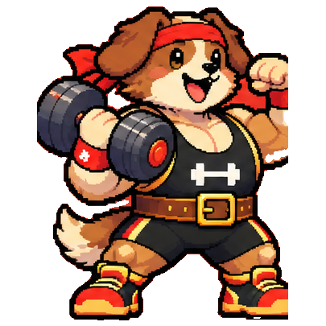<br>💪 Pitbulbro | 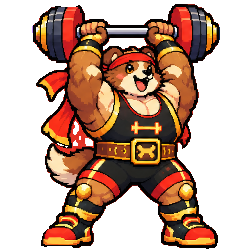<br>**Mastibro** | Trenóbro | Rottweilerbro | Policialbro | Cabodeguerrabro | Amstaffbro | Vigilantebro | Coleirabro | Mordaçabro | Peitoralbro |
| 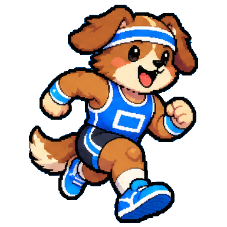<br>❤️ Galgobro | Malamutebro | 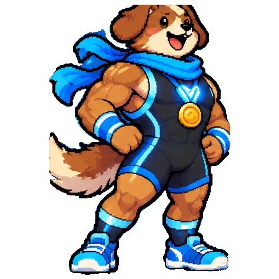<br>**Huskybro** | Whippetbro | Resgatebro | Greyhoundbro | Lebrelbro | Afgãobro | Canódromobro | Borzoibro | Sloughibro |
| 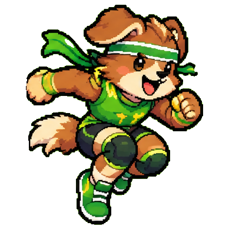<br>⚡ Frisbeebro | Akitabro | Dálmatabro | <br>**Agilitybro** | Corgibro | Bolinhabro | Apanhabro | Busquebro | Pegapegabro | Gravetobro | Truquebro |
| <br>✨ Pastorbro | Bernesebro | Farejadorbro | Beaglebro | <br>**Guiabro** | Rebanhobro | Cercadorbro | Malinoisbro | Kelpiebro | Boiadabro | Sheltiebro |
| <br>💪❤️ Viralatabro | Traçãobro | Andejobro | Bombeirobro | Boiadeirobro | <br>**Cérberobro** | Rueirobro | Esquinabro | Calçadabro | Quintalbro | Caramelinhobro |
| <br>💪⚡ Boxerbro | Staffbro | Pinscherbro | Jabbro | Schnauzerbro | Ringuebro | <br>**Dobermanbro** | Cornerbro | Uppercutbro | Roundbro | Gingadobro |
| <br>💪✨ Bulldogbro | Bullybro | Corsobro | Pugbro | Frenchiebro | Tanquebro | Trombadabro | <br>**Sãobernardobro** | Bufadabro | Ronquebro | Dobrinhabro |
| <br>❤️⚡ Gandulabro | Goleirobro | Lateralbro | Pontabro | Craquebro | Marcadorbro | Carrinhobro | Escanteiobro | <br>**Salukibro** | Meiocampobro | Chapéubro |
| <br>❤️✨ Labradorbro | Socorristabro | Salvavidasbro | Retrieverbro | Terapeutabro | Puxadorbro | Pulolagobro | Assistentebro | Buscadorbro | <br>**Terranovabro** | Lambidabro |
| <br>⚡✨ Poodlebro | Bassetbro | Colliebro | Exposiçãobro | Adestradobro | Tosabro | Pompombro | Penteadobro | Passarelabro | Cachinhobro | <br>**Borderbro** |

#### 💪 Pitbulbro → 10 Lendas

```mermaid
flowchart LR
    C[Pitbulbro]
    C ==>|3600 XP · Força| L0[Mastibro<br/>pura]
    C -.->|Resistência| L1[Trenóbro]
    C -.->|Agilidade| L2[Rottweilerbro]
    C -.->|Técnica| L3[Policialbro]
    C -.->|Força + Resistência| L4[Cabodeguerrabro]
    C -.->|Força + Agilidade| L5[Amstaffbro]
    C -.->|Força + Técnica| L6[Vigilantebro]
    C -.->|Resistência + Agilidade| L7[Coleirabro]
    C -.->|Resistência + Técnica| L8[Mordaçabro]
    C -.->|Agilidade + Técnica| L9[Peitoralbro]
```

#### ❤️ Galgobro → 10 Lendas

```mermaid
flowchart LR
    C[Galgobro]
    C -.->|Força| L0[Malamutebro]
    C ==>|3600 XP · Resistência| L1[Huskybro<br/>pura]
    C -.->|Agilidade| L2[Whippetbro]
    C -.->|Técnica| L3[Resgatebro]
    C -.->|Força + Resistência| L4[Greyhoundbro]
    C -.->|Força + Agilidade| L5[Lebrelbro]
    C -.->|Força + Técnica| L6[Afgãobro]
    C -.->|Resistência + Agilidade| L7[Canódromobro]
    C -.->|Resistência + Técnica| L8[Borzoibro]
    C -.->|Agilidade + Técnica| L9[Sloughibro]
```

#### ⚡ Frisbeebro → 10 Lendas

```mermaid
flowchart LR
    C[Frisbeebro]
    C -.->|Força| L0[Akitabro]
    C -.->|Resistência| L1[Dálmatabro]
    C ==>|3600 XP · Agilidade| L2[Agilitybro<br/>pura]
    C -.->|Técnica| L3[Corgibro]
    C -.->|Força + Resistência| L4[Bolinhabro]
    C -.->|Força + Agilidade| L5[Apanhabro]
    C -.->|Força + Técnica| L6[Busquebro]
    C -.->|Resistência + Agilidade| L7[Pegapegabro]
    C -.->|Resistência + Técnica| L8[Gravetobro]
    C -.->|Agilidade + Técnica| L9[Truquebro]
```

#### ✨ Pastorbro → 10 Lendas

```mermaid
flowchart LR
    C[Pastorbro]
    C -.->|Força| L0[Bernesebro]
    C -.->|Resistência| L1[Farejadorbro]
    C -.->|Agilidade| L2[Beaglebro]
    C ==>|3600 XP · Técnica| L3[Guiabro<br/>pura]
    C -.->|Força + Resistência| L4[Rebanhobro]
    C -.->|Força + Agilidade| L5[Cercadorbro]
    C -.->|Força + Técnica| L6[Malinoisbro]
    C -.->|Resistência + Agilidade| L7[Kelpiebro]
    C -.->|Resistência + Técnica| L8[Boiadabro]
    C -.->|Agilidade + Técnica| L9[Sheltiebro]
```

#### 💪❤️ Viralatabro → 10 Lendas

```mermaid
flowchart LR
    C[Viralatabro]
    C -.->|Força| L0[Traçãobro]
    C -.->|Resistência| L1[Andejobro]
    C -.->|Agilidade| L2[Bombeirobro]
    C -.->|Técnica| L3[Boiadeirobro]
    C ==>|3600 XP · Força + Resistência| L4[Cérberobro<br/>pura]
    C -.->|Força + Agilidade| L5[Rueirobro]
    C -.->|Força + Técnica| L6[Esquinabro]
    C -.->|Resistência + Agilidade| L7[Calçadabro]
    C -.->|Resistência + Técnica| L8[Quintalbro]
    C -.->|Agilidade + Técnica| L9[Caramelinhobro]
```

#### 💪⚡ Boxerbro → 10 Lendas

```mermaid
flowchart LR
    C[Boxerbro]
    C -.->|Força| L0[Staffbro]
    C -.->|Resistência| L1[Pinscherbro]
    C -.->|Agilidade| L2[Jabbro]
    C -.->|Técnica| L3[Schnauzerbro]
    C -.->|Força + Resistência| L4[Ringuebro]
    C ==>|3600 XP · Força + Agilidade| L5[Dobermanbro<br/>pura]
    C -.->|Força + Técnica| L6[Cornerbro]
    C -.->|Resistência + Agilidade| L7[Uppercutbro]
    C -.->|Resistência + Técnica| L8[Roundbro]
    C -.->|Agilidade + Técnica| L9[Gingadobro]
```

#### 💪✨ Bulldogbro → 10 Lendas

```mermaid
flowchart LR
    C[Bulldogbro]
    C -.->|Força| L0[Bullybro]
    C -.->|Resistência| L1[Corsobro]
    C -.->|Agilidade| L2[Pugbro]
    C -.->|Técnica| L3[Frenchiebro]
    C -.->|Força + Resistência| L4[Tanquebro]
    C -.->|Força + Agilidade| L5[Trombadabro]
    C ==>|3600 XP · Força + Técnica| L6[Sãobernardobro<br/>pura]
    C -.->|Resistência + Agilidade| L7[Bufadabro]
    C -.->|Resistência + Técnica| L8[Ronquebro]
    C -.->|Agilidade + Técnica| L9[Dobrinhabro]
```

#### ❤️⚡ Gandulabro → 10 Lendas

```mermaid
flowchart LR
    C[Gandulabro]
    C -.->|Força| L0[Goleirobro]
    C -.->|Resistência| L1[Lateralbro]
    C -.->|Agilidade| L2[Pontabro]
    C -.->|Técnica| L3[Craquebro]
    C -.->|Força + Resistência| L4[Marcadorbro]
    C -.->|Força + Agilidade| L5[Carrinhobro]
    C -.->|Força + Técnica| L6[Escanteiobro]
    C ==>|3600 XP · Resistência + Agilidade| L7[Salukibro<br/>pura]
    C -.->|Resistência + Técnica| L8[Meiocampobro]
    C -.->|Agilidade + Técnica| L9[Chapéubro]
```

#### ❤️✨ Labradorbro → 10 Lendas

```mermaid
flowchart LR
    C[Labradorbro]
    C -.->|Força| L0[Socorristabro]
    C -.->|Resistência| L1[Salvavidasbro]
    C -.->|Agilidade| L2[Retrieverbro]
    C -.->|Técnica| L3[Terapeutabro]
    C -.->|Força + Resistência| L4[Puxadorbro]
    C -.->|Força + Agilidade| L5[Pulolagobro]
    C -.->|Força + Técnica| L6[Assistentebro]
    C -.->|Resistência + Agilidade| L7[Buscadorbro]
    C ==>|3600 XP · Resistência + Técnica| L8[Terranovabro<br/>pura]
    C -.->|Agilidade + Técnica| L9[Lambidabro]
```

#### ⚡✨ Poodlebro → 10 Lendas

```mermaid
flowchart LR
    C[Poodlebro]
    C -.->|Força| L0[Bassetbro]
    C -.->|Resistência| L1[Colliebro]
    C -.->|Agilidade| L2[Exposiçãobro]
    C -.->|Técnica| L3[Adestradobro]
    C -.->|Força + Resistência| L4[Tosabro]
    C -.->|Força + Agilidade| L5[Pompombro]
    C -.->|Força + Técnica| L6[Penteadobro]
    C -.->|Resistência + Agilidade| L7[Passarelabro]
    C -.->|Resistência + Técnica| L8[Cachinhobro]
    C ==>|3600 XP · Agilidade + Técnica| L9[Borderbro<br/>pura]
```

### Esquilo

Nasce de: Vôlei.  Nozibro →  Esquilbro

```mermaid
flowchart LR
    O[🥚 Ovo] -->|60 XP · Vôlei| B[Nozibro<br/>Bebê]
    B -->|300 XP| N[Esquilbro<br/>Novato]
    N -->|1200 XP · Força| C0[Quebranozbro]
    C0 ==>|Força| L0_0[Carvalhobro<br/>pura]
    C0 -.->|Resistência| L0_1[Estoquebro]
    C0 -.->|Agilidade| L0_2[Castanholabro]
    C0 -.->|Técnica| L0_3[Marceneirobro]
    C0 -.->|Força + Resistência| L0_4[Paiolbro]
    C0 -.->|Força + Agilidade| L0_5[Estalobro]
    C0 -.->|Força + Técnica| L0_6[Pilãobro]
    C0 -.->|Resistência + Agilidade| L0_7[Despensabro]
    C0 -.->|Resistência + Técnica| L0_8[Celeirobro]
    C0 -.->|Agilidade + Técnica| L0_9[Cascabro]
    N -->|1200 XP · Resistência| C1[Galhobro]
    C1 -.->|Força| L1_0[Lenhabro]
    C1 ==>|Resistência| L1_1[Florestabro<br/>pura]
    C1 -.->|Agilidade| L1_2[Saltitabro]
    C1 -.->|Técnica| L1_3[Guardanozbro]
    C1 -.->|Força + Resistência| L1_4[Troncudobro]
    C1 -.->|Força + Agilidade| L1_5[Gravetãobro]
    C1 -.->|Força + Técnica| L1_6[Ninhobro]
    C1 -.->|Resistência + Agilidade| L1_7[Alamedabro]
    C1 -.->|Resistência + Técnica| L1_8[Bosquebro]
    C1 -.->|Agilidade + Técnica| L1_9[Ramobro]
    N -->|1200 XP · Agilidade| C2[Pulabro]
    C2 -.->|Força| L2_0[Coquinhobro]
    C2 -.->|Resistência| L2_1[Dosselbro]
    C2 ==>|Agilidade| L2_2[Voadorbro<br/>pura]
    C2 -.->|Técnica| L2_3[Equilibristabro]
    C2 -.->|Força + Resistência| L2_4[Molabro]
    C2 -.->|Força + Agilidade| L2_5[Pulãobro]
    C2 -.->|Força + Técnica| L2_6[Mortalbro]
    C2 -.->|Resistência + Agilidade| L2_7[Pulapulabro]
    C2 -.->|Resistência + Técnica| L2_8[Pogobro]
    C2 -.->|Agilidade + Técnica| L2_9[Cambotabro]
    N -->|1200 XP · Técnica| C3[Acrobabro]
    C3 -.->|Força| L3_0[Ginastabro]
    C3 -.->|Resistência| L3_1[Sementebro]
    C3 -.->|Agilidade| L3_2[Planadorbro]
    C3 ==>|Técnica| L3_3[Parkourbro<br/>pura]
    C3 -.->|Força + Resistência| L3_4[Cordabambabro]
    C3 -.->|Força + Agilidade| L3_5[Picadeirobro]
    C3 -.->|Força + Técnica| L3_6[Contorcionbro]
    C3 -.->|Resistência + Agilidade| L3_7[Saltimbancobro]
    C3 -.->|Resistência + Técnica| L3_8[Monociclobro]
    C3 -.->|Agilidade + Técnica| L3_9[Lonabro]
    N ==>|1200 XP · Força + Resistência| C4[Bolotabro]
    C4 -.->|Força| L4_0[Nozmoscadabro]
    C4 -.->|Resistência| L4_1[Coletorbro]
    C4 -.->|Agilidade| L4_2[Avelãbro]
    C4 -.->|Técnica| L4_3[Silobro]
    C4 ==>|Força + Resistência| L4_4[Sequoiabro<br/>pura]
    C4 -.->|Força + Agilidade| L4_5[Bolotãobro]
    C4 -.->|Força + Técnica| L4_6[Pinhãobro]
    C4 -.->|Resistência + Agilidade| L4_7[Ladeirinhabro]
    C4 -.->|Resistência + Técnica| L4_8[Colheitabro]
    C4 -.->|Agilidade + Técnica| L4_9[Amêndoabro]
    N ==>|1200 XP · Força + Agilidade| C5[Ouriçobro]
    C5 -.->|Força| L5_0[Castanhabro]
    C5 -.->|Resistência| L5_1[Espinhobro]
    C5 -.->|Agilidade| L5_2[Picadabro]
    C5 -.->|Técnica| L5_3[Cardobro]
    C5 -.->|Força + Resistência| L5_4[Cascudobro]
    C5 ==>|Força + Agilidade| L5_5[Espinheirobro<br/>pura]
    C5 -.->|Força + Técnica| L5_6[Agulhabro]
    C5 -.->|Resistência + Agilidade| L5_7[Espetobro]
    C5 -.->|Resistência + Técnica| L5_8[Carapaçabro]
    C5 -.->|Agilidade + Técnica| L5_9[Pontiagudobro]
    N ==>|1200 XP · Força + Técnica| C6[Torabro]
    C6 -.->|Força| L6_0[Troncobro]
    C6 -.->|Resistência| L6_1[Raizbro]
    C6 -.->|Agilidade| L6_2[Lascabro]
    C6 -.->|Técnica| L6_3[Entalhebro]
    C6 -.->|Força + Resistência| L6_4[Toradãobro]
    C6 -.->|Força + Agilidade| L6_5[Serrotebro]
    C6 ==>|Força + Técnica| L6_6[Jequitibro<br/>pura]
    C6 -.->|Resistência + Agilidade| L6_7[Toretebro]
    C6 -.->|Resistência + Técnica| L6_8[Resinabro]
    C6 -.->|Agilidade + Técnica| L6_9[Cavacobro]
    N ==>|1200 XP · Resistência + Agilidade| C7[Copabro]
    C7 -.->|Força| L7_0[Galhadabro]
    C7 -.->|Resistência| L7_1[Topobro]
    C7 -.->|Agilidade| L7_2[Ramagembro]
    C7 -.->|Técnica| L7_3[Folhagembro]
    C7 -.->|Força + Resistência| L7_4[Frondosobro]
    C7 -.->|Força + Agilidade| L7_5[Ramalhetebro]
    C7 -.->|Força + Técnica| L7_6[Casinhabro]
    C7 ==>|Resistência + Agilidade| L7_7[Redemoinhobro<br/>pura]
    C7 -.->|Resistência + Técnica| L7_8[Sombreirobro]
    C7 -.->|Agilidade + Técnica| L7_9[Folhinhabro]
    N ==>|1200 XP · Resistência + Técnica| C8[Cachoeirabro]
    C8 -.->|Força| L8_0[Moinhobro]
    C8 -.->|Resistência| L8_1[Correntebro]
    C8 -.->|Agilidade| L8_2[Respingobro]
    C8 -.->|Técnica| L8_3[Lagobro]
    C8 -.->|Força + Resistência| L8_4[Diquebro]
    C8 -.->|Força + Agilidade| L8_5[Quedabro]
    C8 -.->|Força + Técnica| L8_6[Pedrinhabro]
    C8 -.->|Resistência + Agilidade| L8_7[Riozinhobro]
    C8 ==>|Resistência + Técnica| L8_8[Cascatabro<br/>pura]
    C8 -.->|Agilidade + Técnica| L8_9[Gotabro]
    N ==>|1200 XP · Agilidade + Técnica| C9[Cipóbro]
    C9 -.->|Força| L9_0[Balançobro]
    C9 -.->|Resistência| L9_1[Lianabro]
    C9 -.->|Agilidade| L9_2[Tirolesabro]
    C9 -.->|Técnica| L9_3[Pendurabro]
    C9 -.->|Força + Resistência| L9_4[Trepadeirabro]
    C9 -.->|Força + Agilidade| L9_5[Tarzanbro]
    C9 -.->|Força + Técnica| L9_6[Nóbro]
    C9 -.->|Resistência + Agilidade| L9_7[Pendulobro]
    C9 -.->|Resistência + Técnica| L9_8[Enroscabro]
    C9 ==>|Agilidade + Técnica| L9_9[Trapezistabro<br/>pura]
```

| Atleta \ fase | 💪 Força | ❤️ Resistência | ⚡ Agilidade | ✨ Técnica | 💪❤️ Força + Resistência | 💪⚡ Força + Agilidade | 💪✨ Força + Técnica | ❤️⚡ Resistência + Agilidade | ❤️✨ Resistência + Técnica | ⚡✨ Agilidade + Técnica |
|---|---|---|---|---|---|---|---|---|---|---|
| 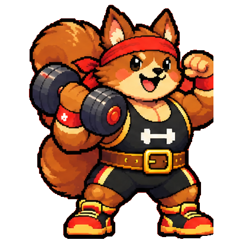<br>💪 Quebranozbro | 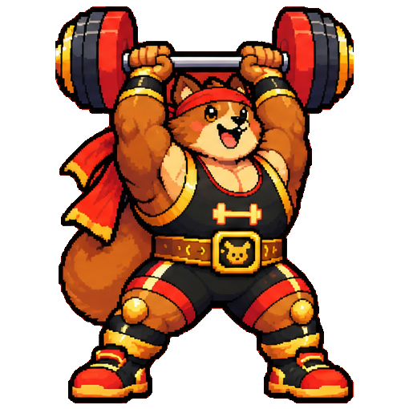<br>**Carvalhobro** | Estoquebro | Castanholabro | Marceneirobro | Paiolbro | Estalobro | Pilãobro | Despensabro | Celeirobro | Cascabro |
| <br>❤️ Galhobro | Lenhabro | 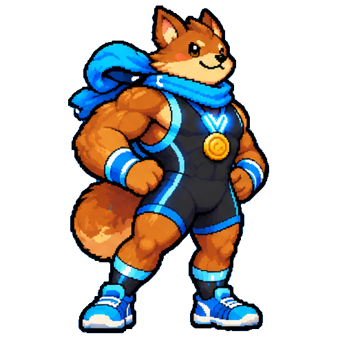<br>**Florestabro** | Saltitabro | Guardanozbro | Troncudobro | Gravetãobro | Ninhobro | Alamedabro | Bosquebro | Ramobro |
| 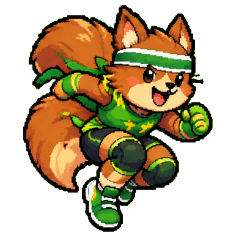<br>⚡ Pulabro | Coquinhobro | Dosselbro | 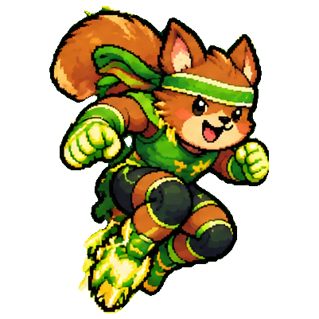<br>**Voadorbro** | Equilibristabro | Molabro | Pulãobro | Mortalbro | Pulapulabro | Pogobro | Cambotabro |
| <br>✨ Acrobabro | Ginastabro | Sementebro | Planadorbro | <br>**Parkourbro** | Cordabambabro | Picadeirobro | Contorcionbro | Saltimbancobro | Monociclobro | Lonabro |
| <br>💪❤️ Bolotabro | Nozmoscadabro | Coletorbro | Avelãbro | Silobro | <br>**Sequoiabro** | Bolotãobro | Pinhãobro | Ladeirinhabro | Colheitabro | Amêndoabro |
| <br>💪⚡ Ouriçobro | Castanhabro | Espinhobro | Picadabro | Cardobro | Cascudobro | <br>**Espinheirobro** | Agulhabro | Espetobro | Carapaçabro | Pontiagudobro |
| <br>💪✨ Torabro | Troncobro | Raizbro | Lascabro | Entalhebro | Toradãobro | Serrotebro | <br>**Jequitibro** | Toretebro | Resinabro | Cavacobro |
| <br>❤️⚡ Copabro | Galhadabro | Topobro | Ramagembro | Folhagembro | Frondosobro | Ramalhetebro | Casinhabro | <br>**Redemoinhobro** | Sombreirobro | Folhinhabro |
| <br>❤️✨ Cachoeirabro | Moinhobro | Correntebro | Respingobro | Lagobro | Diquebro | Quedabro | Pedrinhabro | Riozinhobro | <br>**Cascatabro** | Gotabro |
| <br>⚡✨ Cipóbro | Balançobro | Lianabro | Tirolesabro | Pendurabro | Trepadeirabro | Tarzanbro | Nóbro | Pendulobro | Enroscabro | <br>**Trapezistabro** |

#### 💪 Quebranozbro → 10 Lendas

```mermaid
flowchart LR
    C[Quebranozbro]
    C ==>|3600 XP · Força| L0[Carvalhobro<br/>pura]
    C -.->|Resistência| L1[Estoquebro]
    C -.->|Agilidade| L2[Castanholabro]
    C -.->|Técnica| L3[Marceneirobro]
    C -.->|Força + Resistência| L4[Paiolbro]
    C -.->|Força + Agilidade| L5[Estalobro]
    C -.->|Força + Técnica| L6[Pilãobro]
    C -.->|Resistência + Agilidade| L7[Despensabro]
    C -.->|Resistência + Técnica| L8[Celeirobro]
    C -.->|Agilidade + Técnica| L9[Cascabro]
```

#### ❤️ Galhobro → 10 Lendas

```mermaid
flowchart LR
    C[Galhobro]
    C -.->|Força| L0[Lenhabro]
    C ==>|3600 XP · Resistência| L1[Florestabro<br/>pura]
    C -.->|Agilidade| L2[Saltitabro]
    C -.->|Técnica| L3[Guardanozbro]
    C -.->|Força + Resistência| L4[Troncudobro]
    C -.->|Força + Agilidade| L5[Gravetãobro]
    C -.->|Força + Técnica| L6[Ninhobro]
    C -.->|Resistência + Agilidade| L7[Alamedabro]
    C -.->|Resistência + Técnica| L8[Bosquebro]
    C -.->|Agilidade + Técnica| L9[Ramobro]
```

#### ⚡ Pulabro → 10 Lendas

```mermaid
flowchart LR
    C[Pulabro]
    C -.->|Força| L0[Coquinhobro]
    C -.->|Resistência| L1[Dosselbro]
    C ==>|3600 XP · Agilidade| L2[Voadorbro<br/>pura]
    C -.->|Técnica| L3[Equilibristabro]
    C -.->|Força + Resistência| L4[Molabro]
    C -.->|Força + Agilidade| L5[Pulãobro]
    C -.->|Força + Técnica| L6[Mortalbro]
    C -.->|Resistência + Agilidade| L7[Pulapulabro]
    C -.->|Resistência + Técnica| L8[Pogobro]
    C -.->|Agilidade + Técnica| L9[Cambotabro]
```

#### ✨ Acrobabro → 10 Lendas

```mermaid
flowchart LR
    C[Acrobabro]
    C -.->|Força| L0[Ginastabro]
    C -.->|Resistência| L1[Sementebro]
    C -.->|Agilidade| L2[Planadorbro]
    C ==>|3600 XP · Técnica| L3[Parkourbro<br/>pura]
    C -.->|Força + Resistência| L4[Cordabambabro]
    C -.->|Força + Agilidade| L5[Picadeirobro]
    C -.->|Força + Técnica| L6[Contorcionbro]
    C -.->|Resistência + Agilidade| L7[Saltimbancobro]
    C -.->|Resistência + Técnica| L8[Monociclobro]
    C -.->|Agilidade + Técnica| L9[Lonabro]
```

#### 💪❤️ Bolotabro → 10 Lendas

```mermaid
flowchart LR
    C[Bolotabro]
    C -.->|Força| L0[Nozmoscadabro]
    C -.->|Resistência| L1[Coletorbro]
    C -.->|Agilidade| L2[Avelãbro]
    C -.->|Técnica| L3[Silobro]
    C ==>|3600 XP · Força + Resistência| L4[Sequoiabro<br/>pura]
    C -.->|Força + Agilidade| L5[Bolotãobro]
    C -.->|Força + Técnica| L6[Pinhãobro]
    C -.->|Resistência + Agilidade| L7[Ladeirinhabro]
    C -.->|Resistência + Técnica| L8[Colheitabro]
    C -.->|Agilidade + Técnica| L9[Amêndoabro]
```

#### 💪⚡ Ouriçobro → 10 Lendas

```mermaid
flowchart LR
    C[Ouriçobro]
    C -.->|Força| L0[Castanhabro]
    C -.->|Resistência| L1[Espinhobro]
    C -.->|Agilidade| L2[Picadabro]
    C -.->|Técnica| L3[Cardobro]
    C -.->|Força + Resistência| L4[Cascudobro]
    C ==>|3600 XP · Força + Agilidade| L5[Espinheirobro<br/>pura]
    C -.->|Força + Técnica| L6[Agulhabro]
    C -.->|Resistência + Agilidade| L7[Espetobro]
    C -.->|Resistência + Técnica| L8[Carapaçabro]
    C -.->|Agilidade + Técnica| L9[Pontiagudobro]
```

#### 💪✨ Torabro → 10 Lendas

```mermaid
flowchart LR
    C[Torabro]
    C -.->|Força| L0[Troncobro]
    C -.->|Resistência| L1[Raizbro]
    C -.->|Agilidade| L2[Lascabro]
    C -.->|Técnica| L3[Entalhebro]
    C -.->|Força + Resistência| L4[Toradãobro]
    C -.->|Força + Agilidade| L5[Serrotebro]
    C ==>|3600 XP · Força + Técnica| L6[Jequitibro<br/>pura]
    C -.->|Resistência + Agilidade| L7[Toretebro]
    C -.->|Resistência + Técnica| L8[Resinabro]
    C -.->|Agilidade + Técnica| L9[Cavacobro]
```

#### ❤️⚡ Copabro → 10 Lendas

```mermaid
flowchart LR
    C[Copabro]
    C -.->|Força| L0[Galhadabro]
    C -.->|Resistência| L1[Topobro]
    C -.->|Agilidade| L2[Ramagembro]
    C -.->|Técnica| L3[Folhagembro]
    C -.->|Força + Resistência| L4[Frondosobro]
    C -.->|Força + Agilidade| L5[Ramalhetebro]
    C -.->|Força + Técnica| L6[Casinhabro]
    C ==>|3600 XP · Resistência + Agilidade| L7[Redemoinhobro<br/>pura]
    C -.->|Resistência + Técnica| L8[Sombreirobro]
    C -.->|Agilidade + Técnica| L9[Folhinhabro]
```

#### ❤️✨ Cachoeirabro → 10 Lendas

```mermaid
flowchart LR
    C[Cachoeirabro]
    C -.->|Força| L0[Moinhobro]
    C -.->|Resistência| L1[Correntebro]
    C -.->|Agilidade| L2[Respingobro]
    C -.->|Técnica| L3[Lagobro]
    C -.->|Força + Resistência| L4[Diquebro]
    C -.->|Força + Agilidade| L5[Quedabro]
    C -.->|Força + Técnica| L6[Pedrinhabro]
    C -.->|Resistência + Agilidade| L7[Riozinhobro]
    C ==>|3600 XP · Resistência + Técnica| L8[Cascatabro<br/>pura]
    C -.->|Agilidade + Técnica| L9[Gotabro]
```

#### ⚡✨ Cipóbro → 10 Lendas

```mermaid
flowchart LR
    C[Cipóbro]
    C -.->|Força| L0[Balançobro]
    C -.->|Resistência| L1[Lianabro]
    C -.->|Agilidade| L2[Tirolesabro]
    C -.->|Técnica| L3[Pendurabro]
    C -.->|Força + Resistência| L4[Trepadeirabro]
    C -.->|Força + Agilidade| L5[Tarzanbro]
    C -.->|Força + Técnica| L6[Nóbro]
    C -.->|Resistência + Agilidade| L7[Pendulobro]
    C -.->|Resistência + Técnica| L8[Enroscabro]
    C ==>|3600 XP · Agilidade + Técnica| L9[Trapezistabro<br/>pura]
```

### Gato

Nasce de: Lutas, Dança.  Novelbro →  Bichanobro

```mermaid
flowchart LR
    O[🥚 Ovo] -->|60 XP · Lutas, Dança| B[Novelbro<br/>Bebê]
    B -->|300 XP| N[Bichanobro<br/>Novato]
    N -->|1200 XP · Força| C0[Garrabro]
    C0 ==>|Força| L0_0[Jubabro<br/>pura]
    C0 -.->|Resistência| L0_1[Selvagembro]
    C0 -.->|Agilidade| L0_2[Botebro]
    C0 -.->|Técnica| L0_3[Gladiadorbro]
    C0 -.->|Força + Resistência| L0_4[Arranhadorbro]
    C0 -.->|Força + Agilidade| L0_5[Unhadãobro]
    C0 -.->|Força + Técnica| L0_6[Afiabro]
    C0 -.->|Resistência + Agilidade| L0_7[Rasgãobro]
    C0 -.->|Resistência + Técnica| L0_8[Postebro]
    C0 -.->|Agilidade + Técnica| L0_9[Gaturrabro]
    N -->|1200 XP · Resistência| C1[Rondabro]
    C1 -.->|Força| L1_0[Jaguarbro]
    C1 ==>|Resistência| L1_1[Panterabro<br/>pura]
    C1 -.->|Agilidade| L1_2[Notívagobro]
    C1 -.->|Técnica| L1_3[Sentinelabro]
    C1 -.->|Força + Resistência| L1_4[Quarteirãobro]
    C1 -.->|Força + Agilidade| L1_5[Ruelabro]
    C1 -.->|Força + Técnica| L1_6[Territóriobro]
    C1 -.->|Resistência + Agilidade| L1_7[Madrugãobro]
    C1 -.->|Resistência + Técnica| L1_8[Plantãobro]
    C1 -.->|Agilidade + Técnica| L1_9[Calçadãobro]
    N -->|1200 XP · Agilidade| C2[Telhadobro]
    C2 -.->|Força| L2_0[Arranhabro]
    C2 -.->|Resistência| L2_1[Fujãobro]
    C2 ==>|Agilidade| L2_2[Linxbro<br/>pura]
    C2 -.->|Técnica| L2_3[Funambulobro]
    C2 -.->|Força + Resistência| L2_4[Chaminébro]
    C2 -.->|Força + Agilidade| L2_5[Beiralbro]
    C2 -.->|Força + Técnica| L2_6[Antenabro]
    C2 -.->|Resistência + Agilidade| L2_7[Sotãobro]
    C2 -.->|Resistência + Técnica| L2_8[Claraboiabro]
    C2 -.->|Agilidade + Técnica| L2_9[Cataventobro]
    N -->|1200 XP · Técnica| C3[Ronrobro]
    C3 -.->|Força| L3_0[Karatebro]
    C3 -.->|Resistência| L3_1[Persabro]
    C3 -.->|Agilidade| L3_2[Kungfubro]
    C3 ==>|Técnica| L3_3[Esfingebro<br/>pura]
    C3 -.->|Força + Resistência| L3_4[Almofadãobro]
    C3 -.->|Força + Agilidade| L3_5[Novelãobro]
    C3 -.->|Força + Técnica| L3_6[Massagembro]
    C3 -.->|Resistência + Agilidade| L3_7[Sonecabro]
    C3 -.->|Resistência + Técnica| L3_8[Mantrabro]
    C3 -.->|Agilidade + Técnica| L3_9[Espreguiçabro]
    N ==>|1200 XP · Força + Resistência| C4[Miaufitbro]
    C4 -.->|Força| L4_0[Gatãobro]
    C4 -.->|Resistência| L4_1[Patrulhabro]
    C4 -.->|Agilidade| L4_2[Tocaiabro]
    C4 -.->|Técnica| L4_3[Felinobro]
    C4 ==>|Força + Resistência| L4_4[Tigrebro<br/>pura]
    C4 -.->|Força + Agilidade| L4_5[Felinfitbro]
    C4 -.->|Força + Técnica| L4_6[Miaupowerbro]
    C4 -.->|Resistência + Agilidade| L4_7[Miaurunbro]
    C4 -.->|Resistência + Técnica| L4_8[Miauzenbro]
    C4 -.->|Agilidade + Técnica| L4_9[Miaudançabro]
    N ==>|1200 XP · Força + Agilidade| C5[Unhadabro]
    C5 -.->|Força| L5_0[Rasgabro]
    C5 -.->|Resistência| L5_1[Zarpabro]
    C5 -.->|Agilidade| L5_2[Lacerabro]
    C5 -.->|Técnica| L5_3[Esgrimabro]
    C5 -.->|Força + Resistência| L5_4[Unhãobro]
    C5 ==>|Força + Agilidade| L5_5[Smilodonbro<br/>pura]
    C5 -.->|Força + Técnica| L5_6[Lixadabro]
    C5 -.->|Resistência + Agilidade| L5_7[Riscobro]
    C5 -.->|Resistência + Técnica| L5_8[Afiadorbro]
    C5 -.->|Agilidade + Técnica| L5_9[Unhinhabro]
    N ==>|1200 XP · Força + Técnica| C6[Pumabro]
    C6 -.->|Força| L6_0[Cougarbro]
    C6 -.->|Resistência| L6_1[Serranobro]
    C6 -.->|Agilidade| L6_2[Ocelotebro]
    C6 -.->|Técnica| L6_3[Montanhêsbro]
    C6 -.->|Força + Resistência| L6_4[Andinobro]
    C6 -.->|Força + Agilidade| L6_5[Penedobro]
    C6 ==>|Força + Técnica| L6_6[Leãobro<br/>pura]
    C6 -.->|Resistência + Agilidade| L6_7[Cerradobro]
    C6 -.->|Resistência + Técnica| L6_8[Pantanalbro]
    C6 -.->|Agilidade + Técnica| L6_9[Altiplanobro]
    N ==>|1200 XP · Resistência + Agilidade| C7[Gatunobro]
    C7 -.->|Força| L7_0[Becobro]
    C7 -.->|Resistência| L7_1[Esquivabro]
    C7 -.->|Agilidade| L7_2[Larápiobro]
    C7 -.->|Técnica| L7_3[Varalbro]
    C7 -.->|Força + Resistência| L7_4[Saqueadorbro]
    C7 -.->|Força + Agilidade| L7_5[Afanabro]
    C7 -.->|Força + Técnica| L7_6[Cofrebro]
    C7 ==>|Resistência + Agilidade| L7_7[Guepardobro<br/>pura]
    C7 -.->|Resistência + Técnica| L7_8[Disfarcebro]
    C7 -.->|Agilidade + Técnica| L7_9[Mascarabro]
    N ==>|1200 XP · Resistência + Técnica| C8[Molhadobro]
    C8 -.->|Força| L8_0[Bigodudobro]
    C8 -.->|Resistência| L8_1[Banhobro]
    C8 -.->|Agilidade| L8_2[Margaybro]
    C8 -.->|Técnica| L8_3[Bagrebro]
    C8 -.->|Força + Resistência| L8_4[Chuvabro]
    C8 -.->|Força + Agilidade| L8_5[Poçabro]
    C8 -.->|Força + Técnica| L8_6[Garoabro]
    C8 -.->|Resistência + Agilidade| L8_7[Tempestadebro]
    C8 ==>|Resistência + Técnica| L8_8[Onçabro<br/>pura]
    C8 -.->|Agilidade + Técnica| L8_9[Goteirabro]
    N ==>|1200 XP · Agilidade + Técnica| C9[Muretabro]
    C9 -.->|Força| L9_0[Calhabro]
    C9 -.->|Resistência| L9_1[Varandabro]
    C9 -.->|Agilidade| L9_2[Parapeitobro]
    C9 -.->|Técnica| L9_3[Cumeeirabro]
    C9 -.->|Força + Resistência| L9_4[Muralhabro]
    C9 -.->|Força + Agilidade| L9_5[Gradebro]
    C9 -.->|Força + Técnica| L9_6[Tijolobro]
    C9 -.->|Resistência + Agilidade| L9_7[Portãobro]
    C9 -.->|Resistência + Técnica| L9_8[Jardimbro]
    C9 ==>|Agilidade + Técnica| L9_9[Bastetbro<br/>pura]
```

| Atleta \ fase | 💪 Força | ❤️ Resistência | ⚡ Agilidade | ✨ Técnica | 💪❤️ Força + Resistência | 💪⚡ Força + Agilidade | 💪✨ Força + Técnica | ❤️⚡ Resistência + Agilidade | ❤️✨ Resistência + Técnica | ⚡✨ Agilidade + Técnica |
|---|---|---|---|---|---|---|---|---|---|---|
| 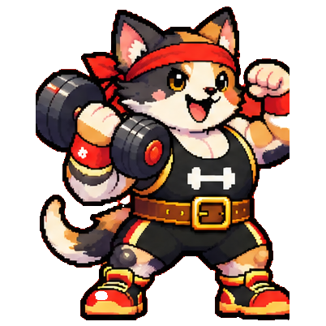<br>💪 Garrabro | 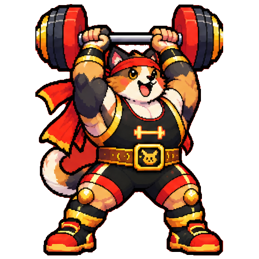<br>**Jubabro** | Selvagembro | Botebro | Gladiadorbro | Arranhadorbro | Unhadãobro | Afiabro | Rasgãobro | Postebro | Gaturrabro |
| 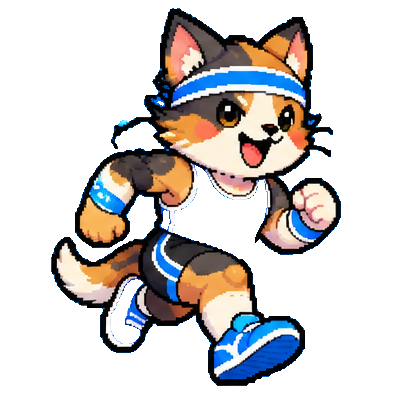<br>❤️ Rondabro | Jaguarbro | <br>**Panterabro** | Notívagobro | Sentinelabro | Quarteirãobro | Ruelabro | Territóriobro | Madrugãobro | Plantãobro | Calçadãobro |
| <br>⚡ Telhadobro | Arranhabro | Fujãobro | <br>**Linxbro** | Funambulobro | Chaminébro | Beiralbro | Antenabro | Sotãobro | Claraboiabro | Cataventobro |
| <br>✨ Ronrobro | Karatebro | Persabro | Kungfubro | <br>**Esfingebro** | Almofadãobro | Novelãobro | Massagembro | Sonecabro | Mantrabro | Espreguiçabro |
| <br>💪❤️ Miaufitbro | Gatãobro | Patrulhabro | Tocaiabro | Felinobro | <br>**Tigrebro** | Felinfitbro | Miaupowerbro | Miaurunbro | Miauzenbro | Miaudançabro |
| <br>💪⚡ Unhadabro | Rasgabro | Zarpabro | Lacerabro | Esgrimabro | Unhãobro | <br>**Smilodonbro** | Lixadabro | Riscobro | Afiadorbro | Unhinhabro |
| <br>💪✨ Pumabro | Cougarbro | Serranobro | Ocelotebro | Montanhêsbro | Andinobro | Penedobro | <br>**Leãobro** | Cerradobro | Pantanalbro | Altiplanobro |
| <br>❤️⚡ Gatunobro | Becobro | Esquivabro | Larápiobro | Varalbro | Saqueadorbro | Afanabro | Cofrebro | <br>**Guepardobro** | Disfarcebro | Mascarabro |
| <br>❤️✨ Molhadobro | Bigodudobro | Banhobro | Margaybro | Bagrebro | Chuvabro | Poçabro | Garoabro | Tempestadebro | <br>**Onçabro** | Goteirabro |
| <br>⚡✨ Muretabro | Calhabro | Varandabro | Parapeitobro | Cumeeirabro | Muralhabro | Gradebro | Tijolobro | Portãobro | Jardimbro | <br>**Bastetbro** |

#### 💪 Garrabro → 10 Lendas

```mermaid
flowchart LR
    C[Garrabro]
    C ==>|3600 XP · Força| L0[Jubabro<br/>pura]
    C -.->|Resistência| L1[Selvagembro]
    C -.->|Agilidade| L2[Botebro]
    C -.->|Técnica| L3[Gladiadorbro]
    C -.->|Força + Resistência| L4[Arranhadorbro]
    C -.->|Força + Agilidade| L5[Unhadãobro]
    C -.->|Força + Técnica| L6[Afiabro]
    C -.->|Resistência + Agilidade| L7[Rasgãobro]
    C -.->|Resistência + Técnica| L8[Postebro]
    C -.->|Agilidade + Técnica| L9[Gaturrabro]
```

#### ❤️ Rondabro → 10 Lendas

```mermaid
flowchart LR
    C[Rondabro]
    C -.->|Força| L0[Jaguarbro]
    C ==>|3600 XP · Resistência| L1[Panterabro<br/>pura]
    C -.->|Agilidade| L2[Notívagobro]
    C -.->|Técnica| L3[Sentinelabro]
    C -.->|Força + Resistência| L4[Quarteirãobro]
    C -.->|Força + Agilidade| L5[Ruelabro]
    C -.->|Força + Técnica| L6[Territóriobro]
    C -.->|Resistência + Agilidade| L7[Madrugãobro]
    C -.->|Resistência + Técnica| L8[Plantãobro]
    C -.->|Agilidade + Técnica| L9[Calçadãobro]
```

#### ⚡ Telhadobro → 10 Lendas

```mermaid
flowchart LR
    C[Telhadobro]
    C -.->|Força| L0[Arranhabro]
    C -.->|Resistência| L1[Fujãobro]
    C ==>|3600 XP · Agilidade| L2[Linxbro<br/>pura]
    C -.->|Técnica| L3[Funambulobro]
    C -.->|Força + Resistência| L4[Chaminébro]
    C -.->|Força + Agilidade| L5[Beiralbro]
    C -.->|Força + Técnica| L6[Antenabro]
    C -.->|Resistência + Agilidade| L7[Sotãobro]
    C -.->|Resistência + Técnica| L8[Claraboiabro]
    C -.->|Agilidade + Técnica| L9[Cataventobro]
```

#### ✨ Ronrobro → 10 Lendas

```mermaid
flowchart LR
    C[Ronrobro]
    C -.->|Força| L0[Karatebro]
    C -.->|Resistência| L1[Persabro]
    C -.->|Agilidade| L2[Kungfubro]
    C ==>|3600 XP · Técnica| L3[Esfingebro<br/>pura]
    C -.->|Força + Resistência| L4[Almofadãobro]
    C -.->|Força + Agilidade| L5[Novelãobro]
    C -.->|Força + Técnica| L6[Massagembro]
    C -.->|Resistência + Agilidade| L7[Sonecabro]
    C -.->|Resistência + Técnica| L8[Mantrabro]
    C -.->|Agilidade + Técnica| L9[Espreguiçabro]
```

#### 💪❤️ Miaufitbro → 10 Lendas

```mermaid
flowchart LR
    C[Miaufitbro]
    C -.->|Força| L0[Gatãobro]
    C -.->|Resistência| L1[Patrulhabro]
    C -.->|Agilidade| L2[Tocaiabro]
    C -.->|Técnica| L3[Felinobro]
    C ==>|3600 XP · Força + Resistência| L4[Tigrebro<br/>pura]
    C -.->|Força + Agilidade| L5[Felinfitbro]
    C -.->|Força + Técnica| L6[Miaupowerbro]
    C -.->|Resistência + Agilidade| L7[Miaurunbro]
    C -.->|Resistência + Técnica| L8[Miauzenbro]
    C -.->|Agilidade + Técnica| L9[Miaudançabro]
```

#### 💪⚡ Unhadabro → 10 Lendas

```mermaid
flowchart LR
    C[Unhadabro]
    C -.->|Força| L0[Rasgabro]
    C -.->|Resistência| L1[Zarpabro]
    C -.->|Agilidade| L2[Lacerabro]
    C -.->|Técnica| L3[Esgrimabro]
    C -.->|Força + Resistência| L4[Unhãobro]
    C ==>|3600 XP · Força + Agilidade| L5[Smilodonbro<br/>pura]
    C -.->|Força + Técnica| L6[Lixadabro]
    C -.->|Resistência + Agilidade| L7[Riscobro]
    C -.->|Resistência + Técnica| L8[Afiadorbro]
    C -.->|Agilidade + Técnica| L9[Unhinhabro]
```

#### 💪✨ Pumabro → 10 Lendas

```mermaid
flowchart LR
    C[Pumabro]
    C -.->|Força| L0[Cougarbro]
    C -.->|Resistência| L1[Serranobro]
    C -.->|Agilidade| L2[Ocelotebro]
    C -.->|Técnica| L3[Montanhêsbro]
    C -.->|Força + Resistência| L4[Andinobro]
    C -.->|Força + Agilidade| L5[Penedobro]
    C ==>|3600 XP · Força + Técnica| L6[Leãobro<br/>pura]
    C -.->|Resistência + Agilidade| L7[Cerradobro]
    C -.->|Resistência + Técnica| L8[Pantanalbro]
    C -.->|Agilidade + Técnica| L9[Altiplanobro]
```

#### ❤️⚡ Gatunobro → 10 Lendas

```mermaid
flowchart LR
    C[Gatunobro]
    C -.->|Força| L0[Becobro]
    C -.->|Resistência| L1[Esquivabro]
    C -.->|Agilidade| L2[Larápiobro]
    C -.->|Técnica| L3[Varalbro]
    C -.->|Força + Resistência| L4[Saqueadorbro]
    C -.->|Força + Agilidade| L5[Afanabro]
    C -.->|Força + Técnica| L6[Cofrebro]
    C ==>|3600 XP · Resistência + Agilidade| L7[Guepardobro<br/>pura]
    C -.->|Resistência + Técnica| L8[Disfarcebro]
    C -.->|Agilidade + Técnica| L9[Mascarabro]
```

#### ❤️✨ Molhadobro → 10 Lendas

```mermaid
flowchart LR
    C[Molhadobro]
    C -.->|Força| L0[Bigodudobro]
    C -.->|Resistência| L1[Banhobro]
    C -.->|Agilidade| L2[Margaybro]
    C -.->|Técnica| L3[Bagrebro]
    C -.->|Força + Resistência| L4[Chuvabro]
    C -.->|Força + Agilidade| L5[Poçabro]
    C -.->|Força + Técnica| L6[Garoabro]
    C -.->|Resistência + Agilidade| L7[Tempestadebro]
    C ==>|3600 XP · Resistência + Técnica| L8[Onçabro<br/>pura]
    C -.->|Agilidade + Técnica| L9[Goteirabro]
```

#### ⚡✨ Muretabro → 10 Lendas

```mermaid
flowchart LR
    C[Muretabro]
    C -.->|Força| L0[Calhabro]
    C -.->|Resistência| L1[Varandabro]
    C -.->|Agilidade| L2[Parapeitobro]
    C -.->|Técnica| L3[Cumeeirabro]
    C -.->|Força + Resistência| L4[Muralhabro]
    C -.->|Força + Agilidade| L5[Gradebro]
    C -.->|Força + Técnica| L6[Tijolobro]
    C -.->|Resistência + Agilidade| L7[Portãobro]
    C -.->|Resistência + Técnica| L8[Jardimbro]
    C ==>|3600 XP · Agilidade + Técnica| L9[Bastetbro<br/>pura]
```

### Coruja

Nasce de: Yoga.  Penugbro →  Corujabro

```mermaid
flowchart LR
    O[🥚 Ovo] -->|60 XP · Yoga| B[Penugbro<br/>Bebê]
    B -->|300 XP| N[Corujabro<br/>Novato]
    N -->|1200 XP · Força| C0[Rapinabro]
    C0 ==>|Força| L0_0[Harpiabro<br/>pura]
    C0 -.->|Resistência| L0_1[Condorbro]
    C0 -.->|Agilidade| L0_2[Gaviãobro]
    C0 -.->|Técnica| L0_3[Caçadorbro]
    C0 -.->|Força + Resistência| L0_4[Gaviãorealbro]
    C0 -.->|Força + Agilidade| L0_5[Agarrabro]
    C0 -.->|Força + Técnica| L0_6[Falcoeirobro]
    C0 -.->|Resistência + Agilidade| L0_7[Acauãbro]
    C0 -.->|Resistência + Técnica| L0_8[Pairabro]
    C0 -.->|Agilidade + Técnica| L0_9[Peneirabro]
    N -->|1200 XP · Resistência| C1[Noturnbro]
    C1 -.->|Força| L1_0[Águiabro]
    C1 ==>|Resistência| L1_1[Luarbro<br/>pura]
    C1 -.->|Agilidade| L1_2[Andorinhabro]
    C1 -.->|Técnica| L1_3[Vigiabro]
    C1 -.->|Força + Resistência| L1_4[Serenobro]
    C1 -.->|Força + Agilidade| L1_5[Morcegobro]
    C1 -.->|Força + Técnica| L1_6[Lanternabro]
    C1 -.->|Resistência + Agilidade| L1_7[Bacuraubro]
    C1 -.->|Resistência + Técnica| L1_8[Breubro]
    C1 -.->|Agilidade + Técnica| L1_9[Vagalumebro]
    N -->|1200 XP · Agilidade| C2[Planabro]
    C2 -.->|Força| L2_0[Mergulhabro]
    C2 -.->|Resistência| L2_1[Migrabro]
    C2 ==>|Agilidade| L2_2[Rasantebro<br/>pura]
    C2 -.->|Técnica| L2_3[Colibribro]
    C2 -.->|Força + Resistência| L2_4[Térmicabro]
    C2 -.->|Força + Agilidade| L2_5[Pipabro]
    C2 -.->|Força + Técnica| L2_6[Asadeltabro]
    C2 -.->|Resistência + Agilidade| L2_7[Brisabro]
    C2 -.->|Resistência + Técnica| L2_8[Altitudebro]
    C2 -.->|Agilidade + Técnica| L2_9[Parapentebro]
    N -->|1200 XP · Técnica| C3[Sabiobro]
    C3 -.->|Força| L3_0[Corujãobro]
    C3 -.->|Resistência| L3_1[Ermitãobro]
    C3 -.->|Agilidade| L3_2[Feiticeirobro]
    C3 ==>|Técnica| L3_3[Oraculobro<br/>pura]
    C3 -.->|Força + Resistência| L3_4[Pergaminhobro]
    C3 -.->|Força + Agilidade| L3_5[Charadabro]
    C3 -.->|Força + Técnica| L3_6[Professorbro]
    C3 -.->|Resistência + Agilidade| L3_7[Bibliotecabro]
    C3 -.->|Resistência + Técnica| L3_8[Filósofobro]
    C3 -.->|Agilidade + Técnica| L3_9[Alquimistabro]
    N ==>|1200 XP · Força + Resistência| C4[Madrugabro]
    C4 -.->|Força| L4_0[Insôniabro]
    C4 -.->|Resistência| L4_1[Vigíliabro]
    C4 -.->|Agilidade| L4_2[Corvobro]
    C4 -.->|Técnica| L4_3[Abutrebro]
    C4 ==>|Força + Resistência| L4_4[Grifobro<br/>pura]
    C4 -.->|Força + Agilidade| L4_5[Alvoradabro]
    C4 -.->|Força + Técnica| L4_6[Despertadorbro]
    C4 -.->|Resistência + Agilidade| L4_7[Galobro]
    C4 -.->|Resistência + Técnica| L4_8[Cafébro]
    C4 -.->|Agilidade + Técnica| L4_9[Raiarbro]
    N ==>|1200 XP · Força + Agilidade| C5[Bicadabro]
    C5 -.->|Força| L5_0[Bicudobro]
    C5 -.->|Resistência| L5_1[Tucanobro]
    C5 -.->|Agilidade| L5_2[Picadãobro]
    C5 -.->|Técnica| L5_3[Picapaubro]
    C5 -.->|Força + Resistência| L5_4[Bicãobro]
    C5 ==>|Força + Agilidade| L5_5[Falcãobro<br/>pura]
    C5 -.->|Força + Técnica| L5_6[Entalhadorbro]
    C5 -.->|Resistência + Agilidade| L5_7[Metralhabro]
    C5 -.->|Resistência + Técnica| L5_8[Cinzelbro]
    C5 -.->|Agilidade + Técnica| L5_9[Bicotabro]
    N ==>|1200 XP · Força + Técnica| C6[Mochobro]
    C6 -.->|Força| L6_0[Murucututubro]
    C6 -.->|Resistência| L6_1[Urububro]
    C6 -.->|Agilidade| L6_2[Carcarábro]
    C6 -.->|Técnica| L6_3[Caburébro]
    C6 -.->|Força + Resistência| L6_4[Buraqueirabro]
    C6 -.->|Força + Agilidade| L6_5[Corujinhabro]
    C6 ==>|Força + Técnica| L6_6[Atenabro<br/>pura]
    C6 -.->|Resistência + Agilidade| L6_7[Cupinzeirobro]
    C6 -.->|Resistência + Técnica| L6_8[Tocabro]
    C6 -.->|Agilidade + Técnica| L6_9[Piadabro]
    N ==>|1200 XP · Resistência + Agilidade| C7[Revoadabro]
    C7 -.->|Força| L7_0[Bandobro]
    C7 -.->|Resistência| L7_1[Arribaçãobro]
    C7 -.->|Agilidade| L7_2[Flechabro]
    C7 -.->|Técnica| L7_3[Bússolabro]
    C7 -.->|Força + Resistência| L7_4[Formaçãobro]
    C7 -.->|Força + Agilidade| L7_5[Esquadrilhabro]
    C7 -.->|Força + Técnica| L7_6[Navegadorbro]
    C7 ==>|Resistência + Agilidade| L7_7[Ciclonebro<br/>pura]
    C7 -.->|Resistência + Técnica| L7_8[Rotabro]
    C7 -.->|Agilidade + Técnica| L7_9[Acrobaciabro]
    N ==>|1200 XP · Resistência + Técnica| C8[Martimbro]
    C8 -.->|Força| L8_0[Garçabro]
    C8 -.->|Resistência| L8_1[Mergulhãobro]
    C8 -.->|Agilidade| L8_2[Gaivotabro]
    C8 -.->|Técnica| L8_3[Arpoabro]
    C8 -.->|Força + Resistência| L8_4[Tarrafabro]
    C8 -.->|Força + Agilidade| L8_5[Piquebro]
    C8 -.->|Força + Técnica| L8_6[Varinhabro]
    C8 -.->|Resistência + Agilidade| L8_7[Manguebro]
    C8 ==>|Resistência + Técnica| L8_8[Albatrozbro<br/>pura]
    C8 -.->|Agilidade + Técnica| L8_9[Brilhobro]
    N ==>|1200 XP · Agilidade + Técnica| C9[Plumabro]
    C9 -.->|Força| L9_0[Pavãobro]
    C9 -.->|Resistência| L9_1[Ararabro]
    C9 -.->|Agilidade| L9_2[Penachobro]
    C9 -.->|Técnica| L9_3[Origamibro]
    C9 -.->|Força + Resistência| L9_4[Plumagembro]
    C9 -.->|Força + Agilidade| L9_5[Lequebro]
    C9 -.->|Força + Técnica| L9_6[Plumãobro]
    C9 -.->|Resistência + Agilidade| L9_7[Ventarolabro]
    C9 -.->|Resistência + Técnica| L9_8[Travesseirobro]
    C9 ==>|Agilidade + Técnica| L9_9[Fênixbro<br/>pura]
```

| Atleta \ fase | 💪 Força | ❤️ Resistência | ⚡ Agilidade | ✨ Técnica | 💪❤️ Força + Resistência | 💪⚡ Força + Agilidade | 💪✨ Força + Técnica | ❤️⚡ Resistência + Agilidade | ❤️✨ Resistência + Técnica | ⚡✨ Agilidade + Técnica |
|---|---|---|---|---|---|---|---|---|---|---|
| <br>💪 Rapinabro | <br>**Harpiabro** | Condorbro | Gaviãobro | Caçadorbro | Gaviãorealbro | Agarrabro | Falcoeirobro | Acauãbro | Pairabro | Peneirabro |
| <br>❤️ Noturnbro | Águiabro | <br>**Luarbro** | Andorinhabro | Vigiabro | Serenobro | Morcegobro | Lanternabro | Bacuraubro | Breubro | Vagalumebro |
| <br>⚡ Planabro | Mergulhabro | Migrabro | <br>**Rasantebro** | Colibribro | Térmicabro | Pipabro | Asadeltabro | Brisabro | Altitudebro | Parapentebro |
| <br>✨ Sabiobro | Corujãobro | Ermitãobro | Feiticeirobro | <br>**Oraculobro** | Pergaminhobro | Charadabro | Professorbro | Bibliotecabro | Filósofobro | Alquimistabro |
| <br>💪❤️ Madrugabro | Insôniabro | Vigíliabro | Corvobro | Abutrebro | <br>**Grifobro** | Alvoradabro | Despertadorbro | Galobro | Cafébro | Raiarbro |
| <br>💪⚡ Bicadabro | Bicudobro | Tucanobro | Picadãobro | Picapaubro | Bicãobro | <br>**Falcãobro** | Entalhadorbro | Metralhabro | Cinzelbro | Bicotabro |
| <br>💪✨ Mochobro | Murucututubro | Urububro | Carcarábro | Caburébro | Buraqueirabro | Corujinhabro | <br>**Atenabro** | Cupinzeirobro | Tocabro | Piadabro |
| <br>❤️⚡ Revoadabro | Bandobro | Arribaçãobro | Flechabro | Bússolabro | Formaçãobro | Esquadrilhabro | Navegadorbro | <br>**Ciclonebro** | Rotabro | Acrobaciabro |
| <br>❤️✨ Martimbro | Garçabro | Mergulhãobro | Gaivotabro | Arpoabro | Tarrafabro | Piquebro | Varinhabro | Manguebro | <br>**Albatrozbro** | Brilhobro |
| <br>⚡✨ Plumabro | Pavãobro | Ararabro | Penachobro | Origamibro | Plumagembro | Lequebro | Plumãobro | Ventarolabro | Travesseirobro | <br>**Fênixbro** |

#### 💪 Rapinabro → 10 Lendas

```mermaid
flowchart LR
    C[Rapinabro]
    C ==>|3600 XP · Força| L0[Harpiabro<br/>pura]
    C -.->|Resistência| L1[Condorbro]
    C -.->|Agilidade| L2[Gaviãobro]
    C -.->|Técnica| L3[Caçadorbro]
    C -.->|Força + Resistência| L4[Gaviãorealbro]
    C -.->|Força + Agilidade| L5[Agarrabro]
    C -.->|Força + Técnica| L6[Falcoeirobro]
    C -.->|Resistência + Agilidade| L7[Acauãbro]
    C -.->|Resistência + Técnica| L8[Pairabro]
    C -.->|Agilidade + Técnica| L9[Peneirabro]
```

#### ❤️ Noturnbro → 10 Lendas

```mermaid
flowchart LR
    C[Noturnbro]
    C -.->|Força| L0[Águiabro]
    C ==>|3600 XP · Resistência| L1[Luarbro<br/>pura]
    C -.->|Agilidade| L2[Andorinhabro]
    C -.->|Técnica| L3[Vigiabro]
    C -.->|Força + Resistência| L4[Serenobro]
    C -.->|Força + Agilidade| L5[Morcegobro]
    C -.->|Força + Técnica| L6[Lanternabro]
    C -.->|Resistência + Agilidade| L7[Bacuraubro]
    C -.->|Resistência + Técnica| L8[Breubro]
    C -.->|Agilidade + Técnica| L9[Vagalumebro]
```

#### ⚡ Planabro → 10 Lendas

```mermaid
flowchart LR
    C[Planabro]
    C -.->|Força| L0[Mergulhabro]
    C -.->|Resistência| L1[Migrabro]
    C ==>|3600 XP · Agilidade| L2[Rasantebro<br/>pura]
    C -.->|Técnica| L3[Colibribro]
    C -.->|Força + Resistência| L4[Térmicabro]
    C -.->|Força + Agilidade| L5[Pipabro]
    C -.->|Força + Técnica| L6[Asadeltabro]
    C -.->|Resistência + Agilidade| L7[Brisabro]
    C -.->|Resistência + Técnica| L8[Altitudebro]
    C -.->|Agilidade + Técnica| L9[Parapentebro]
```

#### ✨ Sabiobro → 10 Lendas

```mermaid
flowchart LR
    C[Sabiobro]
    C -.->|Força| L0[Corujãobro]
    C -.->|Resistência| L1[Ermitãobro]
    C -.->|Agilidade| L2[Feiticeirobro]
    C ==>|3600 XP · Técnica| L3[Oraculobro<br/>pura]
    C -.->|Força + Resistência| L4[Pergaminhobro]
    C -.->|Força + Agilidade| L5[Charadabro]
    C -.->|Força + Técnica| L6[Professorbro]
    C -.->|Resistência + Agilidade| L7[Bibliotecabro]
    C -.->|Resistência + Técnica| L8[Filósofobro]
    C -.->|Agilidade + Técnica| L9[Alquimistabro]
```

#### 💪❤️ Madrugabro → 10 Lendas

```mermaid
flowchart LR
    C[Madrugabro]
    C -.->|Força| L0[Insôniabro]
    C -.->|Resistência| L1[Vigíliabro]
    C -.->|Agilidade| L2[Corvobro]
    C -.->|Técnica| L3[Abutrebro]
    C ==>|3600 XP · Força + Resistência| L4[Grifobro<br/>pura]
    C -.->|Força + Agilidade| L5[Alvoradabro]
    C -.->|Força + Técnica| L6[Despertadorbro]
    C -.->|Resistência + Agilidade| L7[Galobro]
    C -.->|Resistência + Técnica| L8[Cafébro]
    C -.->|Agilidade + Técnica| L9[Raiarbro]
```

#### 💪⚡ Bicadabro → 10 Lendas

```mermaid
flowchart LR
    C[Bicadabro]
    C -.->|Força| L0[Bicudobro]
    C -.->|Resistência| L1[Tucanobro]
    C -.->|Agilidade| L2[Picadãobro]
    C -.->|Técnica| L3[Picapaubro]
    C -.->|Força + Resistência| L4[Bicãobro]
    C ==>|3600 XP · Força + Agilidade| L5[Falcãobro<br/>pura]
    C -.->|Força + Técnica| L6[Entalhadorbro]
    C -.->|Resistência + Agilidade| L7[Metralhabro]
    C -.->|Resistência + Técnica| L8[Cinzelbro]
    C -.->|Agilidade + Técnica| L9[Bicotabro]
```

#### 💪✨ Mochobro → 10 Lendas

```mermaid
flowchart LR
    C[Mochobro]
    C -.->|Força| L0[Murucututubro]
    C -.->|Resistência| L1[Urububro]
    C -.->|Agilidade| L2[Carcarábro]
    C -.->|Técnica| L3[Caburébro]
    C -.->|Força + Resistência| L4[Buraqueirabro]
    C -.->|Força + Agilidade| L5[Corujinhabro]
    C ==>|3600 XP · Força + Técnica| L6[Atenabro<br/>pura]
    C -.->|Resistência + Agilidade| L7[Cupinzeirobro]
    C -.->|Resistência + Técnica| L8[Tocabro]
    C -.->|Agilidade + Técnica| L9[Piadabro]
```

#### ❤️⚡ Revoadabro → 10 Lendas

```mermaid
flowchart LR
    C[Revoadabro]
    C -.->|Força| L0[Bandobro]
    C -.->|Resistência| L1[Arribaçãobro]
    C -.->|Agilidade| L2[Flechabro]
    C -.->|Técnica| L3[Bússolabro]
    C -.->|Força + Resistência| L4[Formaçãobro]
    C -.->|Força + Agilidade| L5[Esquadrilhabro]
    C -.->|Força + Técnica| L6[Navegadorbro]
    C ==>|3600 XP · Resistência + Agilidade| L7[Ciclonebro<br/>pura]
    C -.->|Resistência + Técnica| L8[Rotabro]
    C -.->|Agilidade + Técnica| L9[Acrobaciabro]
```

#### ❤️✨ Martimbro → 10 Lendas

```mermaid
flowchart LR
    C[Martimbro]
    C -.->|Força| L0[Garçabro]
    C -.->|Resistência| L1[Mergulhãobro]
    C -.->|Agilidade| L2[Gaivotabro]
    C -.->|Técnica| L3[Arpoabro]
    C -.->|Força + Resistência| L4[Tarrafabro]
    C -.->|Força + Agilidade| L5[Piquebro]
    C -.->|Força + Técnica| L6[Varinhabro]
    C -.->|Resistência + Agilidade| L7[Manguebro]
    C ==>|3600 XP · Resistência + Técnica| L8[Albatrozbro<br/>pura]
    C -.->|Agilidade + Técnica| L9[Brilhobro]
```

#### ⚡✨ Plumabro → 10 Lendas

```mermaid
flowchart LR
    C[Plumabro]
    C -.->|Força| L0[Pavãobro]
    C -.->|Resistência| L1[Ararabro]
    C -.->|Agilidade| L2[Penachobro]
    C -.->|Técnica| L3[Origamibro]
    C -.->|Força + Resistência| L4[Plumagembro]
    C -.->|Força + Agilidade| L5[Lequebro]
    C -.->|Força + Técnica| L6[Plumãobro]
    C -.->|Resistência + Agilidade| L7[Ventarolabro]
    C -.->|Resistência + Técnica| L8[Travesseirobro]
    C ==>|3600 XP · Agilidade + Técnica| L9[Fênixbro<br/>pura]
```

## Atividade → atributos

| Atividade | Força | Resistência | Agilidade | Técnica |
|---|---|---|---|---|
| Musculação | 80% | | | 20% |
| Crossfit | 40% | 40% | 20% | |
| Corrida | | 80% | 20% | |
| Caminhada | | 100% | | |
| Bike | 20% | 80% | | |
| Natação | | 60% | | 40% |
| Vôlei | | | 60% | 40% |
| Futebol | | 50% | 50% | |
| Lutas | 30% | | 40% | 30% |
| Dança | | | 50% | 50% |
| Yoga | | | | 100% |
| Outro | 25% | 25% | 25% | 25% |

XP de cada atividade = duração × gasto típico (MET) × esforço; acima de 150 XP no dia rende 1/3, com teto de 300 XP/dia. Treinando todo dia, o Atleta chega em ~5 semanas e a Lenda em ~3–4 meses.

## Espécies

A espécie é decidida quando o ovo choca (60 XP, de 1 a 4 treinos), pela **atividade** dos treinos que o chocaram: a atividade com **mais da metade dos minutos** treinados no ovo define o animal. Sem atividade principal (uma mistura) ou com "Outro", nasce o **Coelho**. Os minutos contam, não o XP: senão a corrida, que rende quase o dobro de XP por minuto, venceria a musculação. Urso e Rato dividem musculação e crossfit; o sorteio entre os dois é fixo pelo id do bro. Depois de nascer, a espécie fica gravada no bro. A forma (Atleta, Lenda, híbrido) continua saindo dos atributos.

| Espécie | Atividades no app | No Apple Saúde (tipo exato do treino) |
|---|---|---|
| Urso e Rato | Musculação, Crossfit | Força tradicional e funcional, core, cross training, HIIT, cardio misto, pular corda, escada, step |
| Lobo | Corrida, Bike, Natação | Corrida, atletismo, ciclismo, handbike, cadeira de rodas (corrida), natação, hidroginástica, remo, canoagem e remo de pé, esqui cross-country, triatlo, elíptico, mergulho |
| Cachorro | Caminhada, Futebol | Caminhada, trilha, cadeira de rodas (passeio), futebol, futebol americano e australiano, rúgbi, basquete, handebol, hóquei, lacrosse, beisebol, softbol, críquete, polo aquático, frisbee, brincar, hipismo, caça |
| Esquilo | Vôlei | Vôlei, escalada, ginástica, tênis, tênis de mesa, badminton, squash, raquetebol, pickleball, patinação, snowboard, esqui alpino, esportes na neve, surfe, esportes aquáticos |
| Gato | Lutas, Dança | Artes marciais, boxe, kickboxing, luta, esgrima, dança (cardio e social), barre |
| Coruja | Yoga | Yoga, pilates, flexibilidade, mente e corpo, tai chi, preparação e recuperação, desaquecimento, golfe, arco e flecha, boliche, curling, vela, pesca |
| Coelho | Outro, ou mistura sem atividade principal | Outro, jogos de fitness, transição |

Treinos importados do Apple Saúde usam o tipo exato (tênis vira Esquilo, golfe vira Coruja); os registrados no app usam a categoria. Todas as 84 atividades que o iPhone e o Apple Watch gravam têm um animal (`GymBros/Bros/Hatch.swift`).

Para incluir uma espécie (`Species.all` em `GymBros/Bros/Game.swift`): id, nome, nomes das 10 formas e dos 12 híbridos, as atividades em `GymBros/Bros/Hatch.swift` e as artes `sprite_<id>_<forma>` no app e no widget.

| Espécie | Nasce de | Bebê → Novato | Atletas (Força / Resistência / Agilidade / Técnica) | Lendas |
|---|---|---|---|---|
| Coelho | Outro ou mistura | Gymbro → Cutebro | Halterobro / Maratobro / Saltabro / Zenbro | Trebobro / Fôlegobro / Relampabro / Mestrebro |
| Urso | Musculação, Crossfit | Pelucibro → Ursabro | Supinobro / Trilhabro / Rolabro / Sumobro | Grizzlibro / Montanhabro / Avalanchebro / Kodiabro |
| Rato | Musculação, Crossfit | Queijibro → Ratibro | Marombabro / Rodibro / Fuxibro / Labiribro | Ratazanabro / Esteirabro / Sombrabro / Engenhobro |
| Lobo | Corrida, Bike, Natação | Uivibro → Lobinbro | Alfabro / Trotebro / Caçabro / Matilhabro | Fenribro / Luabro / Ventobro / Ancestrabro |
| Cachorro | Caminhada, Futebol | Filhotibro → Caramelbro | Pitbulbro / Galgobro / Frisbeebro / Pastorbro | Mastibro / Huskybro / Agilitybro / Guiabro |
| Esquilo | Vôlei | Nozibro → Esquilbro | Quebranozbro / Galhobro / Pulabro / Acrobabro | Carvalhobro / Florestabro / Voadorbro / Parkourbro |
| Gato | Lutas, Dança | Novelbro → Bichanobro | Garrabro / Rondabro / Telhadobro / Ronrobro | Jubabro / Panterabro / Linxbro / Esfingebro |
| Coruja | Yoga | Penugbro → Corujabro | Rapinabro / Noturnbro / Planabro / Sabiobro | Harpiabro / Luarbro / Rasantebro / Oraculobro |

Só nascem espécies com as 10 artes no app; as demais ficam cadastradas esperando a arte. Prontas: todas as 8.

Cada espécie também tem as 12 formas híbridas, cada uma com nome próprio: nenhum nome se repete no jogo (ex.: Força + Resistência é **Crossbro** no coelho, **Burpeebro** no urso e **Viralatabro** no cachorro). A lista completa está no `HIBRIDOS.md`. As artes ficam em `sprite_<id>_champion_<a>_<b>` e `sprite_<id>_ultimate_<a>_<b>`; sem a arte, o bro segue a forma normal do atributo dominante. Os prompts estão no `HIBRIDOS.md` e o passo a passo para gerar e instalar, em `tools/README.md`. Prontas: todas as 96.

### Galeria dos híbridos

**Atletas**

| Espécie | Força + Resistência | Força + Agilidade | Força + Técnica | Resistência + Agilidade | Resistência + Técnica | Agilidade + Técnica |
|---|---|---|---|---|---|---|
| Coelho | <br>Crossbro | <br>Golpebro | <br>Arrancobro | <br>Chuteirabro | <br>Nadobro | <br>Gingabro |
| Urso | <br>Burpeebro | <br>Patadabro | <br>Arremessobro | <br>Mateirobro | <br>Salmãobro | <br>Meialuabro |
| Rato | <br>Bigodefitbro | <br>Mordidabro | <br>Gorgonzolabro | <br>Bueirobro | <br>Esgotobro | <br>Arraiabro |
| Lobo | <br>Caninobro | <br>Investidabro | <br>Cumebro | <br>Rastrobro | <br>Riachobro | <br>Crepúsculobro |
| Cachorro | <br>Viralatabro | <br>Boxerbro | <br>Bulldogbro | <br>Gandulabro | <br>Labradorbro | <br>Poodlebro |
| Esquilo | <br>Bolotabro | <br>Ouriçobro | <br>Torabro | <br>Copabro | <br>Cachoeirabro | <br>Cipóbro |
| Gato | <br>Miaufitbro | <br>Unhadabro | <br>Pumabro | <br>Gatunobro | <br>Molhadobro | <br>Muretabro |
| Coruja | <br>Madrugabro | <br>Bicadabro | <br>Mochobro | <br>Revoadabro | <br>Martimbro | <br>Plumabro |

**Lendas**

| Espécie | Força + Resistência | Força + Agilidade | Força + Técnica | Resistência + Agilidade | Resistência + Técnica | Agilidade + Técnica |
|---|---|---|---|---|---|---|
| Coelho | <br>Hércubro | <br>Titãbro | <br>Olimpibro | <br>Tufãobro | <br>Marébro | <br>Piruetabro |
| Urso | <br>Colossobro | <br>Brutobro | <br>Gigantebro | <br>Nevascabro | <br>Polarbro | <br>Aurorabro |
| Rato | <br>Metrôbro | <br>Presabro | <br>Parmesãobro | <br>Ventaniabro | <br>Correntezabro | <br>Piãobro |
| Lobo | <br>Lobisombro | <br>Ragnarbro | <br>Cordilheirabro | <br>Vendavalbro | <br>Fiordebro | <br>Eclipsebro |
| Cachorro | <br>Cérberobro | <br>Dobermanbro | <br>Sãobernardobro | <br>Salukibro | <br>Terranovabro | <br>Borderbro |
| Esquilo | <br>Sequoiabro | <br>Espinheirobro | <br>Jequitibro | <br>Redemoinhobro | <br>Cascatabro | <br>Trapezistabro |
| Gato | <br>Tigrebro | <br>Smilodonbro | <br>Leãobro | <br>Guepardobro | <br>Onçabro | <br>Bastetbro |
| Coruja | <br>Grifobro | <br>Falcãobro | <br>Atenabro | <br>Ciclonebro | <br>Albatrozbro | <br>Fênixbro |
