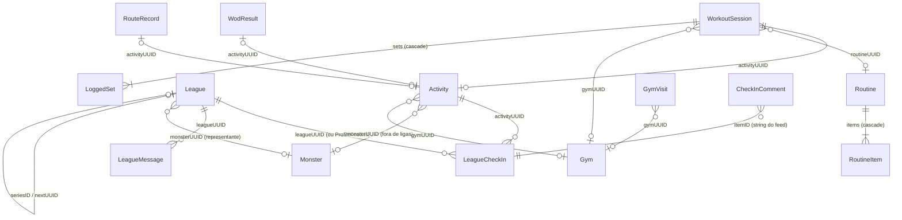

# Arquitetura do GymBros

Documento técnico do app iOS **GymBros** (projeto `GymMonsters`). SwiftUI + SwiftData, iOS 17 (`IPHONEOS_DEPLOYMENT_TARGET = 17.0` em `GymMonsters.xcodeproj/project.pbxproj`). Tudo aqui foi conferido no código; os caminhos citados são relativos à raiz do repositório.

## 1. Visão geral

### Alvos

| Alvo | Tipo | Bundle ID | Código |
|---|---|---|---|
| `GymMonsters` | app | `com.alonsoalmeida.gymmonsters` | `GymMonsters/` + `Shared/` |
| `GymMonstersWidget` | app extension (WidgetKit) | `com.alonsoalmeida.gymmonsters.widget` | `GymMonstersWidget/` + `Shared/` |
| `GymMonstersTests` | unit test (`TEST_HOST` = app) | `com.alonsoalmeida.gymmonsters.tests` | `GymMonstersTests/` |

Dependência externa única: o pacote SPM **MuscleMap** (`https://github.com/melihcolpan/MuscleMap.git`), usado no mapa muscular (`GymMonsters/MuscleViews.swift`).

### App Group

`group.com.alonsoalmeida.gymmonsters`, declarado nos dois entitlements (`GymMonsters/GymMonsters.entitlements`, `GymMonstersWidget/GymMonstersWidget.entitlements`) e em `WidgetData.appGroup` (`Shared/WidgetShared.swift`). Ele só carrega um `UserDefaults(suiteName:)` com:

- `widgetData`: JSON de `WidgetData` (nome, forma, XP, humor, sequência, rotina do dia), gravado pelo app em `MainView.publish` (`GymMonsters/App.swift`).
- `petAt` / `pets`: carinhos dados no widget (`PetStore` em `GymMonstersWidget/PetWidget.swift`).

O banco SwiftData **não** está no App Group: o widget nunca lê o banco, só o `WidgetData`.

### Estrutura de pastas

```
GymMonsters/          app (53 arquivos .swift, wger.json, Assets, Info.plist, entitlements)
GymMonstersWidget/    widgets, Live Activities e controles (iOS 18)
Shared/               código compilado nos dois alvos: Theme (cores), WidgetData, Mood, Live Activity e intents
GymMonstersTests/     XCTest rodando dentro do app
tools/                scripts de artes e tools/wger/build.py, que gera wger.json (fora dos alvos)
```

### Papel de cada arquivo

| Arquivo | Papel |
|---|---|
| `GymMonsters/App.swift` | `@main`, `RootView` (onboarding × app), `MainView` (abas, derivação do estado, widget, lembretes, sync do Saúde, cena de evolução) |
| `GymMonsters/DesignSystem.swift` | Design system `GM*`: escala de raios, `gmFont`, botões (`GMFloatingButton`), seções, campos, steppers (`GMCompactStepper`), `GMMonth`/calendário, `GMTabBar`, `gmModal`/`gmSheet`/`gmActions`/`gmPrompt` |
| `GymMonsters/Model.swift` | `@Model Activity`, cores dos atributos, formatação |
| `GymMonsters/Game.swift` | Regras puras: `Attribute`, `ActivityKind`, `Stage`, `MonsterForm`, `Species`, `Snapshot`, `Game`, `SnapshotCache` |
| `GymMonsters/Monsters.swift` | `@Model Monster`, `MainMonster`, `Roster` (XP por bro), lista "Meus bros" |
| `GymMonsters/MonsterSprite.swift`, `EvolutionView.swift`, `DexView.swift` | Pixel art animada, cena de evolução, Dex/conquistas |
| `GymMonsters/Companion.swift` | Frases do bro, 28 conquistas, `Reminders`, `WeeklySummary` (notificações locais) |
| `GymMonsters/HomeView.swift`, `HistoryView.swift`, `LogActivityView.swift`, `ActivityDetail.swift` | Tela do bro, histórico, registrar atividade, detalhe da atividade |
| `GymMonsters/Training.swift` | `@Model Routine`/`RoutineItem`/`WorkoutSession`/`LoggedSet`, `Progression`, `Deload`, modelos de rotina |
| `GymMonsters/TrainView.swift`, `RoutineEditView.swift`, `WorkoutView.swift`, `SwapExercise.swift` | Aba Treino, edição de rotina, treino guiado, troca de exercício |
| `GymMonsters/LiveWorkout.swift` | `AppData.container`, `LiveWorkout` (estado, descanso, Live Activity), `LiveWod`, `WodCounter` |
| `GymMonsters/HeadphoneControl.swift` | "Modo fone": play/pause do fone marca série, fala no fone (AVAudio + AVSpeech) |
| `GymMonsters/Exercises.swift`, `ExerciseMuscles.swift`, `ExerciseInstructions.swift`, `ExerciseExtra.swift`, `CustomExercise.swift` | Biblioteca: 78 originais (instruções PT), 150 extras (42 de CrossFit), músculos, `@Model CustomExercise` |
| `GymMonsters/Wger.swift`, `GymMonsters/wger.json` | Conteúdo do wger (imagens embutidas, vídeos, instruções, autor e licença por item), 34 exercícios novos, `ExercisePhotos`, `WgerVideoView`, `CreditsView` |
| `GymMonsters/ExerciseStatsView.swift`, `WeeklyVolume.swift`, `MuscleViews.swift`, `PR.swift` | Estatísticas por exercício, volume semanal, mapa muscular, `@Model PersonalRecord` e `PRBook` |
| `GymMonsters/Body.swift`, `BodyTrackerView.swift` | `@Model BodyEntry`/`ExerciseNote`, peso/medidas/fotos, calculadora de anilhas |
| `GymMonsters/Wod.swift` | Benchmarks, cronômetros For Time/AMRAP/EMOM/Tabata, `@Model WodResult` |
| `GymMonsters/Leagues.swift` | `@Model League`/`LeagueCheckIn`, `ScoreInput`, `LeagueScoring`, desempate, regra de foto, renovação, participantes simulados, `LeagueBoard` |
| `GymMonsters/LeagueRemote.swift` | Contrato com o servidor das ligas, tipos `Remote*`, `LeagueRemoteStore`, `@Model LeagueMessage`, `MockLeagueBackend` |
| `GymMonsters/LeaguesView.swift`, `LeagueMural.swift`, `CheckInDetail.swift`, `PeriodPicker.swift` | Telas de ligas, mural, detalhe/comentários do check-in (`@Model CheckInComment`), calendário de período |
| `GymMonsters/Friends.swift`, `FriendsLive.swift`, `PublicProfile.swift` | Amigos (`FriendsBackend`, mock), amigos treinando no mapa (simulados), perfil público |
| `GymMonsters/ProfileView.swift`, `ProfileCalendar.swift`, `StoryShare.swift` | Perfil público/privado, calendário de posts, card para stories |
| `GymMonsters/MapScreen.swift`, `Location.swift`, `Route.swift` | Aba Mapa, `@Model Gym`/`GymVisit` + `GymLocation` (CLMonitor), `@Model RouteRecord` + GPS, `PlaceDetector` |
| `GymMonsters/HealthSync.swift` | Importação/exportação de treinos no HealthKit |
| `GymMonsters/Backup.swift` | Backup/restauração JSON (`Backup`, `BackupDocument`) |
| `GymMonsters/Shortcuts.swift` | `AppShortcutsProvider` (Siri/Atalhos/Botão de Ação) |
| `GymMonsters/SettingsView.swift`, `OnboardingView.swift` | Ajustes (Saúde, lembretes, backup), onboarding |
| `Shared/Theme.swift` | `enum Theme`: cores base e semânticas, usadas pelo app e pelo widget |
| `Shared/WidgetShared.swift` | `Mood`, `WidgetData` (App Group) |
| `Shared/WorkoutLive.swift` | `WorkoutAttributes`, `WodAttributes` (ActivityKit) |
| `Shared/WorkoutIntents.swift` | `CompleteSetIntent`, `SkipRestIntent`, `AddRoundIntent`, `WorkoutIntentBridge` |
| `GymMonstersWidget/*.swift` | `GymMonstersWidgets` (bundle), "Status do bro", `PetWidget`, `TodayWorkoutWidget`, Live Activities de treino e WOD, controles iOS 18 |

## 2. Navegação

### Abas

O app não usa `TabView`. `MainView` (`GymMonsters/App.swift`) monta um `ZStack` com cinco páginas e a `GMTabBar` própria por cima. O motivo está comentado no código: o `TabView` empurra a 5ª aba para o menu "Mais". Cada página é criada na primeira visita e continua viva (guarda rolagem e navegação), controlada pelo conjunto `visited`.

| Tag | Aba | Tela raiz |
|---|---|---|
| 0 (centro, sprite do bro) | Bro | `HomeView` |
| 1 | Treino | `TrainView` |
| 2 | Ligas | `LeaguesView` |
| 3 | Mapa (badge = amigos treinando agora) | `MapScreen` |
| 4 | Histórico | `HistoryView` |

`RootView` mostra `OnboardingView` enquanto `@AppStorage("trainerName")` estiver vazio.

### Telas principais e empilhamento

- Push dentro de cada aba: `NavigationStack` + `NavigationLink`/`navigationDestination` (ex.: `TrainView` → `WodListView`, `PRBookView`, `ExerciseStatsList`, `WeeklyVolumeView`, `MuscleMapView`, `BodyTrackerView`; `LeaguesView` → `LeagueDetailView`).
- O avatar do perfil fica no cabeçalho `GMScreen` (`ProfileAvatarButton` em `GymMonsters/DesignSystem.swift`) e abre `ProfileView` como modal (`GymMonsters/ProfileView.swift`).
- A tela Bros (Meus bros, Dex, Conquistas) abre por `gmModal` a partir da tela do bro (`MainView`); a cena de evolução também é `gmModal`, numa fila.
- Entrada externa: `onOpenURL` trata `gymbros://start` (widget "Treino do dia") e a notificação `NotificationRouter.startWorkout` (chegada na academia) troca para a aba Treino e começa o treino do dia.

### Modais (todos em `GymMonsters/DesignSystem.swift`)

| Modificador | Implementação | Uso |
|---|---|---|
| `gmModal(isPresented:)` / `gmModal(item:)` | `fullScreenCover` com tema escuro e `tint` | Telas inteiras: registrar atividade, ajustes, amigos, criar/entrar em liga, treino em andamento, corrida com GPS (46 usos) |
| `gmSheet(isPresented:)` | `fullScreenCover` transparente + `GMOverlayHost` (fundo escuro, arrastar para fechar) + `GMSheetCard` | Bottom sheet de conteúdo livre (17 usos) |
| `gmActions(isPresented:title:message:actions:)` | Mesmo host, lista de `GMAction` + "Cancelar" | Substitui `Menu` e `confirmationDialog` (28 usos) |
| `gmPrompt(...)` | Host centralizado com `GMTextField` | Substitui `alert` com campo de texto |

Detalhes que importam: o host roda a ação **depois** de fechar a camada (`close(then:)`), para permitir abrir outra tela em seguida; e `.transaction(value:)` desliga a animação do sistema só na abertura daquela camada. Não há `.sheet`, `.alert` nem `confirmationDialog` no app, e `fullScreenCover` só aparece dentro de `DesignSystem.swift`.

## 3. Modelo de dados (SwiftData)

Container único em `AppData.container` (`GymMonsters/LiveWorkout.swift`), criado com o schema explícito `AppData.schema`, com recuperação quando não abre e file protection (ver dívida 2), registrado na cena por `.modelContainer(AppData.container)` (`GymMonsters/App.swift`) e acessado diretamente por código fora de views (`GymLocation`, `PRBook`, intents do Live Activity). São 18 modelos:

| Modelo | Arquivo | Campos principais |
|---|---|---|
| `Activity` | `GymMonsters/Model.swift` | `uuid`, `kindRaw`, `date`, `minutes`, `effort`, `note`, `healthUUID`, `healthWrittenUUID`, `source`, `monsterUUID`, `gymUUID`, `meters`, `kcal` |
| `Monster` | `GymMonsters/Monsters.swift` | `uuid`, `name`, `createdAt`, `isStarter`, `lastFormID`, `speciesID` |
| `Routine` | `GymMonsters/Training.swift` | `uuid`, `name`, `weekdaysRaw`, `order`, `items` (cascade) |
| `RoutineItem` | `GymMonsters/Training.swift` | `exerciseID`, `sets`, `reps`, `rest`, `order`, `supersetNext`, `routine` |
| `WorkoutSession` | `GymMonsters/Training.swift` | `uuid`, `title`, `routineUUID`, `start`, `end` (nil = em andamento), `effort`, `activityUUID`, `currentExerciseID`, `restEnd`, `gymUUID`, `supersetRaw`, `isDeload`, `sets` (cascade) |
| `LoggedSet` | `GymMonsters/Training.swift` | `exerciseID`, `exerciseOrder`, `index`, `weight`, `reps`, `targetReps`, `done`, `warmup`, `session` |
| `CustomExercise` | `GymMonsters/CustomExercise.swift` | `uuid`, `name`, `groupRaw`, `equipment`, `typeRaw` (id = `custom-<uuid>`) |
| `PersonalRecord` | `GymMonsters/PR.swift` | `uuid`, `exerciseID`, `weight`, `reps`, `date` |
| `ExerciseNote` | `GymMonsters/Body.swift` | `exerciseID`, `text`, `updated` |
| `BodyEntry` | `GymMonsters/Body.swift` | `uuid`, `date`, `weight`, medidas, `healthUUID`, `photoFront`/`photoSide` (external storage) |
| `WodResult` | `GymMonsters/Wod.swift` | `uuid`, `wodID`, `date`, `seconds`/`rounds`/`reps`, `rx`, `capped`, `activityUUID` |
| `RouteRecord` | `GymMonsters/Route.swift` | `uuid`, `activityUUID`, `kindRaw`, `start`, `seconds`, `meters`, `points` (Doubles lat/lon empacotados, external storage) |
| `Gym` | `GymMonsters/Location.swift` | `uuid`, `name`, `latitude`, `longitude`, `radius`, `createdAt` |
| `GymVisit` | `GymMonsters/Location.swift` | `uuid`, `gymUUID`, `gymName`, `start`, `end` |
| `League` | `GymMonsters/Leagues.swift` | `uuid`, `name`, `code`, `scoringRaw`, `start`, `end`, `isMock`, `monsterUUID`, `autoRenew`, `season`, `seriesID`, `nextUUID`, `weightsRaw`, `tieBreakRaw`, `photoRuleRaw`, `teamsRaw`, `myTeamID`, `cover` |
| `LeagueCheckIn` | `GymMonsters/Leagues.swift` | `uuid`, `leagueUUID`, `activityUUID`, `title`, `note`, `date`, `photo`, `place`, `hadPhoto` |
| `LeagueMessage` | `GymMonsters/LeagueRemote.swift` | `uuid`, `leagueUUID`, `text`, `date`, `syncedAt` |
| `CheckInComment` | `GymMonsters/CheckInDetail.swift` | `uuid`, `itemID` (id do `FeedItem`), `text`, `date`, `authorID` ("me" ou `memberID`), `authorName` |

### Relações

Só há duas relações SwiftData de verdade (`@Relationship(deleteRule: .cascade)`): `Routine.items ↔ RoutineItem.routine` e `WorkoutSession.sets ↔ LoggedSet.session`. Todo o resto é **referência por UUID** (ou por string), sem integridade garantida pelo banco; quem lê precisa tolerar alvo inexistente (ex.: `Roster` ignora `monsterUUID` desconhecido, `LeagueBoard.feed` descarta check-in sem atividade). Enums são guardados como `*Raw: String` e listas como strings separadas por vírgula ou quebra de linha (`weekdaysRaw`, `supersetRaw`, `weightsRaw`, `teamsRaw`).

Casos especiais:

- **Perfil como destino de check-in**: `LeagueCheckIn.leagueUUID == ProfileFeed.id` (UUID fixo `…0000AA`, `GymMonsters/Leagues.swift`) significa "postado no perfil".
- `LeagueCheckIn` guarda `title`/`date`, mas tipo, minutos e esforço vêm da `Activity` apontada.
- `exerciseID` aponta para a biblioteca em memória (`Exercise`), não para o banco, exceto `custom-<uuid>`.



### Estado fora do banco

`UserDefaults.standard` guarda ajustes e alguns estados de domínio: `trainerName`, `mainMonster` (`MainMonster.id`), `discovered`, `achievementsSeen`, lembretes, chaves do Saúde (`healthEnabled`, `healthLastSync`, `healthIgnored`, `healthWrite`…), estado do `GymLocation` (`gymInsideID`, `gymArrival`, `gymNotifyArrival`, `gymAutoFinish`), código de amigo (`friendCode`), a oferta pendente de atualizar rotina (`pendingRoutineUpdate`) e o estado inteiro do servidor de amigos simulado (`mockFriends`).

## 4. Regras derivadas

### O bro é função do histórico (`Game.snapshot`)

`GymMonsters/Game.swift` declara: "nada fica guardado além do log". `Game.snapshot([ActivityRecord])` percorre as atividades em ordem e calcula:

- **XP por atividade**: `minutos (máx. 240) × MET do tipo × (0,6 + 0,08 × esforço) / 10` (`Game.xp`).
- **Limite diário**: até 150 XP brutos no dia conta inteiro; o excedente vale 1/3; ganho máximo de 300 XP/dia (`dailySoftCap`, `dailyHardCap`).
- **Atributos**: cada `ActivityKind` tem pesos em Força/Resistência/Agilidade/Técnica; o XP ganho é distribuído em `stageAttributes` e `lifetimeAttributes`.
- **Estágios**: Ovo 0 → Bebê 60 → Rookie 300 → Champion 1200 → Ultimate 3600. Em Champion e Ultimate, `Game.branch` escolhe o galho pelo atributo dominante desde a última evolução; vira híbrido se o 2º tiver ≥ 90% do 1º (`hybridRatio`).
- `hatchAttributes` (atributos ao chocar), `evolutions`, `xpByActivity`, `streak`, `bestStreak`, `todayXP`, nível `√(XP/5) + 1`.

Consequência: editar ou apagar uma `Activity` recalcula tudo. As telas usam `Game.cachedSnapshot`, que guarda até 24 resultados com chave = registros + dia + calendário. O único estado persistido do bro é o que não pode ser recalculado sem mudar quem já nasceu: `Monster.speciesID` (fixada na chocagem, em `MainView.check`, e apagada se o bro voltar a ser ovo) e `Monster.lastFormID` (para tocar a cena de evolução uma vez; várias evoluções entram numa fila).

### Roster: para qual bro vai cada atividade

`Roster` (`GymMonsters/Monsters.swift`) é construído a cada render de `MainView` a partir de monstros, atividades, check-ins e ligas:

1. Atividade com check-in em ligas → XP para o `League.monsterUUID` válido de cada uma dessas ligas (pode ir para mais de um bro). A regra está em `Roster.owners`, usada também pelas prévias de XP.
2. Sem check-in em liga → para `Activity.monsterUUID` (o principal no momento do registro) ou, se não existir mais, para o inicial.
3. Um `Game.snapshot` por monstro; a espécie vem de `speciesID` ou de `Species.hatch(attributes:seed:)`; formas híbridas sem arte caem na forma simples (`single`).

`MainView.derive()` mistura: snapshot do bro principal (XP/forma) com streak e humor do **jogador** (todas as atividades); o XP por atividade mostrado nas listas é o `Roster.xpByActivity` (o maior entre os donos).

### Ligas: `ScoreInput`, `LeagueScoring`, `LeagueBoard`

- `ScoreInput` (`GymMonsters/Leagues.swift`) é o mínimo para pontuar: tipo, minutos, esforço, metros, kcal. Vem de `Activity.scoreInput` (seus check-ins) ou `RemoteCheckIn.input` (dos outros).
- `LeagueScoring.score`:
  - `pontos`: `Game.xp` da atividade; com pesos por atributo (0× a 3×), o XP é multiplicado por `Σ peso_do_tipo × peso_da_liga`.
  - `treinos`: 1 por check-in. `minutos`: até 240. `distancia`: metros. `calorias`: `kcal` do Saúde ou `HealthSync.activeKcal` com peso de referência 70 kg.
- `PhotoRule.apply`: sem foto vale igual, metade ou zero. `League.score` aplica as duas coisas.
- `LeagueBoard` (`@MainActor`):
  - `feed`: junta seus `LeagueCheckIn` com os `RemoteCheckIn` da liga, já pontuados.
  - `ranking` (também aceita `remote:`): todos os participantes aparecem (inclusive zerados); filtra pela janela (`RankWindow`: liga, semana, mês) e pelo período da liga; ordena por placar e depois pelo desempate (`LeagueTieBreak`: quem chegou antes ao placar, maior sequência de dias, mais check-ins) e marca `tied`.
  - `teams`: placar do time = soma do placar dos membros; o bro do time sai da **média** de XP dos membros e do atributo somado (`teamBro`).
- `LeagueRenewal.run` (chamado quando o app fica ativo) cria a próxima temporada das ligas com `autoRenew`, pulando temporadas perdidas com o app fechado.

## 5. Camada "servidor" simulada

Não existe rede no app. Ligas e amigos já seguem um contrato de servidor, implementado por mocks determinísticos.

### Ligas (`GymMonsters/LeagueRemote.swift`)

- `LeagueBackend`: `fetch(LeagueKey, now:) -> RemoteLeague` e `send([OutgoingMessage], to:) -> [UUID]` (ids aceitos).
- `LeagueKey`: o que o servidor precisa saber da liga (`uuid`, `code`, período, `isMock`, nomes dos times).
- Tipos de resposta (`Codable`, formato da API): `RemoteMember`, `RemoteCheckIn` (com `hasPhoto` e `photoURL`), `RemoteTeam`, `RemoteMessage`, agregados em `RemoteLeague`.
- `LeagueRemoteStore` (`@MainActor @Observable`, singleton): `backend` trocável, `cache` por `LeagueKey`, `refresh(_:)` (chamado em `LeaguesView` e `LeagueDetailView`) e `flush(context:)`. Sem cache e com o mock, `remote(_:)` calcula a resposta na hora para não piscar vazio.
- `MockLeagueBackend`: só a liga com `isMock` tem gente — os 8 `FakeMember` (`GymMonsters/Leagues.swift`), check-ins gerados por dia com `SeededRandom` (hash FNV + LCG, estável entre execuções) e recados do mural. Ligas criadas pelo usuário só recebem os times. `send` aceita tudo.
- **Caixa de saída**: seus recados são `@Model LeagueMessage`; `syncedAt == nil` = pendente. `LeagueMuralView` grava o recado e chama `flush`, que agrupa pendentes por liga, envia e marca `syncedAt` nos aceitos.

### Amigos (`GymMonsters/Friends.swift`)

- `FriendsBackend`: `fetch`, `add(code:)`, `add(id:)`, `accept`, `decline`, `remove`, `profile(id) -> PublicProfile`.
- Tipos: `RemoteFriend` (id, nome, `formID`, código), `FriendsState` (amigos + pedidos recebidos), `PublicProfile` (`GymMonsters/PublicProfile.swift`: bro, stats, conquistas e posts como `[RemoteCheckIn]`; partes escondidas chegam `nil`).
- `FriendsStore` (`@MainActor @Observable`): cache de estado e perfis, `myCode` (gerado localmente uma vez), `suggestions(from:)` (participantes das suas ligas em andamento que ainda não são amigos).
- `MockFriendsBackend`: diretório = amigos do mapa (`FriendsLive.simulated`) + `FakeMember` + "Mari"; estado persistido em `UserDefaults("mockFriends")`; pedido aceito na hora; perfis e posts de 90 dias gerados com `SeededRandom`.
- `FriendsLive` (`GymMonsters/FriendsLive.swift`) mostra no mapa só os simulados que ainda estão em `FriendsStore.friendIDs`.

### Fluxo atual

```mermaid
sequenceDiagram
    participant UI as LeagueDetailView / LeagueMuralView
    participant DB as SwiftData
    participant Store as LeagueRemoteStore
    participant BE as LeagueBackend (MockLeagueBackend)

    UI->>Store: refresh([league])
    Store->>BE: fetch(league.key, now)
    BE-->>Store: RemoteLeague (members, checkIns, teams, messages)
    Store-->>UI: cache[key] (Observable)
    UI->>DB: LeagueCheckIn (meus) + Activity
    UI->>UI: LeagueBoard.feed / ranking / teams

    UI->>DB: insert LeagueMessage(syncedAt = nil)
    UI->>Store: flush(context)
    Store->>DB: fetch LeagueMessage where syncedAt == nil
    Store->>BE: send([OutgoingMessage], to: key)
    BE-->>Store: [UUID] aceitos
    Store->>DB: syncedAt = now; save()

    Note over UI,BE: Check-ins próprios, ligas criadas, comentários e<br/>código de amigo nunca saem do aparelho
```

### O que falta para ligar um servidor real

O caminho previsto no código é implementar `LeagueBackend`/`FriendsBackend` com HTTP e trocar `LeagueRemoteStore.shared.backend` e `FriendsStore.shared.backend`. O que ainda não tem contrato:

1. **Envio dos próprios check-ins**: `LeagueBackend` não tem operação para isso; `LeagueCheckIn` não tem `syncedAt` nem upload de foto (o `RemoteCheckIn.photoURL` só existe na leitura).
2. **Criar e entrar em liga**: `CreateLeagueView` gera o código localmente (`League.newCode()`); `JoinLeagueView` só aceita `AMIGOS` e responde "Convites entre pessoas chegam quando o app tiver servidor".
3. **Identidade**: não há conta nem id de usuário; você é sempre `memberID == "me"` no feed. O `friendCode` é gerado e guardado só no aparelho.
4. **Perfil próprio, times e comentários**: `PublicProfile` do usuário é montado localmente; a escolha de time (`League.myTeamID`) e os `CheckInComment` ficam no aparelho.
5. **Amigos treinando ao vivo**: `FriendsLive` é inteiramente simulado, sem contrato.
6. **Amigos reais**: o estado inicial já depende do backend (`FriendsStore.initialState`: mock carrega `mockFriends`, outro começa vazio), mas não há busca de pessoas reais.

## 6. Integrações do sistema

### HealthKit (`GymMonsters/HealthSync.swift`)

- **Importação** (`sync`, ao app ficar ativo em `MainView.syncHealth`): treinos desde `lastSync − 2 dias` (na primeira vez, 14 dias), mínimo 5 min. Pula ids já conhecidos (`healthUUID`, `healthWrittenUUID`, ignorados), treinos gravados pelo próprio app (bundle id) e treinos com mais de 50% de sobreposição com algo já registrado. Tipo via `kind(for:)`, esforço estimado por kcal ativas × esperado, distância e kcal gravadas na `Activity`.
- **Exportação** (`exportPending`, opcional `healthWrite`): grava como `HKWorkout` + `activeEnergyBurned` as atividades registradas no app desde que a opção foi ligada; `deleteWritten` remove do Saúde ao apagar/editar.
- **Peso corporal**: `importBodyMass` (`GymMonsters/Body.swift`) traz 2 anos de `bodyMass` para `BodyEntry`.

### Localização (`GymMonsters/Location.swift`)

- `GymLocation` (singleton `@MainActor`) usa `CLMonitor("gymbros")` com `CircularGeographicCondition` para até 20 lugares (os visitados mais recentemente). `startMonitoring()` roda no `init` do app, inclusive quando o iOS acorda o app em segundo plano.
- Entrada: cria `GymVisit`, guarda `insideID` e, se não há treino rodando, notifica com categoria `ARRIVAL` (ação "Começar treino") e marca `pendingArrival` (oferta ao abrir o app por até 1 h).
- Saída: fecha a visita e, com `autoFinish`, encerra o treino daquele lugar se tiver ≥ 10 min (`LiveWorkout.autoFinish`).
- `suggestions(near:)` busca academias reais via `MKLocalPointsOfInterestRequest`; `PlaceDetector` (`GymMonsters/Route.swift`) decide o lugar ao começar musculação/WOD.
- Migração: `migrateSingleGym` converte a academia única guardada em `UserDefaults("gym")` por versões antigas.

### Rotas GPS (`GymMonsters/Route.swift`)

`RouteTracker` (`@Observable`) com `allowsBackgroundLocationUpdates` (modo de fundo `location` no `Info.plist`), `distanceFilter` 5 m, descarta leituras com precisão ≥ 30 m e saltos acima de 15 m/s, suporta pausa. O percurso vira `RouteRecord` ligado à `Activity` por `activityUUID`.

### Notificações

- Locais apenas (`UNUserNotificationCenter`); `NotificationRouter` é o delegate e mostra banner com o app aberto.
- Fim do descanso (`LiveWorkout.startRest`, id `rest`), chegada/saída da academia, `Reminders.schedule` (próximos 7 dias, só em dias sem treino) e `WeeklySummary.schedule` (domingo à noite, com posição nas ligas via `LeagueBoard`) em `GymMonsters/Companion.swift`. São reagendadas a cada mudança relevante em `MainView.publish`.

### Live Activity, widgets e controles

- `Shared/WorkoutLive.swift`: `WorkoutAttributes` (exercício, série, descanso, sprite) e `WodAttributes`.
- `LiveWorkout.show/refresh/endAll` e `LiveWod.show/end` (`GymMonsters/LiveWorkout.swift`) pedem a atividade com `pushType: nil` (só atualização local).
- Botões do Live Activity e do Control Center são `LiveActivityIntent` (`Shared/WorkoutIntents.swift`) que rodam no processo do app; o app registra as closures em `WorkoutIntentBridge` no `init` (`GymMonsters/App.swift`). `addRound` é registrado só enquanto o cronômetro do WOD está na tela (`GymMonsters/Wod.swift`).
- `GymMonstersWidget/GymMonstersWidget.swift` (`GymMonstersWidgets`): `PetWidget` (pose por minuto, carinho via `PetIntent`), "Status do bro", `TodayWorkoutWidget` (`gymbros://start`), `WorkoutLiveActivity`, `WodLiveActivity` e, no iOS 18, `CompleteSetControl`/`SkipRestControl`.
- O app chama `WidgetCenter.shared.reloadAllTimelines()` (`WidgetBridge.reload`) depois de gravar o `WidgetData`.

### Atalhos (`GymMonsters/Shortcuts.swift`)

`GymBrosShortcuts` expõe "Série feita" e "Pular descanso" (os mesmos intents do Live Activity) para Siri, app Atalhos e Botão de Ação.

### Backup JSON (`GymMonsters/Backup.swift`)

- `Backup.make` serializa DTOs de todos os modelos (inclusive `LeagueMessage`), um subconjunto de ajustes (`settingKeys`, agora com `autoWarmup`, `restNotification` e `barWeight`) em texto e com tipo (`typedSettings`), a foto do perfil e a capa reduzida da temporada atual de cada liga; `version = 1`, campos novos opcionais para ler backups antigos.
- `restore` apaga todos os modelos do banco e reinsere; check-ins voltam sem imagem, mas com `hadPhoto`. Depois, Ajustes reinicia o monitoramento dos lugares. Exportação/importação por `fileExporter`/`fileImporter` em `GymMonsters/SettingsView.swift`.
- Não entram no backup: imagens dos check-ins, fotos de progresso do `BodyEntry`, metas, lembretes, preferências do Saúde e de lugares, visibilidade do perfil e o estado do servidor de amigos simulado.

## 7. Testes

- **Como rodam**: o alvo `GymMonstersTests` tem `TEST_HOST` apontando para `GymMonsters.app`, então os testes rodam **dentro do app instalado** no aparelho. `GymTestCase` (`GymMonstersTests/TestSupport.swift`) salva e restaura chaves de `UserDefaults` (`exerciseGoals`, `deloadUntil`, `deloadSnooze` e `barCountsBar`, chave que o app não usa mais) e `PRBook.manual`, e oferece `memoryContext()` com um `ModelContainer` em memória (`Activity`, `WorkoutSession`, `LoggedSet`, `League`, `LeagueCheckIn`) separado do banco real.
- **Cobertura** (66 testes, por `func test`):

| Arquivo | Testes | O que cobre |
|---|---|---|
| `GymMonstersTests/GameTests.swift` | 9 | Fórmula de XP, teto diário, chocagem, galho de Força, híbrido só com quase empate, sequência até ontem, Coelho em treino equilibrado, `Roster.owners`, cache de snapshot |
| `GymMonstersTests/ProgressionTests.swift` | 22 | Sugestão de carga, deload após 3 falhas, metas de reps, PR manual, aquecimento, 1RM Epley, recordes, incremento só com barra, formatação, calculadora, melhor marca, esforço do encerramento automático, `Deload.apply`, nome do personalizado, ordem da troca |
| `GymMonstersTests/LeagueTests.swift` | 17 | Pesos por atributo, modos de pontuação, janela do mês, três desempates, regra de foto e "Vale ½", check-in restaurado, ids de times (estáveis e legados), `ranking` com `remote` injetado, mesmo bro em todo lugar, estabilidade do `MockLeagueBackend`, placar do time |
| `GymMonstersTests/WorkoutTests.swift` | 16 | Superset, aquecimento fora do log e dos totais, deload por semanas, ranking com período, período pelo calendário, textos de início, renovação de temporada, troca em superset, aviso "Dez segundos", CAP |
| `GymMonstersTests/NamesAndBarTests.swift` | 2 | Nomes únicos das formas, carga com barra pelo tipo do treino |

- **Sem cobertura**: `Backup` (ida e volta), recuperação do banco, `HealthSync` (sobreposição, estimativa de esforço), `LeagueRemoteStore.flush`, `FriendsStore`, `GymLocation`, `RouteTracker` e UI.

## 8. Decisões e dívidas técnicas observadas

### Decisões

- **Estado derivado**: o histórico de `Activity` é a fonte da verdade; XP, forma, humor, conquistas e rankings são recalculados (`GymMonsters/Game.swift`, `GymMonsters/Monsters.swift`, `GymMonsters/Leagues.swift`).
- **Design system próprio** substituindo controles nativos, inclusive abas e modais (`GymMonsters/DesignSystem.swift`).
- **Referências por UUID** em vez de `@Relationship`, o que facilita backup e o futuro formato de API, mas sem integridade referencial.
- **Contrato de servidor antes do servidor**: protocolos + mocks determinísticos (`SeededRandom`) permitem trocar a implementação sem mexer nas telas.
- **Tudo local**: sem conta e sem rede; o widget só enxerga o `WidgetData` do App Group.

### Dívidas

1. **Custo de render (reduzido)**: `MainView.body` chama `derive()` a cada avaliação e monta o `Roster`; os snapshots vêm de `Game.cachedSnapshot`, mas a chave do cache é linear no histórico. `LeagueBoard.feed/ranking` e `teams` (que roda `Game.snapshot` por membro) não têm cache.
2. **Migrações sem versão** (`GymMonsters/LiveWorkout.swift`): o banco não derruba mais o app (se não abrir, é movido para `default-erro-<timestamp>.store`, o app abre com um banco novo ou, no limite, em memória, e avisa); o banco tem file protection `completeUntilFirstUserAuthentication`. Mas não há `VersionedSchema` nem `SchemaMigrationPlan`, então uma migração que falhe ainda começa do zero; migrações de dados são à mão (`Roster.ensureStarter`, `GymLocation.migrateSingleGym`, ids legados de times).
3. **Singletons e estado global**: `LeagueRemoteStore.shared`, `FriendsStore.shared`, `GymLocation.shared`, `PRBook.manual` (`nonisolated(unsafe) static var`, `GymMonsters/PR.swift`) e acesso direto a `AppData.container.mainContext` fora das views.
4. ~~`LeagueBoard.ranking` ignora o `remote` injetado~~: corrigido, `ranking` aceita `remote:` como `feed` e `teams` (`testRankingUsesInjectedRemote`).
5. **Pontos da liga sem teto diário**: o modo `pontos` usa `Game.xp` bruto, não o XP com limite diário do bro; o mesmo vale para a pontuação dos posts no perfil (`GymMonsters/ProfileView.swift`).
6. **Erros engolidos**: quase todo `save`/`fetch` usa `try?`; falhas de `backend.fetch`/`send` são silenciosas (a mensagem fica pendente sem aviso).
7. **Exclusões em cascata manuais**: como as relações são por UUID, a limpeza fica no código: `deleteActivity` (`GymMonsters/ActivityDetail.swift`) apaga `WorkoutSession`, `LeagueCheckIn` com seus `CheckInComment`, `RouteRecord` e `WodResult`; sair da liga apaga check-ins, comentários e recados; "Recomeçar jornada" faz o mesmo para todas as atividades.
8. **Backup incompleto**: imagens de check-in e fotos de progresso não entram; ajustes fora de `settingKeys` (metas, lembretes, Saúde, lugares, visibilidade, `friendCode`) não são restaurados.
9. **Simulação espalhada**: dados fictícios em três lugares (`FakeMember` em `GymMonsters/Leagues.swift`, `FriendsLive.simulated`, diretório do `MockFriendsBackend`), mas a forma do bro de cada pessoa vem só de `FakeMember`.

### Inconsistências encontradas

As quatro da primeira versão foram resolvidas: o cabeçalho de `Leagues.swift` descreve a regra do `Roster`; o README do projeto menciona a gravação no Saúde; a mesma pessoa simulada tem o mesmo bro em liga, mapa e amigos; e apagar a atividade de um WOD apaga o `WodResult`. Restam pequenas sobras: `GymTestCase` ainda guarda a chave `barCountsBar`, que o app não usa, e o `URLCache` de 300 MB configurado em `App.init` não tem mais imagem remota para guardar.
