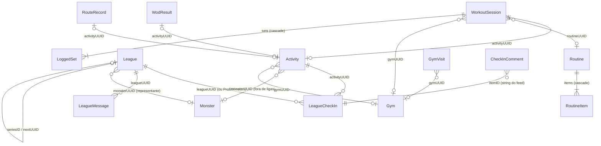

# Arquitetura do GymBros

Documento técnico do app iOS **GymBros** (projeto `GymBros`). SwiftUI + SwiftData, iOS 17 (`IPHONEOS_DEPLOYMENT_TARGET = 17.0` em `GymBros.xcodeproj/project.pbxproj`). Tudo aqui foi conferido no código; os caminhos citados são relativos à raiz do repositório.

## 1. Visão geral

### Alvos

| Alvo | Tipo | Bundle ID | Código |
|---|---|---|---|
| `GymBros` | app | `com.alonsoalmeida.gymbros` | `GymBros/` + `Shared/` |
| `GymBrosWidget` | app extension (WidgetKit) | `com.alonsoalmeida.gymbros.widget` | `GymBrosWidget/` + `Shared/` |
| `GymBrosTests` | unit test (`TEST_HOST` = app) | `com.alonsoalmeida.gymbros.tests` | `GymBrosTests/` |

Dependência externa única: o pacote SPM **MuscleMap** (`https://github.com/melihcolpan/MuscleMap.git`, fixado em 1.9.0 com `exactVersion`), usado no mapa muscular (`GymBros/Exercises/MuscleViews.swift`).

### App Group

`group.com.alonsoalmeida.gymbros`, declarado nos dois entitlements (`GymBros/Resources/GymBros.entitlements`, `GymBrosWidget/GymBrosWidget.entitlements`) e em `WidgetData.appGroup` (`Shared/WidgetShared.swift`). No container do grupo ficam:

- `UserDefaults(suiteName:)` com `widgetData`: JSON de `WidgetData` (nome, forma, XP, humor, sequência, rotina do dia), gravado pelo app em `MainView.publish` (`GymBros/App/App.swift`).
- No mesmo `UserDefaults`, `petAt` / `pets`: carinhos dados no widget (`PetStore` em `GymBrosWidget/PetWidget.swift`).
- O banco SwiftData: como o app tem a entitlement de App Group, o `ModelConfiguration` padrão de `AppData.container` cria o `default.store` no container do grupo (`Library/Application Support/default.store`), e não no sandbox do app (conferido no aparelho).

O widget não abre o banco: lê só o `WidgetData`.

### Estrutura de pastas

O app usa pastas sincronizadas do Xcode: todo arquivo dentro de `GymBros/` entra no alvo sem editar o `project.pbxproj`.

```
GymBros/              app (118 arquivos .swift)
  App/        (8)     @main, RootView/MainView, onboarding, ajustes (índice e páginas), termos, política de privacidade, SocialGate, atalhos
  Models/     (11)    todos os @Model do SwiftData (um arquivo por domínio) e Schema.swift (SchemaV1, SchemaV2, AppMigrationPlan, AppData)
  DesignSystem/ (17)  componentes GM* (inclusive as peças de ajustes), escala de raios, gmFont, PeriodPicker
  Bros/       (10)    regras do jogo, divisão dos atributos, chocagem, Roster, tela do bro, sprites, BroBook e ficha do BroBook, evolução, frases e lembretes
  Activities/ (6)     registrar atividade (tipo exato do treino, treino feito sem "Começar"), histórico, detalhe e card para stories
  Train/      (14)    aba Treino, rotinas, treino guiado, progressão, PRs, WOD (importação, movimentos, linha do tempo), Live Activity, modo fone
  Exercises/  (7)     biblioteca de exercícios, conteúdo do wger, mapa muscular, exercício personalizado
  Leagues/    (7)     regras das ligas, rodada suíça, contrato com o servidor, telas, mural e comentários
  Duels/      (3)     X1: regras, DuelStore, contrato e mock, telas
  Friends/    (5)     amigos, amigos ao vivo e treino ao vivo (LiveShare), perfil público, aba Mapa
  Inbox/      (5)     caixa de entrada: mensagens diretas, notificações sociais, preferências, mock
  Music/      (1)     "Ouvindo agora" (Apple Music; Spotify preparado)
  Moderation/ (4)     denunciar e bloquear (contrato, ModerationStore, mock, telas) e filtro de palavras
  Access/     (3)     RBAC: roles, permissões, matriz, AccessStore, fonte das roles, ações administrativas, contas de teste
  Onboarding/ (4)     tutorial de primeira utilização (roteiro, coordenador, alvos, vinheta)
  Profile/    (5)     perfil, calendário de posts, perfil físico, peso/medidas, calculadora de anilhas
  Services/   (8)     conta, dados da conta, conta de demonstração, backend (mock/CloudKit), backup, HealthKit, lugares de treino, rotas GPS
  Resources/          Assets.xcassets, wger.json, Info.plist, GymBros.entitlements, PrivacyInfo.xcprivacy
GymBrosWidget/        widgets, Live Activities e controles (iOS 18) (6 arquivos .swift)
Shared/               código compilado nos dois alvos: Theme (cores), WidgetData, Mood, Live Activity e intents (4 arquivos .swift)
GymBrosTests/         XCTest rodando dentro do app (32 arquivos .swift: 31 de testes e TestSupport.swift)
tools/                scripts de artes e tools/wger/build.py, que gera GymBros/Resources/wger.json (fora dos alvos)
```

### Papel de cada arquivo

| Arquivo | Papel |
|---|---|
| `GymBros/App/App.swift` | `@main`, `RootView` (login obrigatório → onboarding → app), `MainView` (abas, derivação do estado, widget, lembretes, sync do Saúde, cena de evolução) |
| `GymBros/App/OnboardingView.swift`, `GymBros/App/SettingsView.swift` | Onboarding (nome e aceite dos termos); índice dos Ajustes |
| `GymBros/App/SettingsPages.swift` | Páginas dos Ajustes empurradas pelo índice: perfil e bro, notificações (tópicos sociais), treino, música, Apple Saúde, backup, conta, privacidade, "Como funciona" e diagnóstico |
| `GymBros/App/PrivacyPolicyView.swift` | `PrivacyPolicy` (texto) e `PrivacyPolicyView` |
| `GymBros/App/Shortcuts.swift` | `AppShortcutsProvider` (Siri/Atalhos/Botão de Ação) |
| `GymBros/Models/Schema.swift` | `SchemaV1` (18 modelos, com a `League` da V1 congelada em `SchemaV1.League`), `SchemaV2` (atual: `League.swissRaw`), `AppMigrationPlan` (V1 → V2 leve), `AppData` (`container`, `recoveredCopy`, file protection, `setAside`) |
| `GymBros/Models/Activity.swift` | `@Model Activity`, cores dos atributos, `effortLabel`, `durationText` |
| `GymBros/Models/Monster.swift` | `@Model Monster` (`displayName`) |
| `GymBros/Models/Training.swift` | `@Model Routine`/`RoutineItem`/`WorkoutSession`/`LoggedSet`, com superset, totais, troca de exercício e comparação com a rotina de origem (`routineChanges`, `apply(to:context:)`) |
| `GymBros/Models/CustomExercise.swift` | `@Model CustomExercise` (`exerciseID`, `exercise`) |
| `GymBros/Models/PersonalRecord.swift` | `@Model PersonalRecord` |
| `GymBros/Models/Body.swift` | `@Model BodyEntry`/`ExerciseNote`, `Measure` |
| `GymBros/Models/WodResult.swift` | `@Model WodResult` (`text`, `score`) |
| `GymBros/Models/RouteRecord.swift` | `@Model RouteRecord` (pontos empacotados, `coordinates`, `encode`) |
| `GymBros/Models/Gym.swift` | `@Model Gym`/`GymVisit` |
| `GymBros/Models/League.swift` | `@Model League`/`LeagueCheckIn`/`LeagueMessage`/`CheckInComment` |
| `GymBros/DesignSystem/DesignSystem.swift` | Escala de raios (`extension Theme`) e `gmFont` (`GMScaledFont`) |
| `GymBros/DesignSystem/GMButtons.swift` | `GMPress`, `GMButton`, `GMIconButton`, `GMFloatingButton`, `GMTextButton` |
| `GymBros/DesignSystem/GMSurfaces.swift` | `GMCard`, `GMSection`, `GMDivider`, `GMRow`, `GMValueRow`, `GMEmptyState` |
| `GymBros/DesignSystem/GMIndicators.swift` | `GMProgressBar`, `GMBadge`, `GMOnlineDot` |
| `GymBros/DesignSystem/GMChips.swift`, `GymBros/DesignSystem/GMFlow.swift` | `GMChip`, `GMSegmented`, `GMChoiceChips`; layout `GMFlow` |
| `GymBros/DesignSystem/GMToggles.swift` | `GMSwitch`, `GMToggle` |
| `GymBros/DesignSystem/GMFields.swift` | `GMTextField`, `GMSearchField`, `GMLockedRow`, `GMDecimalField` |
| `GymBros/DesignSystem/GMSteppers.swift` | `GMStepper`, `GMCompactStepper`, `GMEffortPicker`, `GMRuler` |
| `GymBros/DesignSystem/GMCalendar.swift` | `GMDateTimePicker`, `GMDateText`, `GMDateField`, `GMTimeField`, `GMMonth`, `GMCalendar`, `GMTimeWheel`, `GMWheel`, `GMDurationWheel` |
| `GymBros/DesignSystem/GMScreen.swift` | `GMHeader`, `GMScreen`, `GMModal`, `gmModal` |
| `GymBros/DesignSystem/GMSheets.swift` | `GMAction`, `GMOverlayHost`, `GMSheetCard`, `gmSheet`/`gmActions`/`gmPrompt` |
| `GymBros/DesignSystem/GMTabBar.swift` | `GMTabItem`, `GMTabBar` |
| `GymBros/DesignSystem/GMSettings.swift` | Peças dos Ajustes: `GMIconTile`, `GMNavRow`, `GMIconToggle`, `GMCountBadge` |
| `GymBros/DesignSystem/GMKeyboard.swift` | `GMKeyboardDismisser`, `gmKeyboardDone` |
| `GymBros/DesignSystem/GMExtensions.swift` | `String.capitalizedFirst`, gesto de voltar sem barra de navegação (`UINavigationController`) |
| `GymBros/DesignSystem/PeriodPicker.swift` | Calendário de período (`GMRangeCalendar`) |
| `GymBros/Bros/Game.swift` | Regras puras: `Attribute`, `ActivityKind`, `Stage`, `MonsterForm`, `Species`, `Snapshot`, `Game`, `SnapshotCache`; `ActivityRecord.split` usa a divisão guardada da atividade ou a tabela da categoria |
| `GymBros/Bros/AttributeSplit.swift` | `AttributeSplit` (divisão do XP entre os atributos pelo tipo exato do Saúde, séries, movimentos e formato do WOD, duração, esforço e ritmo) e `ActivitySplits` (divisão calculada ao salvar, guardada em `UserDefaults("activitySplits")` por id da atividade) |
| `GymBros/Bros/Hatch.swift` | `Hatch`: animal de cada atividade (`ActivityKind` e todos os `HKWorkoutActivityType`) e a fatia mínima de minutos (`majority`) para a atividade principal decidir a espécie |
| `GymBros/Bros/Monsters.swift` | `MainMonster`, `Roster` (XP por bro), "Meus bros" como uma Box (slots e resumo do selecionado), `MonsterChoiceSection`, `representative` |
| `GymBros/Bros/MonsterSprite.swift`, `GymBros/Bros/EvolutionView.swift`, `GymBros/Bros/DexView.swift` | Pixel art animada, cena de evolução, BroBook/conquistas |
| `GymBros/Bros/DexEntryView.swift` | Ficha de uma forma do BroBook (arte, tipos, números, como conseguir, linha evolutiva), aberta por `.sheet` do BroBook e de "Meus bros" |
| `GymBros/Bros/Companion.swift` | Frases do bro, 28 conquistas, `Reminders`, `WeeklySummary` (notificações locais) |
| `GymBros/Bros/HomeView.swift` | Tela do bro, com o cartão do X1 (`DuelHomeCard`) e a entrada da caixa de entrada |
| `GymBros/Activities/HistoryView.swift`, `GymBros/Activities/LogActivityView.swift`, `GymBros/Activities/ActivityDetail.swift` | Histórico, registrar atividade, detalhe da atividade (`deleteActivity`) |
| `GymBros/Activities/StoryShare.swift` | Card para stories |
| `GymBros/Activities/WorkoutTypes.swift` | `WorkoutType` (tipos do Apple Saúde com nome e ícone em português, por seção, com busca), `ActivityTypePicker` (atalhos dos recentes em `@AppStorage("recentWorkoutTypes")`) e `WorkoutTypeList` |
| `GymBros/Activities/ManualWorkout.swift` | Treino feito sem "Começar": `ManualWorkoutDraft` (rotina, exercícios à mão ou WOD), `ManualWorkoutSection` e `WorkoutDoneFlow`; ao salvar grava `WorkoutSession` com as séries ou `WodResult` |
| `GymBros/Train/Progression.swift` | `PendingRoutineUpdate`, `SetLog`/`SessionLog`, `Deload`, `TrainingGoal`, `Suggestion`, `Progression`, modelos de rotina (`RoutineTemplate`) |
| `GymBros/Train/TrainView.swift`, `GymBros/Train/RoutineEditView.swift`, `GymBros/Train/WorkoutView.swift`, `GymBros/Train/SwapExercise.swift` | Aba Treino, edição de rotina, treino guiado, troca de exercício |
| `GymBros/Train/LiveWorkout.swift` | `LiveWorkout` (estado, descanso, Live Activity), `LiveWod`, `WodCounter` |
| `GymBros/Train/HeadphoneControl.swift` | "Modo fone": fala no fone os avisos do descanso (AVSpeech; sessão de áudio ativa só durante a fala) |
| `GymBros/Train/ExerciseStatsView.swift`, `GymBros/Train/WeeklyVolume.swift` | Estatísticas por exercício, volume semanal |
| `GymBros/Train/PR.swift` | `PRBook`, `PRBookView`, `PRSessionView` |
| `GymBros/Train/Wod.swift` | Benchmarks, cronômetros For Time/AMRAP/EMOM/Tabata, `clock`, telas de WOD e de resultado |
| `GymBros/Train/WodImport.swift` | Treino do coach: `PlannedWod` e `WodPlan` (importados em `UserDefaults("plannedWods")`, todos guardados), `WodParser` (texto → formato, blocos com descanso, data do título, movimentos e partes; `tidy` deixa a linha legível), `WodOCR` (Vision, vários prints juntados pela sobreposição em `merge`), `WodAI` (Foundation Models, iOS 26 com Apple Intelligence), `ImportWodView` e `PlannedWodView` |
| `GymBros/Train/WodMovements.swift` | Apelidos → exercícios da biblioteca para as linhas do WOD (inglês/português, plural, siglas, erros de leitura) |
| `GymBros/Train/WodTimeline.swift` | `WodTimelineEntry` (importado com ou sem resultado, ou resultado avulso; feito, hoje, agendado, perdido) e `WodTimelineView` (aberta pela aba Treino e pela lista de WODs) |
| `GymBros/Exercises/Exercises.swift`, `GymBros/Exercises/ExerciseMuscles.swift`, `GymBros/Exercises/ExerciseInstructions.swift`, `GymBros/Exercises/ExerciseExtra.swift` | Biblioteca: 78 originais (instruções PT), 150 extras (42 de CrossFit), músculos |
| `GymBros/Exercises/CustomExerciseForm.swift` | `Exercise.register` dos personalizados e `CustomExerciseForm` |
| `GymBros/Exercises/MuscleViews.swift` | Mapa muscular (MuscleMap) |
| `GymBros/Exercises/Wger.swift`, `GymBros/Resources/wger.json` | Conteúdo do wger (imagens embutidas, vídeos, instruções, autor e licença por item), 34 exercícios novos, `ExercisePhotos`, `WgerVideoView`, `CreditsView` |
| `GymBros/Profile/BodyTrackerView.swift`, `GymBros/Profile/BodyTools.swift` | Peso/medidas/fotos; calculadora de anilhas (`Plates`) e `HealthSync.importBodyMass` |
| `GymBros/Profile/BodyProfile.swift` | Perfil físico opcional (altura, ano de nascimento, `FitnessGoal`, `Experience`) em `UserDefaults`, peso para estimar calorias (`weightForEstimates`), IMC, basal Mifflin-St Jeor e referência de energia, proteína e água (`targets`); `BodyProfileSection` na seção de Metas do perfil |
| `GymBros/Profile/ProfileView.swift`, `GymBros/Profile/ProfileCalendar.swift` | Perfil público/privado (`ProfileAvatarButton`), calendário de posts |
| `GymBros/Leagues/Leagues.swift` | `ScoreInput`, `LeagueScoring`, desempate, regra de foto, `ProfileFeed`, renovação, participantes simulados, `LeagueBoard` (inclusive `swiss`) |
| `GymBros/Leagues/Swiss.swift`, `GymBros/Leagues/SwissRoundSection.swift` | Rodada suíça diária: `SwissCriterion`, `SwissTally`, `SwissMatch`, `SwissRound`, `SwissTable`, `SwissBonus`, `Swiss.table`/`pair`, `League.swissJoinedAt`; seção "seu confronto de hoje" na liga |
| `GymBros/Leagues/LeagueRemote.swift` | Contrato com o servidor das ligas, tipos `Remote*`/`Outgoing*`/`LeagueDraft`, `LeagueRemoteStore` (caixa de saída), `LeagueOutbox`, `MockLeagueBackend` |
| `GymBros/Leagues/LeaguesView.swift`, `GymBros/Leagues/LeagueMural.swift`, `GymBros/Leagues/CheckInDetail.swift` | Telas de ligas, mural, detalhe/comentários do check-in |
| `GymBros/Duels/Duel.swift` | X1 global, sem liga: regras puras (`DuelMetric`, `RemoteDuel`, `DuelPhase`, `DuelRefusal`, `DuelScore`, `Duels`, `DuelRecord`) |
| `GymBros/Duels/DuelStore.swift` | Contrato `DuelBackend`, `DuelStore` (bro que luta por X1 em `UserDefaults("duelMonsters")`), `MockDuelBackend` e o servidor simulado `MockDuelServer` (actor) |
| `GymBros/Duels/DuelViews.swift` | `DuelsView`, placar ao vivo, desafiar (métrica, pessoa, bro), `DuelHistorySection` (perfil), `DuelHomeCard` (tela do bro), `FighterPicker` |
| `GymBros/Friends/Friends.swift`, `GymBros/Friends/FriendsLive.swift`, `GymBros/Friends/PublicProfile.swift` | Amigos (`FriendsBackend`, mock), amigos treinando no mapa (simulados), perfil público |
| `GymBros/Friends/MapScreen.swift` | Aba Mapa |
| `GymBros/Inbox/Inbox.swift` | Caixa de entrada: `DirectMessage` (mensagem, força, convite e resposta), `InboxEvent`, `InboxState`, contrato `InboxBackend`, `InboxStore` (lidos, notificados, reações viram `CheckInComment`, eventos de X1) e `ServerInboxBackend` (modo `.cloudKit`, lança `InboxError.needsServer`) |
| `GymBros/Inbox/InboxMock.swift` | `MockInboxBackend` (`UserDefaults("mockInbox")`): conversas de exemplo, respostas dos amigos simulados, reações nos seus check-ins, aviso de amigo treinando |
| `GymBros/Inbox/InboxView.swift`, `GymBros/Inbox/ConversationView.swift` | Abas Notificações e Mensagens, conversa, convite para treinar junto |
| `GymBros/Inbox/NotificationPrefs.swift` | `NotificationTopic` (7 tópicos, chaves `notify.*`), `NotificationPrefs` (pausa), `NotificationPermission`, `SocialNotifier` (notificações locais com categorias e ações) |
| `GymBros/Moderation/Moderation.swift`, `GymBros/Moderation/ModerationSheets.swift` | Denunciar e bloquear: `ModerationBackend`, `ReportedContent`, `ReportReason`, `ModerationStore` (bloqueados, conteúdo oculto, fila de envio e filtros usados pelas telas), `MockModerationBackend`, o modificador `.moderation(_:)` (menu, motivo, confirmação, "obrigado") e `BlockedUsersView` |
| `GymBros/Services/Auth.swift` | Conta: `AuthBackend`, `AuthUser`, `AuthStore` (sessão no Keychain, exclusão de conta), `Keychain` (gravar, ler e apagar itens do app), `AccountData` (chaves de usuário, cópia dos ajustes e limpeza dos dados da conta no aparelho), `MockAuthBackend` (e-mail/senha e Apple simulados) e `LoginView` (botão oficial da Apple, botão da conta de demonstração no `.mock`) |
| `GymBros/Services/DemoAccount.swift` | Conta de demonstração da revisão da Apple (só no `.mock`): credenciais fixas e `seedIfNeeded` (entra uma vez na liga de exemplo, chamado pela aba Ligas); ver `docs/app-review.md` |
| `GymBros/Services/AccountSync.swift` | Dados vinculados à conta: contrato `AccountDataBackend` (upload/download/delete da cópia no formato do `Backup`), `MockAccountDataBackend` (servidor simulado em arquivo), `ServerAccountDataBackend` (modo `.cloudKit`, lança erro), `AccountSync` (adoção, restauração, upload com debounce, sair e excluir) e `AccountLoadingView` |
| `GymBros/App/SocialGate.swift` | `SocialGate`: mostra `TermsPrompt` no lugar do conteúdo social quando falta aceitar os termos; com o aceite, exige a permissão pedida (`requires:`) e mostra só um indicador enquanto as roles carregam |
| `GymBros/Access/Access.swift` | `AppRole`, `Permission`, `PermissionScope`, `OwnedResource` (`League.isMine`), `RolePolicy.standard` (matriz), `AccessContext`, `AccessError` |
| `GymBros/Access/AccessStore.swift` | `RoleBackend`, `AccessStore` (`can`, `authorize`, `refresh`), `MockRoleBackend`, `AdminBackend`/`TrustedServerRequired`/`AdminActions` (ações de ADMIN, dependem de servidor confiável) |
| `GymBros/Access/DevAccounts.swift` | `DevAccount` e `DevAccountPicker`: contas fixas por role no `.mock`, só em Debug |
| `GymBros/Onboarding/` | Tutorial: `OnboardingStep` (roteiro, `MainTab`, `OnboardingTarget`), `OnboardingCoordinator` (estado e `OnboardingPersistence` por conta), `SpotlightTarget` (`OnboardingTargetRegistry`, rolagem até o alvo), `SpotlightOverlay` (vinheta e cartão) |
| `GymBros/Music/Music.swift` | "Ouvindo agora": `NowPlayingProvider` (Apple Music pelo MediaPlayer, Spotify indisponível até ter `clientID`), `MusicShareStore` (opcional, desligado por padrão, chaves vão com a conta), mostrado no card do amigo ao vivo (`LiveFriend.music`) e em Ajustes > Música |
| `GymBros/App/TermsView.swift` | Termos de uso: `Terms` (texto, versão, aceite em `UserDefaults`, `canPublish`), `TermsView`, `LegalConsent` (duas caixas; o documento abre pelo link no nome), `TermsAcceptView`, `TermsGate` + `.termsGate(_:)` (roda a ação de publicar depois do aceite) e `TermsPrompt` |
| `GymBros/Moderation/ContentFilter.swift`, `GymBros/Moderation/BlockedTerms.swift` | Filtro de palavras puro (`ContentFilter.allows`, `match`, `publishable`) e a lista de termos; `ContentBlockedNote` é o aviso perto do campo |
| `GymBros/Services/Backend.swift` | Interruptor `Backend.mode` (`.mock` por padrão, `.cloudKit`), `Backend.install()` (liga os oito stores) e as implementações CloudKit de cinco contratos (`CloudKitAuthBackend`, `CloudKitLeagueBackend`, `CloudKitDuelBackend`, `CloudKitFriendsBackend`, `CloudKitModerationBackend`) e o `CloudKitRoleBackend` (só leitura das roles) sobre o banco público (`Cloud`, `Cloud.knownID`, `CloudType`) |
| `GymBros/Services/Location.swift` | `GymLocation` (CLMonitor), `NotificationRouter` |
| `GymBros/Services/Route.swift` | GPS (`RouteTracker`), `kmText`/`paceText`, telas de corrida, `GymEditorView`, `GymChooserView`, `PlaceDetector` |
| `GymBros/Services/HealthSync.swift` | Importação/exportação de treinos no HealthKit |
| `GymBros/Services/Backup.swift` | Backup/restauração JSON (`Backup`, `BackupDocument`) |
| `GymBros/Resources/Assets.xcassets`, `GymBros/Resources/Info.plist`, `GymBros/Resources/GymBros.entitlements` | Imagens (sprites, ícone, fotos do wger), Info.plist e entitlements do app |
| `Shared/Theme.swift` | `enum Theme`: cores base e semânticas, usadas pelo app e pelo widget |
| `Shared/WidgetShared.swift` | `Mood`, `WidgetData` (App Group) |
| `Shared/WorkoutLive.swift` | `WorkoutAttributes`, `WodAttributes` (ActivityKit) |
| `Shared/WorkoutIntents.swift` | `CompleteSetIntent`, `SkipRestIntent`, `AddRoundIntent`, `WorkoutIntentBridge` |
| `GymBrosWidget/GymBrosWidget.swift`, `GymBrosWidget/PetWidget.swift` | `GymBrosWidgets` (bundle), "Status do bro", `PetWidget` |
| `GymBrosWidget/TodayWidget.swift` | `TodayWorkoutWidget`: treino do dia com botão que abre o app já no treino |
| `GymBrosWidget/WorkoutLiveActivity.swift`, `GymBrosWidget/WodLiveActivity.swift` | Live Activities do treino (série atual ou descanso, com o botão da vez) e do WOD (cronômetro atualizado pelo iOS) |
| `GymBrosWidget/WorkoutControls.swift` | `CompleteSetControl` e `SkipRestControl` (Central de Controle, tela de bloqueio, Botão de Ação; iOS 18) |

## 2. Navegação

### Abas

O app não usa `TabView`. `MainView` (`GymBros/App/App.swift`) monta um `ZStack` com cinco páginas e a `GMTabBar` própria por cima. O motivo está comentado no código: o `TabView` empurra a 5ª aba para o menu "Mais". Cada página é criada na primeira visita e continua viva (guarda rolagem e navegação), controlada pelo conjunto `visited`.

| Tag | Aba | Tela raiz |
|---|---|---|
| 0 (centro, sprite do bro) | Bro | `HomeView` |
| 1 | Treino | `TrainView` |
| 2 | Ligas | `LeaguesView` |
| 3 | Mapa (badge = amigos treinando agora) | `MapScreen` |
| 4 | Histórico | `HistoryView` |

`RootView` mostra `LoginView(required: true)` (sem botão de fechar) enquanto não houver sessão; com sessão, `AccountLoadingView` até o `AccountSync` deixar no aparelho os dados daquela conta (seção "Dados da conta"), depois `OnboardingView` enquanto `@AppStorage("trainerName")` estiver vazio e depois `MainView`. "Sair da conta" e "Excluir conta" trocam a tela por "Saindo…", limpam o aparelho e, sem sessão, o `RootView` volta ao login. O `SocialGate` (aba Ligas, Amigos, "Amigos agora" do Mapa, parte pública do perfil) só pede o aceite dos termos e a permissão da role. `postCheckIns`/`syncCheckIns` ainda conferem sessão, termos e permissão (`Terms.canPublish`), para nada ser publicado se a sessão acabar com uma tela aberta.

### Telas principais e empilhamento

- Push dentro de cada aba: `NavigationStack` + `NavigationLink`/`navigationDestination` (ex.: `TrainView` → `WodListView`, `PRBookView`, `ExerciseStatsList`, `WeeklyVolumeView`, `MuscleMapView`, `BodyTrackerView`; `LeaguesView` → `LeagueDetailView`).
- O avatar do perfil fica no cabeçalho `GMScreen` (`ProfileAvatarButton` em `GymBros/Profile/ProfileView.swift`) e abre `ProfileView` como modal (`GymBros/Profile/ProfileView.swift`).
- A tela Bros (Meus bros, BroBook, Conquistas) abre por `gmModal` a partir da tela do bro (`MainView`); a cena de evolução também é `gmModal`, numa fila. A ficha de uma forma (`DexEntryView`) abre por `.sheet` no BroBook e em "Meus bros".
- Caixa de entrada: `InboxView` abre por `gmModal` na tela do bro (`HomeView`) e empurra `ConversationView`; um toque numa notificação social (`InboxStore.route`) volta para a aba 0 e abre a caixa.
- X1: `DuelsView` abre por `gmModal` no cartão da tela do bro (`DuelHomeCard`), na caixa de entrada e em Amigos; o histórico fica no perfil (`DuelHistorySection`).
- WODs: `WodTimelineView` é empurrada pela aba Treino e pela lista de WODs.
- Entrada externa: `onOpenURL` trata `gymbros://start` (widget "Treino do dia") e a notificação `NotificationRouter.startWorkout` (chegada na academia) troca para a aba Treino e começa o treino do dia.

### Modais (`GymBros/DesignSystem/GMScreen.swift` e `GymBros/DesignSystem/GMSheets.swift`)

| Modificador | Implementação | Uso |
|---|---|---|
| `gmModal(isPresented:)` / `gmModal(item:)` | `fullScreenCover` com tema escuro e `tint` | Telas inteiras: registrar atividade, ajustes, amigos, caixa de entrada, X1, criar/entrar em liga, treino em andamento, corrida com GPS (78 usos) |
| `gmSheet(isPresented:)` | `fullScreenCover` transparente + `GMOverlayHost` (fundo escuro, arrastar para fechar) + `GMSheetCard` | Bottom sheet de conteúdo livre (25 usos) |
| `gmActions(isPresented:title:message:actions:)` | Mesmo host, lista de `GMAction` + "Cancelar" | Substitui `Menu` e `confirmationDialog` (41 usos) |
| `gmPrompt(...)` | Host centralizado com `GMTextField` | Substitui `alert` com campo de texto (2 usos) |

Detalhes que importam: o host roda a ação **depois** de fechar a camada (`close(then:)`), para permitir abrir outra tela em seguida; e `.transaction(value:)` desliga a animação do sistema só na abertura daquela camada. Não há `.alert` nem `confirmationDialog` no app. Há três `.sheet` nativos com detents (`DexView` e `Monsters.swift` para a `DexEntryView`, `ActivityTypePicker` para a `WorkoutTypeList`), e `fullScreenCover` aparece fora de `GymBros/DesignSystem/GMScreen.swift` e `GymBros/DesignSystem/GMSheets.swift` só no `TermsGate` (`GymBros/App/TermsView.swift`).

### Tutorial de primeira utilização (`GymBros/Onboarding/`)

Coach marks sobre a interface real, depois do cadastro do nome (`OnboardingView`), quando a `MainView` está livre (sem evolução, BroBook, aviso de chegada ou banco recuperado por cima) e, na abertura automática, sem treino em andamento.

- `OnboardingStep.tour`: roteiro declarativo (id, texto, alvos, aba, posição do cartão, interação). Mudar a ordem ou adicionar etapas é só editar a lista.
- `.onboardingTarget(_:shape:)`: marca o elemento real; `OnboardingTargetRegistry` guarda o frame global (as abas escondidas não registram, via `onboardingVisible`). A `GMTabBar` registra o próprio frame (`tabBar`): alvo que está embaixo da barra só é destacado depois de rolar para cima dela (`OnboardingScroll`), e os alvos das abas ignoram a barra.
- `OnboardingCoordinator`: estado, navegação entre abas, espera o elemento aparecer (até 2 s) e pula a etapa com log (`Logger` categoria `onboarding`) se ele não existir.
- `OnboardingOverlay`: vinheta com recorte par-ímpar (o recorte não é pintado: mostra a interface de baixo). Etapas explicativas bloqueiam toques; as de toque (`openTab`) deixam o toque passar pelo recorte.
- Persistência em `UserDefaults`, por conta (hash do id) ou do aparelho sem conta: não apresentado, em andamento (retoma na etapa), concluído, pulado.
- Ajustes → Como funciona → "Ver tutorial do app". Em Debug, Ajustes → Desenvolvimento ("Testar onboarding", "Mostrar na próxima abertura") e os argumentos `-onboardingReset` e `-onboardingStep <id>`; nada disso compila em Release.

## 3. Modelo de dados (SwiftData)

Container único em `AppData.container` (`GymBros/Models/Schema.swift`), criado com o schema versionado `AppData.schema` (`SchemaV2`, 2.0.0; o `AppMigrationPlan` migra o `SchemaV1` com um estágio `.lightweight`), sem CloudKit (`cloudKitDatabase: .none`, para a entitlement do iCloud do backend não espelhar o banco local), com recuperação quando não abre e file protection (ver dívida 2), gravado no container do App Group (`default.store`, ver 1. Visão geral), registrado na cena por `.modelContainer(AppData.container)` (`GymBros/App/App.swift`) e acessado diretamente por código fora de views (`GymLocation`, `PRBook`, `DuelStore`, `ActivitySplits.stamp`, intents do Live Activity). São 18 modelos, todos em `GymBros/Models/`; a única outra classe `@Model` é `SchemaV1.League` (`GymBros/Models/Schema.swift`), cópia congelada da `League` publicada na V1, usada só pelo plano de migração (a V2 acrescenta `League.swissRaw`, com valor padrão, por isso o estágio é leve):

| Modelo | Arquivo | Campos principais |
|---|---|---|
| `Activity` | `GymBros/Models/Activity.swift` | `uuid`, `kindRaw`, `date`, `minutes`, `effort`, `note`, `healthUUID`, `healthWrittenUUID`, `healthType` (tipo exato do treino no Saúde), `source`, `monsterUUID`, `gymUUID`, `meters`, `kcal` |
| `Monster` | `GymBros/Models/Monster.swift` | `uuid`, `name`, `createdAt`, `isStarter`, `lastFormID`, `speciesID` |
| `Routine` | `GymBros/Models/Training.swift` | `uuid`, `name`, `weekdaysRaw`, `order`, `items` (cascade) |
| `RoutineItem` | `GymBros/Models/Training.swift` | `exerciseID`, `sets`, `reps`, `rest`, `order`, `supersetNext`, `routine` |
| `WorkoutSession` | `GymBros/Models/Training.swift` | `uuid`, `title`, `routineUUID`, `start`, `end` (nil = em andamento), `effort`, `activityUUID`, `currentExerciseID`, `restEnd`, `gymUUID`, `supersetRaw`, `isDeload`, `sets` (cascade) |
| `LoggedSet` | `GymBros/Models/Training.swift` | `exerciseID`, `exerciseOrder`, `index`, `weight`, `reps`, `targetReps`, `done`, `warmup`, `session` |
| `CustomExercise` | `GymBros/Models/CustomExercise.swift` | `uuid`, `name`, `groupRaw`, `equipment`, `typeRaw` (id = `custom-<uuid>`) |
| `PersonalRecord` | `GymBros/Models/PersonalRecord.swift` | `uuid`, `exerciseID`, `weight`, `reps`, `date` |
| `ExerciseNote` | `GymBros/Models/Body.swift` | `exerciseID`, `text`, `updated` |
| `BodyEntry` | `GymBros/Models/Body.swift` | `uuid`, `date`, `weight`, medidas, `healthUUID`, `photoFront`/`photoSide` (external storage) |
| `WodResult` | `GymBros/Models/WodResult.swift` | `uuid`, `wodID`, `date`, `seconds`/`rounds`/`reps`, `rx`, `capped`, `activityUUID` |
| `RouteRecord` | `GymBros/Models/RouteRecord.swift` | `uuid`, `activityUUID`, `kindRaw`, `start`, `seconds`, `meters`, `points` (Doubles lat/lon empacotados, external storage) |
| `Gym` | `GymBros/Models/Gym.swift` | `uuid`, `name`, `latitude`, `longitude`, `radius`, `createdAt` |
| `GymVisit` | `GymBros/Models/Gym.swift` | `uuid`, `gymUUID`, `gymName`, `start`, `end` |
| `League` | `GymBros/Models/League.swift` | `uuid`, `name`, `emoji`, `code`, `scoringRaw`, `start`, `end`, `isMock`, `joinedAt`, `monsterUUID`, `autoRenew`, `season`, `seriesID`, `nextUUID`, `weightsRaw`, `tieBreakRaw`, `photoRuleRaw`, `swissRaw` (V2), `teamsRaw`, `myTeamID`, `cover`, `joined`, `syncedAt` |
| `LeagueCheckIn` | `GymBros/Models/League.swift` | `uuid`, `leagueUUID`, `activityUUID`, `title`, `note`, `date`, `photo`, `place`, `hadPhoto`, `syncedAt` |
| `LeagueMessage` | `GymBros/Models/League.swift` | `uuid`, `leagueUUID`, `text`, `date`, `syncedAt` |
| `CheckInComment` | `GymBros/Models/League.swift` | `uuid`, `itemID` (id do `FeedItem`), `text`, `date`, `authorID` ("me" ou `memberID`), `authorName` |

### Relações

Só há duas relações SwiftData de verdade (`@Relationship(deleteRule: .cascade)`): `Routine.items ↔ RoutineItem.routine` e `WorkoutSession.sets ↔ LoggedSet.session`. Todo o resto é **referência por UUID** (ou por string), sem integridade garantida pelo banco; quem lê precisa tolerar alvo inexistente (ex.: `Roster` ignora `monsterUUID` desconhecido, `LeagueBoard.feed` descarta check-in sem atividade). Enums são guardados como `*Raw: String` (inclusive `swissRaw`) e listas como strings separadas por vírgula ou quebra de linha (`weekdaysRaw`, `supersetRaw`, `weightsRaw`, `teamsRaw`).

Casos especiais:

- **Perfil como destino de check-in**: `LeagueCheckIn.leagueUUID == ProfileFeed.id` (UUID fixo `…0000AA`, `GymBros/Leagues/Leagues.swift`) significa "postado no perfil".
- `LeagueCheckIn` guarda `title`/`date`, mas tipo, minutos e esforço vêm da `Activity` apontada.
- `exerciseID` aponta para a biblioteca em memória (`Exercise`), não para o banco, exceto `custom-<uuid>`.
- `Activity.healthType` guarda o tipo exato do treino (`HKWorkoutActivityType`): vem do Saúde na importação e, agora, também do seletor de tipo ao registrar no app (`LogActivityView`, check-in rápido em `LeaguesView`); ver dívida 11.
- A divisão do XP entre os atributos de cada atividade fica fora do banco, em `ActivitySplits` (`UserDefaults("activitySplits")`, id → "forca:0.40,…"), para não mexer no schema; vai no backup (`ActivityDTO.attributes`).



### Estado fora do banco

`UserDefaults.standard` guarda ajustes e alguns estados de domínio: `trainerName`, `mainMonster` (`MainMonster.id`), `discovered`, `achievementsSeen`, lembretes, chaves do Saúde (`healthEnabled`, `healthLastSync`, `healthIgnored`, `healthWrite`…), estado do `GymLocation` (`gymInsideID`, `gymArrival`, `gymNotifyArrival`, `gymAutoFinish`), código de amigo (`friendCode`), a oferta pendente de atualizar rotina (`pendingRoutineUpdate`) e o estado inteiro do servidor de amigos simulado (`mockFriends`), as contas do login simulado (`mockAccounts`), o id do iCloud no modo CloudKit (`cloudUserID`), os check-ins apagados a retirar do servidor (`pendingRetractions`, `LeagueOutbox`), o perfil físico (`profileHeight`, `profileBirthYear`, `profileGoal`… em `BodyProfile.keys`), a divisão dos atributos por atividade (`activitySplits`), os WODs importados (`plannedWods`), os tipos de treino recentes (`recentWorkoutTypes`), o bro escolhido para cada X1 (`duelMonsters`), o estado da caixa de entrada (`inboxSeenAt`, `inboxReadUntil`, `inboxNotified`… em `InboxStore.defaultsKeys`), os tópicos de notificação (`notify.*`, `notify.paused`), a música (`shareMusic`, `musicSource`) e os servidores simulados de mensagens e X1 (`mockInbox`, `mockDuels`, estacionados por conta em `AccountSync.socialKeys`).

## 4. Regras derivadas

### O bro é função do histórico (`Game.snapshot`)

`GymBros/Bros/Game.swift` declara: "nada fica guardado além do log". `Game.snapshot([ActivityRecord])` percorre as atividades em ordem e calcula:

- **XP por atividade**: `minutos (máx. 240) × MET do tipo × (0,6 + 0,08 × esforço) / 10` (`Game.xp`).
- **Limite diário**: até 150 XP brutos no dia conta inteiro; o excedente vale 1/3; ganho máximo de 300 XP/dia (`dailySoftCap`, `dailyHardCap`).
- **Atributos**: o XP ganho é distribuído em Força/Resistência/Agilidade/Técnica (`stageAttributes` e `lifetimeAttributes`) pela divisão da atividade (`ActivityRecord.split`). Ela é calculada uma vez ao salvar (`ActivitySplits.stamp`, chamado no registro, no treino guiado, no WOD, na corrida com GPS, no check-in rápido e na importação do Saúde) por `AttributeSplit.split`: parte da tabela do tipo exato do Saúde ou de `ActivityKind.weights`, mistura 75% do detalhe do treino (padrão de movimento e reps de cada série, descanso curto puxa resistência; movimentos e formato do WOD) e ajusta por duração, esforço e ritmo/distância; o resultado soma 1, sem fatias abaixo de 3%. Mudar as regras depois não reescreve atividades antigas; atividades sem divisão guardada usam a tabela fixa da categoria.
- **Estágios**: Ovo 0 → Bebê 60 → Novato 300 → Atleta 1200 → Lenda 3600. A espécie não sai daqui: ver `Species.hatch` abaixo. Em Atleta e Lenda, `Game.branch` escolhe o galho pelo atributo dominante desde a última evolução; vira híbrido se o 2º tiver ≥ 90% do 1º (`hybridRatio`).
- `hatchAttributes` (atributos ao chocar), `evolutions`, `xpByActivity`, `streak`, `bestStreak`, `todayXP`, nível `√(XP/5) + 1`.

Consequência: editar ou apagar uma `Activity` recalcula tudo. As telas usam `Game.cachedSnapshot`, que guarda até 24 resultados com chave = registros + dia + calendário. O único estado persistido do bro é o que não pode ser recalculado sem mudar quem já nasceu: `Monster.speciesID` (fixada na chocagem, em `MainView.check`, e apagada se o bro voltar a ser ovo) e `Monster.lastFormID` (para tocar a cena de evolução uma vez; várias evoluções entram numa fila).

### Roster: para qual bro vai cada atividade

`Roster` (`GymBros/Bros/Monsters.swift`) é construído a cada render de `MainView` a partir de monstros, atividades, check-ins e ligas:

1. Atividade com check-in em ligas → XP para o `League.monsterUUID` válido de cada uma dessas ligas (pode ir para mais de um bro). A regra está em `Roster.owners`, usada também pelas prévias de XP.
2. Sem check-in em liga → para `Activity.monsterUUID` (o principal no momento do registro) ou, se não existir mais, para o inicial.
3. Um `Game.snapshot` por monstro; a espécie vem de `speciesID` ou de `Species.hatch(records:seed:)`, que soma os minutos de cada atividade até o choco e usa o animal da que passar de metade (`Hatch.majority`), com o tipo exato do Saúde quando existe; sem atividade principal, nasce o Coelho, e Urso/Rato se decidem pela semente do UUID; formas híbridas sem arte caem na forma simples (`single`).

`MainView.derive()` mistura: snapshot do bro principal (XP/forma) com streak e humor do **jogador** (todas as atividades); o XP por atividade mostrado nas listas é o `Roster.xpByActivity` (o maior entre os donos).

### Ligas: `ScoreInput`, `LeagueScoring`, `LeagueBoard`

- `ScoreInput` (`GymBros/Leagues/Leagues.swift`) é o mínimo para pontuar: tipo, minutos, esforço, metros, kcal. Vem de `Activity.scoreInput` (seus check-ins, com os mesmos dados publicados: sem kcal/distância do Saúde e com esforço 5 nelas) ou `RemoteCheckIn.input` (dos outros).
- `LeagueScoring.score`:
  - `pontos`: `Game.xp` da atividade; com pesos por atributo (0× a 3×), o XP é multiplicado por `Σ peso_do_tipo × peso_da_liga`, com o peso do tipo da tabela fixa da categoria (`ActivityKind.weights`), e não com a divisão guardada da atividade (`ActivitySplits`), que não vai no check-in.
  - `treinos`: 1 por check-in. `minutos`: até 240. `distancia`: metros. `calorias`: `kcal` publicado ou `HealthSync.activeKcal` com peso de referência 70 kg (kcal do Saúde não sai do aparelho, então atividade do Saúde também é estimada).
- `PhotoRule.apply`: sem foto vale igual, metade ou zero. `League.score` aplica as duas coisas.
- `LeagueBoard` (`@MainActor`):
  - `feed`: junta seus `LeagueCheckIn` com os `RemoteCheckIn` da liga, já pontuados.
  - `ranking` (também aceita `remote:`): todos os participantes aparecem (inclusive zerados); filtra pela janela (`RankWindow`: liga, semana, mês) e pelo período da liga; ordena por placar e depois pelo desempate (`LeagueTieBreak`: quem chegou antes ao placar, maior sequência de dias, mais check-ins) e marca `tied`.
  - `swiss`: rodada suíça diária (`GymBros/Leagues/Swiss.swift`), derivada do feed e dos membros (`"me"` + `remote.members`), cada um só a partir do dia em que entrou (`joined`: `League.swissJoinedAt` para você, `RemoteMember.joinedAt` para os outros; sem data = desde o início). `Swiss.table` percorre os dias da liga até hoje: o 1º dia é pareado por hash (id global + código da liga + data), os seguintes por pontos suíços (desempate por id global; `"me"` vira `Cloud.knownID`, para todos os aparelhos parearem igual); `Swiss.pair` busca pareamento sem revanche (com limite de passos) e cai para a menor revanche; folga para quem folgou menos, do fim da lista. Critério da liga (`SwissCriterion`): mais pontos, mais check-ins válidos (regra de foto) ou presença. Só dias encerrados contam: vitória/folga 1, empate ½, ninguém treinou 0. O bônus no placar sai de `SwissBonus.table` (por `LeagueScoring`) e o `ranking` soma no dia do confronto (janela) e marca `RankRow.swiss`/`bonus`. Tela: `SwissRoundSection`.
  - `teams`: placar do time = soma do placar dos membros; o bro do time sai da **média** de XP dos membros e do atributo somado (`teamBro`).
- `LeagueRenewal.run` (chamado quando o app fica ativo) cria a próxima temporada das ligas com `autoRenew`, pulando temporadas perdidas com o app fechado.

### X1 (`GymBros/Duels/Duel.swift`)

Independente das ligas. O servidor guarda `RemoteDuel` (quem desafiou e quem foi desafiado com nome e bro, métrica, quando, resposta e o valor que cada lado informou). Fase derivada (`phase(now:)`): pendente até 24 h depois do desafio, recusado, expirado, ativo até 24 h depois do aceite, encerrado. `Duels.myValue` soma as suas atividades na janela pela métrica; o do adversário vem de `reported`. `DuelStore` informa o seu valor (`report`) quando muda (até 1 h depois do fim). Métricas (`DuelMetric`): XP, treinos, minutos, distância, calorias. Um X1 aberto (pendente ou ativo) por par; não se desafia a si mesmo, quem você bloqueou nem quem te bloqueou; só bros já chocados lutam (`DuelRefusal.noHatchedBro`), e o bro escolhido fica só no aparelho (`duelMonsters`). Não toca em ranking, pontos nem suíço.

## 5. Servidor: contratos, mock e CloudKit

O app fala com o servidor só por sete contratos: `AuthBackend` (`GymBros/Services/Auth.swift`), `AccountDataBackend` (`GymBros/Services/AccountSync.swift`), `LeagueBackend` (`GymBros/Leagues/LeagueRemote.swift`), `DuelBackend` (`GymBros/Duels/DuelStore.swift`), `FriendsBackend` (`GymBros/Friends/Friends.swift`), `ModerationBackend` (`GymBros/Moderation/Moderation.swift`) e `InboxBackend` (`GymBros/Inbox/Inbox.swift`). Quem responde é escolhido por um interruptor em `GymBros/Services/Backend.swift`: `Backend.mode` é `.mock` hoje (o Personal Team não tem iCloud) e `Backend.install()`, chamado ao abrir o app, liga os sete stores e o `AccessStore` ao backend escolhido. Em `.mock` não há rede; em `.cloudKit` login, ligas, X1, amigos e moderação vão para o banco público do container `iCloud.com.alonsoalmeida.gymbros`, e os dados da conta (`ServerAccountDataBackend`) e as mensagens diretas (`ServerInboxBackend`) só lançam erro até existir servidor próprio. Esquema, permissões e o passo a passo para ligar estão em `docs/cloudkit.md`. A liga de exemplo (`AMIGOS`) continua simulada nos dois modos. O mesmo interruptor liga a fonte das roles do RBAC (`RoleBackend`, só leitura; `docs/rbac.md`).

### Conta (`GymBros/Services/Auth.swift`)

- `AuthBackend`: `signInWithApple`, `signIn(email:password:)`, `signUp(name:email:password:)`, `signOut`, `deleteAccount`.
- `AuthStore.deleteAccount(context:defaults:widget:beforeWipe:)`: servidor primeiro; só se der certo, `AccountData.wipeAll` apaga o banco inteiro (os 18 modelos), as chaves de usuário (`AccountData.userKeys`, inclusive `friendCode`, `pendingRetractions`, bloqueios, denúncias e aceite dos termos), `cloudUserID`, `publishedProfile-*` e o resumo do widget, limpa os caches de `LeagueRemoteStore`, `DuelStore`, `FriendsStore`, `InboxStore` e `ModerationStore` e apaga a sessão do Keychain. Quem chama é `AccountSync.deleteAccount`, que antes apaga a cópia da conta no servidor.
- `AuthStore` (`@MainActor @Observable`, singleton): valida e-mail e senha (mínimo 8 caracteres), guarda o `AuthUser` (id, nome, e-mail, provedor, token) no Keychain (`Keychain`, serviço `GymBros.auth`, conta `authUser`, acessível só neste aparelho depois do primeiro desbloqueio); sessões antigas em `UserDefaults("authUser")` migram na primeira leitura. Usa o nome da conta como nome de treinador se ainda não houver um; `RootView` só passa do `LoginView` com sessão. Nenhuma senha é guardada no app.
- `MockAuthBackend`: login simulado. "Continuar com a Apple" devolve sempre o mesmo usuário neste aparelho (`mockAppleAccount`, como um Apple ID), com e-mail de retransmissão; o cadastro guarda só e-mail → nome em `UserDefaults("mockAccounts")` (recusa e-mail repetido) e o login aceita qualquer senha válida, porque sem servidor não há como conferir.
- `MockAuthBackend.deleteAccount`: tira o e-mail de `mockAccounts` (ou esquece o usuário Apple simulado) e volta amigos e moderação simulados ao começo.
- `CloudKitAuthBackend`: "Continuar com a Apple" abre a folha da Apple (`AppleIDAuthorization`, `ASAuthorizationAppleIDProvider`, exige a capability Sign in with Apple) e os dados ficam no id do iCloud (`Cloud.me()`); e-mail e senha respondem `AuthError.appleOnly`; `deleteAccount` apaga perfil, `Member`, `CheckIn`, `Message`, `FriendLink` de saída, `Report`, `Block` e `Duel` do usuário.
- `LoginView` usa o `SignInWithAppleButton` oficial só como visual (o toque vai para `AuthStore`, que escolhe mock ou real pelo `Backend.mode`).
- Ajustes mostra a conta (com o aviso "Login e servidor simulados…" no `.mock`), "Sair da conta" (salva a cópia na conta, tira os dados do aparelho e volta ao login; sem conseguir salvar, nada sai) e "Excluir conta" (confirmação destrutiva, apaga tudo na conta e no aparelho, volta ao login).

### Dados da conta (`GymBros/Services/AccountSync.swift`)

- Treinos, bros, rotinas, recordes, medidas, ligas e ajustes são da conta. O aparelho guarda a cópia de trabalho; a cópia da conta é um `Backup` com `accountSettings` (property list com todas as `AccountData.userKeys`) e as fotos dos check-ins.
- `AccountDataBackend`: `upload(_:accountID:)`, `download(accountID:) -> Backup?`, `delete(accountID:)`. `MockAccountDataBackend` grava um arquivo por conta em `Application Support/MockServer/<sha256 do id>.json` (fora do SwiftData, sai junto com o app); `park`/`unpark` guardam em `<hash>.social.plist` o estado dos outros servidores simulados (`mockFriends`, `mockInbox`, `mockReports`, `mockBlocks`, `mockDuels`) ao sair e o devolvem ao entrar, para outra conta não ver amigos e mensagens da anterior. `ServerAccountDataBackend` (modo `.cloudKit`) lança `AccountSyncError.noServer`: a cópia tem dados do Apple Saúde e não pode ir para o iCloud (guideline 5.1.3(ii)); a implementação real fica para o servidor próprio (`docs/cloudkit.md`).
- `AccountSync` (`@MainActor @Observable`): `UserDefaults("accountDataOwner")` guarda o hash da conta dona dos dados locais. `enter(user)`: se o dono é a conta, segue; se é outra, guarda uma cópia em `Application Support/AccountSync/` e limpa; se o servidor tem dados da conta, restaura (guardando antes os dados sem dono, se houver); se não tem, os dados locais sem dono (instalações de antes da conta obrigatória) passam a ser da conta e sobem. `scheduleUpload` (5 s sem mudanças, disparado por `ModelContext.didSave` e `UserDefaults.didChangeNotification` no `RootView`) e `uploadInBackground` (ao ir para segundo plano). `signOut` sobe, troca a tela, limpa (`AccountData.wipeAll` + widget, Live Activity, notificações, lugares monitorados e `PRBook`) e encerra a sessão. Depois de restaurar, `deviceReload` faz `ModerationStore`, `InboxStore`, `MusicShareStore`, `GymLocation` (academias monitoradas) e `PRBook` relerem o aparelho. `deleteAccount` apaga a cópia no servidor e chama `AuthStore.deleteAccount`; confirmada a exclusão, grava `accountDataPendingWipe` e `finishPendingDeletion` limpa o aparelho e as cópias da conta em `Application Support/AccountSync/` (`conta-<hash>-…`, `sem-dono-<hash>-…`). Se falhar, a conta já não existe e não há erro na tela: a limpeza roda de novo ao abrir o app (`RootView`) e antes de qualquer `enter`.
- Contexto, `UserDefaults`, App Group, pasta das cópias e limpeza do aparelho são injetados (testes usam banco em memória, suites e pastas temporárias).

### Ligas (`GymBros/Leagues/LeagueRemote.swift`)

- `LeagueBackend`: `fetch(LeagueKey, now:) -> RemoteLeague`, `send([OutgoingMessage], to:)`, `create(LeagueDraft)`, `join(code:) -> LeagueDraft?`, `setMembership(_:in:)`, `publish([OutgoingCheckIn], to:)`, `retract(_:from:)`, `leave(_:)`. Envios devolvem os ids aceitos.
- `LeagueKey`: o que o servidor precisa saber da liga (`uuid`, `code`, período, `isMock`, nomes dos times). Posts do perfil usam a chave `.profileFeed`.
- Tipos (`Codable`, formato da API): `RemoteMember` (com `joinedAt`, dia em que entrou), `RemoteCheckIn` (com `hasPhoto` e `photoURL`), `RemoteTeam`, `RemoteMessage`, agregados em `RemoteLeague`; na ida, `LeagueDraft` (com o critério suíço `swiss`, opcional para ligas antigas), `Membership` (com `joinedAt` = `League.swissJoinedAt`), `OutgoingCheckIn`, `OutgoingMessage`.
- `LeagueRemoteStore` (`@MainActor @Observable`, singleton): `backend` trocável, `cache` por `LeagueKey`, `refresh(_:)` (chamado em `LeaguesView` e `LeagueDetailView`), `join(code:)`, `leave(_:)`, `flush(context:)` e `scheduleFlush()` (2 s depois de cada mudança, juntando várias num envio). Sem cache e com o mock, `remote(_:)` calcula a resposta na hora para não piscar vazio.
- `MockLeagueBackend`: só a liga com `isMock` tem gente — os 8 `FakeMember` (`GymBros/Leagues/Leagues.swift`), check-ins gerados por dia com `SeededRandom` (hash FNV + LCG, estável entre execuções) e recados do mural. Ligas criadas pelo usuário só recebem os times; `join` não acha nada; todo envio é aceito.
- `CloudKitLeagueBackend` (`GymBros/Services/Backend.swift`): registros `League` (com `swiss`), `Member` (com `joinedAt`; sem ele, a data de criação do registro), `CheckIn` (foto como `CKAsset`) e `Message` do banco público.
- **Caixa de saída**: o que é seu continua no SwiftData e sobe depois. `flush` manda, nesta ordem: ligas com `syncedAt == nil` (cria a liga se `!joined` e publica seu lugar: nome, forma do bro, time), check-ins com `syncedAt == nil` (inclusive editados, pelo mesmo id), retiradas pendentes de check-ins apagados (`LeagueOutbox`, em `UserDefaults("pendingRetractions")`) e recados com `syncedAt == nil`. Um envio por vez: chamadas durante um envio esperam ele acabar. Os dados são lidos antes da rede e, na volta, `syncedAt` é gravado só em quem ainda existe (rebuscado pelo `uuid`). Erro interrompe o envio, fica em `lastError` e tudo continua pendente para a próxima vez.

### X1 (`GymBros/Duels/DuelStore.swift`)

- `DuelBackend`: `duels(now:)`, `challenge(_:from:metric:now:)`, `respond(to:accept:as:now:)` (`as` leva o bro que vai lutar), `report(_:for:now:)`.
- `DuelStore` (`@MainActor @Observable`, singleton): `refresh` busca os X1 e manda o seu valor dos ativos e dos encerrados há menos de 1 h, só quando mudou; troca o seu id do servidor por `"me"` (`Cloud.knownID`); confere as recusas antes de chamar o servidor (`refusal`, `acceptRefusal`); esconde os X1 de quem você bloqueou; `notices` alimenta a caixa de entrada. `DuelsView` atualiza a cada 3 s logo depois de desafiar (2 min) e a cada 30 s no resto (`Duels.refreshInterval`).
- `MockDuelBackend` repassa para o actor `MockDuelServer` (`UserDefaults("mockDuels")`, estacionado por conta em `AccountSync.socialKeys`): o diretório é o do `MockFriendsBackend`; quem você desafia responde 3–9 s depois (80% aceitam, pela semente do id), soma 1 a 3 treinos sorteados durante o X1, e as pessoas simuladas te desafiam até uma vez por dia nos últimos 3 dias (70% de chance por dia). `report` é ignorado.
- `CloudKitDuelBackend` (`GymBros/Services/Backend.swift`): registros `Duel` no banco público, cada lado escreve só o seu (`duel-<uuid>` desafio, `duel-<uuid>-answer-<id>` resposta, `duel-<uuid>-score-<aleatório>` valor; só vale o registro cujo `creatorUserRecordID` é o `user`); busca os dos últimos 30 dias. Par aberto e bloqueio são conferidos só no aparelho (ver dívida 13).

### Caixa de entrada (`GymBros/Inbox/Inbox.swift`)

- `InboxBackend`: `fetch() -> InboxState` (mensagens, pessoas e eventos dos últimos 90 dias) e `send(DirectMessage) -> DirectMessage`. Tipos de mensagem (`DirectKind`): texto, força, convite para treinar junto (`TrainInvite`, com hora e lugar) e resposta ao convite.
- `InboxStore` (`@MainActor @Observable`, singleton): `refresh(context:)` roda ao app ficar ativo e a cada 45 s enquanto ativo (`MainView`), atualiza também os X1 (`loadDuels`) e transforma em eventos o que mudou neles (desafio, aceite, recusa, expiração e resultado); reações e comentários dos outros nos seus check-ins viram `CheckInComment`; só pede notificação do que é novo (na primeira busca da conta só marca), respeitando tópico, pausa, conversa aberta e bloqueios/denúncias. Envio exige a permissão `directMessagesSend`, não vai para quem você bloqueou, só para amigos (ou quem já conversou com você) e passa pelo `ContentFilter`. Lidos e notificados ficam em `InboxStore.defaultsKeys` (vão com a conta).
- `MockInboxBackend` (`GymBros/Inbox/InboxMock.swift`, `UserDefaults("mockInbox")`): conversas de exemplo na primeira vez, resposta dos amigos simulados alguns segundos depois, 1 a 3 reações fixas nos seus check-ins dos últimos 3 dias e aviso diário de amigo do mapa treinando; ids estáveis por `UUID(seed:)`.
- `ServerInboxBackend` (modo `.cloudKit`): lança `InboxError.needsServer`, porque mensagens diretas no banco público ficariam legíveis por qualquer conta do iCloud; o caminho é um servidor próprio com push (`docs/servidor-real.md`).

### Amigos (`GymBros/Friends/Friends.swift`)

- `FriendsBackend`: `fetch`, `add(code:)`, `add(id:)`, `accept`, `decline`, `remove`, `profile(id) -> PublicProfile` e `publish(_:friendCode:)`.
- Tipos: `RemoteFriend` (id, nome, `formID`, código), `FriendsState` (amigos + pedidos recebidos), `PublicProfile` (`GymBros/Friends/PublicProfile.swift`: bro, stats, conquistas e posts como `[RemoteCheckIn]`; partes escondidas chegam `nil`).
- `FriendsStore` (`@MainActor @Observable`): cache de estado e perfis, `myCode` (gerado localmente uma vez), `suggestions(from:)` (participantes das suas ligas em andamento que ainda não são amigos) e `publish(_:)`, que sobe o seu perfil público ao abrir o app só se o hash SHA-256 mudou (por modo de backend). Trocar o backend descarta o estado do anterior.
- `MockFriendsBackend`: diretório = amigos do mapa (`FriendsLive.simulated`) + `FakeMember` + "Mari"; estado persistido em `UserDefaults("mockFriends")`; pedido aceito na hora; perfis e posts de 90 dias gerados com `SeededRandom`.
- `CloudKitFriendsBackend`: amizade é um `FriendLink` em cada direção (pedir cria `eu->você`, aceitar cria o de volta), para ninguém escrever registro de outra pessoa; perfis em `Profile`.
- `FriendsLive` (`GymBros/Friends/FriendsLive.swift`) mostra no mapa só os simulados que ainda estão em `FriendsStore.friendIDs`.

### Fluxo atual

```mermaid
sequenceDiagram
    participant UI as LeagueDetailView / LeagueMuralView
    participant DB as SwiftData
    participant Store as LeagueRemoteStore
    participant BE as LeagueBackend (Mock ou CloudKit)

    UI->>Store: refresh([league])
    Store->>BE: fetch(league.key, now)
    BE-->>Store: RemoteLeague (members, checkIns, teams, messages)
    Store-->>UI: cache[key] (Observable)
    UI->>DB: LeagueCheckIn (meus) + Activity
    UI->>UI: LeagueBoard.feed / ranking / teams

    UI->>DB: insert/alterar League, LeagueCheckIn, LeagueMessage (syncedAt = nil)
    UI->>Store: scheduleFlush()
    Store->>DB: pendentes (syncedAt == nil) + LeagueOutbox
    Store->>BE: create / setMembership / publish / retract / send
    BE-->>Store: [UUID] aceitos
    Store->>DB: syncedAt = now; save()

    Note over UI,BE: Comentários, foto do perfil e treino ao vivo<br/>nunca saem do aparelho
```

### O que ainda falta

O caminho previsto é trocar `Backend.mode` para `.cloudKit` depois de configurar o iCloud (`docs/cloudkit.md`). Mesmo assim, ainda não têm contrato ou implementação:

1. **Comentários e reações**: os seus `CheckInComment` não chegam a outras pessoas (vão só na cópia da sua conta); os dos outros só chegam pelo `MockInboxBackend`.
2. **Fotos de outras pessoas**: `RemoteCheckIn.photoURL` já chega, mas as telas mostram o quadro colorido.
3. **Foto do perfil**: não sobe.
4. **Temporadas passadas**: a renovação é calculada em cada aparelho; o ranking de temporadas antigas só existe localmente.
5. **Amigos treinando ao vivo e "Ouvindo agora"**: `FriendsLive` é inteiramente simulado, sem contrato; a música lida pelo `MusicShareStore` não sai do aparelho e a dos amigos (`LiveFriend.music`) é simulada.
6. **Push**: não há push; as notificações sociais (mensagens, força, convites, X1, reações, pedidos de amizade) são locais, geradas pelo `InboxStore` com o app ativo (`CKQuerySubscription` ou APNs no servidor próprio).
7. **Login com e-mail de verdade**: exige servidor próprio; no modo CloudKit só existe a conta Apple/iCloud.
8. **Mensagens diretas e dados da conta**: `ServerInboxBackend` e `ServerAccountDataBackend` só lançam erro; no `.cloudKit` a caixa de entrada mostra o aviso e o login para em "Não deu para abrir sua conta".

## 6. Integrações do sistema

### HealthKit (`GymBros/Services/HealthSync.swift`)

- **Importação** (`sync`, ao app ficar ativo em `MainView.syncHealth`): treinos desde `lastSync − 2 dias` (na primeira vez, 14 dias), mínimo 5 min. Pula ids já conhecidos (`healthUUID`, `healthWrittenUUID`, ignorados), treinos gravados pelo próprio app (bundle id) e treinos com mais de 50% de sobreposição com algo já registrado. Tipo via `kind(for:)` (o tipo exato vai para `Activity.healthType`, usado na chocagem), esforço estimado por kcal ativas × esperado (com o peso do Saúde ou `BodyProfile.weightForEstimates`), distância e kcal gravadas na `Activity`.
- **Exportação** (`exportPending`, opcional `healthWrite`): grava como `HKWorkout` + `activeEnergyBurned` as atividades registradas no app desde que a opção foi ligada, com o tipo exato escolhido (`Activity.healthType`) ou o da categoria; `deleteWritten` remove do Saúde ao apagar/editar.
- Cada treino importado ganha a sua divisão de atributos (`ActivitySplits.stamp`), com o tipo exato do Saúde.
- **Peso corporal**: `importBodyMass` (`GymBros/Profile/BodyTools.swift`) traz 2 anos de `bodyMass` para `BodyEntry`.

### Localização (`GymBros/Services/Location.swift`)

- `GymLocation` (singleton `@MainActor`) usa `CLMonitor("gymbros")` com `CircularGeographicCondition` para até 20 lugares (os visitados mais recentemente). `startMonitoring()` roda no `init` do app, inclusive quando o iOS acorda o app em segundo plano.
- Entrada: cria `GymVisit`, guarda `insideID` e, se não há treino rodando, notifica com categoria `ARRIVAL` (ação "Começar treino") e marca `pendingArrival` (oferta ao abrir o app por até 1 h).
- Saída: fecha a visita e, com `autoFinish`, encerra o treino daquele lugar se tiver ≥ 10 min (`LiveWorkout.autoFinish`).
- `suggestions(near:)` busca academias reais via `MKLocalPointsOfInterestRequest`; `PlaceDetector` (`GymBros/Services/Route.swift`) decide o lugar ao começar musculação/WOD.
- Migração: `migrateSingleGym` converte a academia única guardada em `UserDefaults("gym")` por versões antigas.

### Rotas GPS (`GymBros/Services/Route.swift`)

`RouteTracker` (`@Observable`) com `allowsBackgroundLocationUpdates` (modo de fundo `location` no `Info.plist`), `distanceFilter` 5 m, descarta leituras com precisão ≥ 30 m e saltos acima de 15 m/s, suporta pausa. O percurso vira `RouteRecord` ligado à `Activity` por `activityUUID`.

### Notificações

- Locais apenas (`UNUserNotificationCenter`); `NotificationRouter` é o delegate e mostra banner com o app aberto. As categorias são registradas em `GymBros/Services/Location.swift`: `ARRIVAL` e as sociais de `SocialNotifier` (`DM`, `CHEER`, `INVITE`, `SOCIAL`, com as ações responder, mandar força de volta, "Bora" e "Hoje não").
- Sociais (`GymBros/Inbox/NotificationPrefs.swift`): o `InboxStore` entrega com `SocialNotifier.deliver` o que chegou de novo, por tópico (`NotificationTopic`: mensagens, força, convites, X1, amigo treinando, reações, pedidos de amizade; todos começam ligados) e com a pausa geral (`notify.paused`); `NotificationPermissionCard` pede a permissão ou leva aos Ajustes do iPhone.
- Fim do descanso (`LiveWorkout.startRest`, id `rest`), chegada/saída da academia, `Reminders.schedule` (próximos 7 dias, só em dias sem treino) e `WeeklySummary.schedule` (domingo à noite, com posição nas ligas via `LeagueBoard`) em `GymBros/Bros/Companion.swift`. São reagendadas a cada mudança relevante em `MainView.publish`.

### Live Activity, widgets e controles

- `Shared/WorkoutLive.swift`: `WorkoutAttributes` (exercício, série, descanso, sprite) e `WodAttributes`.
- `LiveWorkout.show/refresh/endAll` e `LiveWod.show/end` (`GymBros/Train/LiveWorkout.swift`) pedem a atividade com `pushType: nil` (só atualização local).
- Botões do Live Activity e do Control Center são `LiveActivityIntent` (`Shared/WorkoutIntents.swift`) que rodam no processo do app; o app registra as closures em `WorkoutIntentBridge` no `init` (`GymBros/App/App.swift`). `addRound` é registrado só enquanto o cronômetro do WOD está na tela (`GymBros/Train/Wod.swift`).
- `GymBrosWidget/GymBrosWidget.swift` (`GymBrosWidgets`): `PetWidget` (pose por minuto, carinho via `PetIntent`), "Status do bro", `TodayWorkoutWidget` (`gymbros://start`), `WorkoutLiveActivity`, `WodLiveActivity` e, no iOS 18, `CompleteSetControl`/`SkipRestControl`.
- O app chama `WidgetCenter.shared.reloadAllTimelines()` (`WidgetBridge.reload`) depois de gravar o `WidgetData`.

### Música (`GymBros/Music/Music.swift`)

`AppleMusicNowPlaying` lê o que toca no app Música pelo MediaPlayer (`MPMusicPlayerController.systemMusicPlayer`, permissão `MPMediaLibrary`, texto em `INFOPLIST_KEY_NSAppleMusicUsageDescription`), sem a capability MusicKit. `SpotifyNowPlaying` fica indisponível (`clientID = nil`) e não aparece nos Ajustes. `MusicShareStore` começa desligado; ligar pede o acesso e, se negado, continua desligado com a explicação.

### Leitura do treino do coach (`GymBros/Train/WodImport.swift`)

Prints escolhidos pelo `PhotosPicker` (até 6, em ordem) passam pelo `VNRecognizeTextRequest` (Vision, pt-BR e en-US) e são juntados pela sobreposição (`WodOCR.merge`); com iOS 26 e Apple Intelligence disponível (`SystemLanguageModel.default.isAvailable`, atrás de `#if canImport(FoundationModels)`), `WodAI` estrutura o texto; sem isso, vale o `WodParser`. Tudo no aparelho.

### Atalhos (`GymBros/App/Shortcuts.swift`)

`GymBrosShortcuts` expõe "Série feita" e "Pular descanso" (os mesmos intents do Live Activity) para Siri, app Atalhos e Botão de Ação.

### Backup JSON (`GymBros/Services/Backup.swift`)

- `Backup.make` serializa DTOs de todos os modelos (inclusive `LeagueMessage`; cada atividade leva a sua divisão de atributos em `ActivityDTO.attributes`, e o `restore` troca o `activitySplits` inteiro), um subconjunto de ajustes (`settingKeys`, com `autoWarmup`, `restNotification`, `barWeight`, os WODs agendados (`plannedWods`), metas por exercício e o perfil físico com as metas de peso e frequência de `BodyProfile.keys`) em texto e com tipo (`typedSettings`), a foto do perfil e a capa reduzida da temporada atual de cada liga; `version = 1`, campos novos opcionais para ler backups antigos. Com `account: true` (cópia da conta, `AccountSync`), leva também todas as chaves de usuário (`accountSettings`), as fotos dos check-ins e de progresso e as capas inteiras.
- `restore` apaga todos os modelos do banco e reinsere num só `save()` (se algo falhar, `rollback()` e o banco fica como estava); check-ins voltam sem imagem, mas com `hadPhoto`. Ligas e check-ins guardam `syncedAt` (e a liga, `joined`), então o flush não recria ligas nem republica check-ins já enviados; em backups antigos (sem `hasSyncState`) tudo volta como já enviado e a liga como de outra pessoa (`joined = true`). Depois, Ajustes reinicia o monitoramento dos lugares. Exportação/importação por `fileExporter`/`fileImporter` em `GymBros/App/SettingsView.swift`.
- Não entram no arquivo de backup (só na cópia da conta): imagens dos check-ins, fotos de progresso do `BodyEntry`, lembretes, preferências do Saúde e de lugares e visibilidade do perfil. Em nenhum dos dois: a sessão (`authUser`) e o estado do servidor simulado.

## 7. Testes

- **Como rodam**: o alvo `GymBrosTests` tem `TEST_HOST` apontando para `GymBros.app`, então os testes rodam **dentro do app instalado** no aparelho. `GymTestCase` (`GymBrosTests/TestSupport.swift`) salva e restaura chaves de `UserDefaults` (`exerciseGoals`, `deloadUntil`, `deloadSnooze` e `barCountsBar`, chave que o app não usa mais) e `PRBook.manual`, e oferece `memoryContext()` com um `ModelContainer` em memória (`Activity`, `WorkoutSession`, `LoggedSet`, `League`, `LeagueCheckIn`) separado do banco real. `StoryTests` monta um container próprio, que inclui `BodyEntry` e `RouteRecord`. `StoreTests` confere que o banco real do aparelho abre com o schema atual sem ser movido e que um banco gravado na V1 migra para a V2 sem perder dados.
- **Cobertura** (262 testes em 31 arquivos, contados por `func test`; todos XCTest, nenhum `@Test` do Swift Testing; a mesma contagem saiu do `xcodebuild test` no iPhone em 19/10/2026, 0 falhas):

| Arquivo | Testes | O que cobre |
|---|---|---|
| `GymBrosTests/GameTests.swift` | 10 | Fórmula de XP, teto diário, chocagem, galho de Força, híbrido só com quase empate, espécie pela atividade principal (minutos, tipo exato do Saúde, mistura vira Coelho), toda atividade com animal, sequência até ontem, `Roster.owners`, cache de snapshot |
| `GymBrosTests/AttributeSplitTests.swift` | 8 | Divisão dos atributos: atividade simples mantém a tabela da categoria, musculação pesada × leve, levantamento olímpico é técnica, ritmo e distância da corrida, formato e movimentos do WOD, tipo do Saúde mais específico, `encode`/`decode` ida e volta, `Game` usa a divisão guardada |
| `GymBrosTests/ProgressionTests.swift` | 25 | Sugestão de carga, deload após 3 falhas, metas de reps, PR manual, aquecimento, 1RM Epley, recordes, incremento só com barra, formatação, calculadora, melhor marca, esforço do encerramento automático, `Deload.apply`, nome do personalizado, ordem da troca, rampa feita à mão fora das séries de trabalho, carga e séries sem subir juntas, pirâmide perto do topo conta como trabalho |
| `GymBrosTests/LeagueTests.swift` | 19 | Pesos por atributo, modos de pontuação, janela do mês, três desempates, regra de foto e "Vale ½", check-in restaurado, ids de times (estáveis e legados), `ranking` com `remote` injetado, mesmo bro em todo lugar, estabilidade do `MockLeagueBackend`, placar do time, `LeagueDraft` ida e volta com as regras, `LeagueOutbox` só retira check-in já publicado |
| `GymBrosTests/SwissTests.swift` | 19 | Rodada suíça: pareia vizinhos na ordem, evita revanche e aceita quando não há saída, quatro jogadores se enfrentam antes de repetir, folga rotativa e para quem folgou menos, determinismo com ids globais, menos de dois membros sem rodada, resultado por critério, hoje não pontua, tabela de bônus, pontos e histórico, bônus no ranking pelo dia do confronto, regra de foto nos check-ins válidos, quem entra depois só é pareado a partir do dia em que entrou (inclusive na liga de exemplo e com `joinedAt` do servidor), criador conta desde o início |
| `GymBrosTests/WorkoutTests.swift` | 16 | Superset, aquecimento fora do log e dos totais, deload por semanas, ranking com período, período pelo calendário, textos de início, renovação de temporada, troca em superset, aviso "Dez segundos", CAP |
| `GymBrosTests/ManualWorkoutTests.swift` | 2 | Treino feito sem "Começar": rotina vira sessão encerrada com as séries; WOD vira `WodResult` |
| `GymBrosTests/WorkoutTypeTests.swift` | 2 | Catálogo de tipos do Saúde (ids únicos, pelo menos 80, as 12 categorias voltam para elas mesmas) e busca por nome e apelido |
| `GymBrosTests/NamesAndBarTests.swift` | 2 | Nomes únicos das formas, carga com barra pelo tipo do treino |
| `GymBrosTests/DexEntryTests.swift` | 2 | Ficha do BroBook: linha evolutiva (anterior e próximas), "como conseguir" e atividades sugeridas |
| `GymBrosTests/StoryTests.swift` | 4 | Card do story: sem peso não mostra calorias, com peso estima, kcal do Saúde vence a estimativa, corrida com distância, pace e trajeto |
| `GymBrosTests/KeychainTests.swift` | 1 | Gravar, sobrescrever e apagar um item no Keychain |
| `GymBrosTests/WodImportTests.swift` | 13 | Treino do coach: seções da mensagem, formato no título e time cap, formatos (AMRAP, EMOM/E2MOM, Tabata, For Time), linha de formato com movimento mantida, seções numeradas e cap em linha separada, formato não achado, WOD importado pendente até ter resultado, blocos e linhas, movimentos reconhecidos (variantes e todo apelido aponta para um exercício existente), data do título sem confundir cargas, prints juntados |
| `GymBrosTests/WodTimelineTests.swift` | 2 | Linha do tempo: importado guarda o resultado e os outros resultados ficam avulsos; planos antigos continuam |
| `GymBrosTests/StoreTests.swift` | 3 | Banco do aparelho abre com o schema atual sem ser movido, container em memória com o `AppMigrationPlan`, migração V1 → V2 em disco |
| `GymBrosTests/LiveShareTests.swift` | 4 | Treino ao vivo: ligado por padrão, padrão desligado nos ajustes, escolha por treino (e esquecida ao terminar), chaves vão com a conta |
| `GymBrosTests/DuelTests.swift` | 14 | X1: desafios cruzados (vale o mais antigo), atividade do Saúde sem dados do Saúde, janela de 24 h após o aceite, valor só na janela e com qualquer atividade, métricas diferentes, vitória/empate/derrota, registros e retrospecto, atualização rápida só logo depois de desafiar, expiração do pendente, um aberto por par, qualquer pessoa menos você e bloqueados, pessoa simulada responde e treina, ~80% aceitam, mock recusa par aberto/bloqueio/desconhecido, desafio recebido respondido e persistido |
| `GymBrosTests/DuelFighterTests.swift` | 2 | Ovo não luta; o bro escolhido te representa no X1 |
| `GymBrosTests/LeagueFlushTests.swift` | 2 | `flush` concorrente não repete create/publish/retract/send e grava `syncedAt`; liga e check-in apagados durante o envio não derrubam o app (backend que grava as chamadas, `pendingRetractions` salvo e restaurado) |
| `GymBrosTests/HealthPrivacyTests.swift` | 6 | Guideline 5.1.3(ii): atividade do Saúde não publica valores do Saúde, atividade do app mantém o esforço escolhido, `healthType` sozinho conta como Saúde, distância do GPS do app sobe, `CKRecord(cloud:)` sem valores do Saúde, placar próprio igual ao calculado pelos outros |
| `GymBrosTests/AccountDeletionTests.swift` | 6 | Excluir conta: `AccountData.wipeSocial` apaga ligas, check-ins, recados, comentários e chaves sociais (num `UserDefaults` de teste); `AuthStore(account:)` com conta de Keychain de teste chama o servidor antes e apaga tudo do aparelho e a sessão; falha no servidor não apaga nada; sem sessão nada é postado; `MockAuthBackend` libera o e-mail e volta aos amigos de exemplo |
| `GymBrosTests/AccountSyncTests.swift` | 10 | Dados da conta (banco em memória, suites de `UserDefaults`, pastas temporárias): dados sem dono adotados e enviados, sair limpa banco/ajustes/widget e entrar restaura (com fotos e ajustes de qualquer tipo), troca de conta não mistura (nem amigos e mensagens simulados), dados de outro dono guardados antes de sair, stores relidos depois de restaurar (denúncias ocultas, leitura das conversas), excluir apaga servidor simulado, aparelho e cópias guardadas, exclusão interrompida termina antes da próxima conta, falha ao excluir mantém tudo |
| `GymBrosTests/ModerationTests.swift` | 9 | Denúncia esconde só aquele conteúdo e chega ao servidor, foto denunciada mantém o check-in sem foto, denúncia sem rede fica escondida e é reenviada, bloqueio esconde a pessoa em tudo e desfaz a amizade sem mudar o placar da liga, desbloquear mostra de novo sem refazer a amizade, lista do servidor, excluir conta limpa bloqueios e denúncias, mock guarda até o reset |
| `GymBrosTests/InboxTests.swift` | 14 | Caixa de entrada: primeira busca só marca, tópico desligado e pausa silenciam, conversa aberta não notifica e conta como lida, itens antigos não notificam, não lidos, resposta a convite, só amigos e filtro de palavras, bloqueado some e não recebe, mensagem denunciada some, sem permissão nada é enviado, eventos de X1 pelo lado de quem desafiou, X1 notifica uma vez e respeita o tópico, tópicos começam ligados, UUID estável pela semente |
| `GymBrosTests/MusicShareTests.swift` | 5 | "Ouvindo agora": desligado não lê nada, ligar lê a música atual, acesso negado continua desligado com mensagem, Spotify escondido até ser registrado, chaves vão com a conta |
| `GymBrosTests/ContentFilterTests.swift` | 8 | Filtro: termos em português e inglês, acentos, maiúsculas, trocas (@, 0, 1, $), letras repetidas e separadas, palavras inocentes, termos com `*` e lista própria, cada termo da lista, `publishable`, check-in barrado não é criado nem alterado, tirar destino apaga mesmo com texto barrado |
| `GymBrosTests/TermsTests.swift` | 4 | Aceite com versão e data, versão nova pede de novo, `TermsGate` espera o aceite, excluir conta apaga o aceite |
| `GymBrosTests/AccessTests.swift` | 24 | RBAC: matriz exata e exaustiva, negação fora da matriz, sem privilégio de ADMIN em USER/DEVELOPER, escopo próprio, roles somadas, valores inválidos, deslogado, sem atribuição, carregando, falha da consulta, troca de conta, logout, contas de teste com as suas roles, caixa de saída/moderação/amigos sem permissão, `AdminActions` (ver `docs/rbac.md`) |
| `GymBrosTests/DemoAccountTests.swift` | 5 | Conta de demonstração: entra na liga de exemplo uma vez (com participantes simulados), não volta depois de sair, não duplica, só ela e só no `.mock`; credenciais válidas e nome fixo no `MockAuthBackend`; `demoSeeded` é chave da conta |
| `GymBrosTests/OnboardingTests.swift` | 19 | Tutorial: roteiro com ids estáveis e fim sem alvo, persistência, primeira vez e conclusão, pular, não começa sobre modais nem com treino rodando, pedido explícito recomeça, retoma da etapa salva, avançar/voltar/progresso, abrir a aba pedida conclui a etapa, alvo ausente é pulado, registro recusa alvo fora da tela e une alvos, recorte com o formato do elemento, um tutorial por conta, suspender guarda o progresso, argumentos de lançamento, recomeço de desenvolvimento, alvo embaixo da barra de abas, alvos das abas ignoram a barra, etapa pede rolagem até o alvo |
| `GymBrosTests/BackupTests.swift` | 2 | `make` -> JSON -> `restore` em banco em memória: `syncedAt`/`joined` de ligas e check-ins, `typedSettings` e foto do perfil; backup antigo (sem `hasSyncState`) volta com `syncedAt = exportedAt` e `joined = true` |

- **Sem cobertura**: rollback da restauração do `Backup`, recuperação do banco, `HealthSync` (sobreposição, estimativa de esforço), `FriendsStore` (só o bloqueio por permissão), a validação do login do `AuthStore` (e-mail, senha, Apple; o login só aparece como passo de outros testes), os backends CloudKit (inclusive `CloudKitDuelBackend`), `ActivitySplits.stamp` e a limpeza de `activitySplits`, check-in de atividade registrada no app com tipo escolhido (dívida 11), `BodyProfile.targets`, `GymLocation`, `RouteTracker`, `WodOCR`/`WodAI` e UI.

## 8. Decisões e dívidas técnicas observadas

### Decisões

- **Estado derivado**: o histórico de `Activity` é a fonte da verdade; XP, forma, humor, conquistas e rankings são recalculados (`GymBros/Bros/Game.swift`, `GymBros/Bros/Monsters.swift`, `GymBros/Leagues/Leagues.swift`).
- **Design system próprio** substituindo controles nativos, inclusive abas e modais (`GymBros/DesignSystem/`).
- **Referências por UUID** em vez de `@Relationship`, o que facilita backup e o futuro formato de API, mas sem integridade referencial.
- **Contrato de servidor antes do servidor**: protocolos + mocks determinísticos (`SeededRandom`) permitem trocar a implementação sem mexer nas telas; a implementação CloudKit já existe e é escolhida por `Backend.mode`.
- **Divisão dos atributos fora do schema**: a divisão de cada atividade é calculada ao salvar e guardada em `UserDefaults` (`ActivitySplits`), e não como campo da `Activity`, para não mexer no schema publicado; regras novas não reescrevem a história dos bros.
- **X1 fora das ligas**: o X1 não depende de liga nem mexe em placar; cada aparelho calcula e informa só o próprio valor (`GymBros/Duels/Duel.swift`).
- **Local primeiro**: o SwiftData do aparelho é a fonte da verdade e o servidor recebe só o que é compartilhado (ligas, check-ins postados, recados, perfil público) pela caixa de saída; com `Backend.mode = .mock` (padrão) não há rede e o login é simulado. O banco fica no container do App Group, mas o widget só lê o `WidgetData`.

### Dívidas

1. **Custo de render (reduzido)**: `MainView.body` chama `derive()` a cada avaliação e monta o `Roster`; os snapshots vêm de `Game.cachedSnapshot`, mas a chave do cache é linear no histórico. `LeagueBoard.feed/ranking` e `teams` (que roda `Game.snapshot` por membro) não têm cache. Agora o `ranking` também monta a tabela suíça quando não recebe `swiss:` (todos os dias da liga, com até 5 mil passos de busca de pareamento por rodada): o card de cada liga na lista (`GymBros/Leagues/LeaguesView.swift`, l. 83), as temporadas anteriores (l. 245) e o `WeeklySummary` (`GymBros/Bros/Companion.swift`, l. 234) chamam sem passar a tabela. A caixa de entrada consulta o servidor a cada 45 s com o app ativo, e a tela do X1 a cada 3 ou 30 s.
2. **Migrações versionadas a partir do V1** (`GymBros/Models/Schema.swift`): o banco não derruba mais o app (se não abrir, é movido para `default-erro-<timestamp>.store`, o app abre com um banco novo ou, no limite, em memória, e avisa); o banco tem file protection `completeUntilFirstUserAuthentication`. O schema atual é o `SchemaV2` (estágio leve a partir do `SchemaV1`, cuja `League` fica congelada em `SchemaV1.League`; o teste `testV1StoreMigratesToV2` grava um banco V1 em disco e abre com o plano); mudanças de modelo entram como `SchemaV3` + estágio, para a recuperação ser exceção; migrações de dados são à mão (`Roster.ensureStarter`, `GymLocation.migrateSingleGym`, ids legados de times).
3. **Singletons e estado global**: `LeagueRemoteStore.shared`, `FriendsStore.shared`, `AuthStore.shared`, `DuelStore.shared`, `InboxStore.shared`, `MusicShareStore.shared`, `GymLocation.shared`, `ActivitySplits` (cache `nonisolated(unsafe)` com `NSLock`), `PRBook.manual` (`nonisolated(unsafe) static var`, `GymBros/Train/PR.swift`) e acesso direto a `AppData.container.mainContext` fora das views.
4. ~~`LeagueBoard.ranking` ignora o `remote` injetado~~: corrigido, `ranking` aceita `remote:` como `feed` e `teams` (`testRankingUsesInjectedRemote`).
5. **Pontos da liga sem teto diário**: o modo `pontos` usa `Game.xp` bruto, não o XP com limite diário do bro; o mesmo vale para a pontuação dos posts no perfil (`GymBros/Profile/ProfileView.swift`).
6. **Erros engolidos**: quase todo `save`/`fetch` usa `try?`; falhas de `backend.fetch` são silenciosas e as do `flush` só ficam em `LeagueRemoteStore.lastError` (o envio para no primeiro erro e tudo segue pendente).
7. **Exclusões em cascata manuais**: como as relações são por UUID, a limpeza fica no código: `deleteActivity` (`GymBros/Activities/ActivityDetail.swift`) apaga `WorkoutSession`, `LeagueCheckIn` com seus `CheckInComment`, `RouteRecord` e `WodResult`; sair da liga apaga check-ins, comentários e recados; "Recomeçar jornada" faz o mesmo para todas as atividades (e zera `activitySplits`); `deleteActivity` também tira a entrada da atividade de `activitySplits`.
8. **Backup incompleto**: o arquivo exportado não leva imagens de check-in, fotos de progresso nem ajustes fora de `settingKeys` (a cópia da conta leva). Com o servidor simulado, apagar o app apaga a cópia da conta junto.
9. ~~Token da sessão em `UserDefaults`~~: corrigido, o `AuthUser` vai para o Keychain e sessões antigas migram (`testSaveOverwriteAndDelete`).
10. **Simulação espalhada**: dados fictícios em vários lugares (`FakeMember` em `GymBros/Leagues/Leagues.swift`, `FriendsLive.simulated`, diretório do `MockFriendsBackend`, conversas do `MockInboxBackend`, desafios do `MockDuelServer`, `LiveFriend.music`), mas a forma do bro de cada pessoa vem só de `FakeMember` e o X1 simulado usa o diretório do `MockFriendsBackend`.
11. ~~Atividade do app tratada como do Saúde~~: corrigido, `isFromHealth` olha só o `healthUUID` (`testAppActivityWithHealthTypeIsNotHealth`).
12. ~~Chaves fora da conta~~: corrigido, `duelMonsters`, `duelScoreRecords` e `recentWorkoutTypes` estão em `AccountData.userKeys`, `wipeAll` zera `activitySplits` e o `DuelStore` lê os representantes direto do `UserDefaults`.
13. **X1 confiado no aparelho**: o valor de cada lado é informado pelo próprio aparelho (`report`, já só com dados publicáveis; no CloudKit só vale o registro criado pela própria pessoa), e as regras de um X1 aberto por par, bloqueio e prazo são conferidas só no app (`DuelStore.refusal`); `CloudKitDuelBackend` grava no banco público, legível por qualquer conta (World: Read), e não confere nada disso. `MockDuelBackend.report` ignora o valor.
14. ~~Rodada suíça pelo calendário local~~: corrigido, o dia da rodada usa `Swiss.calendar` (fuso fixo America/Sao_Paulo).

### Inconsistências encontradas

As quatro da primeira versão foram resolvidas: o cabeçalho de `GymBros/Leagues/Leagues.swift` descreve a regra do `Roster`; o README do projeto menciona a gravação no Saúde; a mesma pessoa simulada tem o mesmo bro em liga, mapa e amigos; e apagar a atividade de um WOD apaga o `WodResult`. Restam pequenas sobras: `GymTestCase` ainda guarda a chave `barCountsBar`, que o app não usa (e que continua em `AccountData.userKeys`), e o `URLCache` de 300 MB configurado em `App.init` não tem mais imagem remota para guardar. Os três `.sheet` nativos (BroBook e seletor de tipo) fogem da regra de modais do design system (seção 2).
