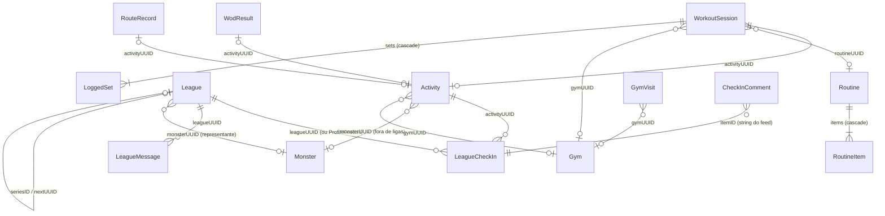

# Arquitetura do GymBros

Documento técnico do app iOS **GymBros** (projeto `GymBros`). SwiftUI + SwiftData, iOS 17 (`IPHONEOS_DEPLOYMENT_TARGET = 17.0` em `GymBros.xcodeproj/project.pbxproj`). Tudo aqui foi conferido no código; os caminhos citados são relativos à raiz do repositório.

## 1. Visão geral

### Alvos

| Alvo | Tipo | Bundle ID | Código |
|---|---|---|---|
| `GymBros` | app | `com.alonsoalmeida.gymbros` | `GymBros/` + `Shared/` |
| `GymBrosWidget` | app extension (WidgetKit) | `com.alonsoalmeida.gymbros.widget` | `GymBrosWidget/` + `Shared/` |
| `GymBrosTests` | unit test (`TEST_HOST` = app) | `com.alonsoalmeida.gymbros.tests` | `GymBrosTests/` |

Dependência externa única: o pacote SPM **MuscleMap** (`https://github.com/melihcolpan/MuscleMap.git`), usado no mapa muscular (`GymBros/Exercises/MuscleViews.swift`).

### App Group

`group.com.alonsoalmeida.gymbros`, declarado nos dois entitlements (`GymBros/Resources/GymBros.entitlements`, `GymBrosWidget/GymBrosWidget.entitlements`) e em `WidgetData.appGroup` (`Shared/WidgetShared.swift`). No container do grupo ficam:

- `UserDefaults(suiteName:)` com `widgetData`: JSON de `WidgetData` (nome, forma, XP, humor, sequência, rotina do dia), gravado pelo app em `MainView.publish` (`GymBros/App/App.swift`).
- No mesmo `UserDefaults`, `petAt` / `pets`: carinhos dados no widget (`PetStore` em `GymBrosWidget/PetWidget.swift`).
- O banco SwiftData: como o app tem a entitlement de App Group, o `ModelConfiguration` padrão de `AppData.container` cria o `default.store` no container do grupo (`Library/Application Support/default.store`), e não no sandbox do app (conferido no aparelho).

O widget não abre o banco: lê só o `WidgetData`.

### Estrutura de pastas

O app usa pastas sincronizadas do Xcode: todo arquivo dentro de `GymBros/` entra no alvo sem editar o `project.pbxproj`.

```
GymBros/              app (81 arquivos .swift)
  App/                @main, RootView/MainView, onboarding, ajustes, atalhos
  Models/             todos os @Model do SwiftData (um arquivo por domínio) e Schema.swift (SchemaV1, AppMigrationPlan, AppData)
  DesignSystem/       componentes GM*, escala de raios, gmFont, PeriodPicker
  Bros/               regras do jogo, chocagem, Roster, tela do bro, sprites, Dex, evolução, frases e lembretes
  Activities/         registrar atividade, histórico, detalhe e card para stories
  Train/              aba Treino, rotinas, treino guiado, progressão, PRs, WOD, Live Activity, modo fone
  Exercises/          biblioteca de exercícios, conteúdo do wger, mapa muscular, exercício personalizado
  Leagues/            regras das ligas, contrato com o servidor, telas, mural e comentários
  Friends/            amigos, amigos ao vivo, perfil público, aba Mapa
  Profile/            perfil, calendário de posts, perfil físico, peso/medidas, calculadora de anilhas
  Services/           conta, backend (mock/CloudKit), backup, HealthKit, lugares de treino, rotas GPS
  Resources/          Assets.xcassets, wger.json, Info.plist, GymBros.entitlements
GymBrosWidget/        widgets, Live Activities e controles (iOS 18)
Shared/               código compilado nos dois alvos: Theme (cores), WidgetData, Mood, Live Activity e intents
GymBrosTests/         XCTest rodando dentro do app
tools/                scripts de artes e tools/wger/build.py, que gera GymBros/Resources/wger.json (fora dos alvos)
```

### Papel de cada arquivo

| Arquivo | Papel |
|---|---|
| `GymBros/App/App.swift` | `@main`, `RootView` (login × onboarding × app), `MainView` (abas, derivação do estado, widget, lembretes, sync do Saúde, cena de evolução) |
| `GymBros/App/OnboardingView.swift`, `GymBros/App/SettingsView.swift` | Onboarding; Ajustes (conta, Saúde, lembretes, lugares, backup) |
| `GymBros/App/Shortcuts.swift` | `AppShortcutsProvider` (Siri/Atalhos/Botão de Ação) |
| `GymBros/Models/Schema.swift` | `SchemaV1` (lista dos 18 modelos), `AppMigrationPlan`, `AppData` (`container`, `recoveredCopy`, file protection, `setAside`) |
| `GymBros/Models/Activity.swift` | `@Model Activity`, cores dos atributos, `effortLabel`, `durationText` |
| `GymBros/Models/Monster.swift` | `@Model Monster` (`displayName`) |
| `GymBros/Models/Training.swift` | `@Model Routine`/`RoutineItem`/`WorkoutSession`/`LoggedSet`, com superset, totais, troca de exercício e comparação com a rotina de origem (`routineChanges`, `apply(to:context:)`) |
| `GymBros/Models/CustomExercise.swift` | `@Model CustomExercise` (`exerciseID`, `exercise`) |
| `GymBros/Models/PersonalRecord.swift` | `@Model PersonalRecord` |
| `GymBros/Models/Body.swift` | `@Model BodyEntry`/`ExerciseNote`, `Measure` |
| `GymBros/Models/WodResult.swift` | `@Model WodResult` (`text`, `score`) |
| `GymBros/Models/RouteRecord.swift` | `@Model RouteRecord` (pontos empacotados, `coordinates`, `encode`) |
| `GymBros/Models/Gym.swift` | `@Model Gym`/`GymVisit` |
| `GymBros/Models/League.swift` | `@Model League`/`LeagueCheckIn`/`LeagueMessage`/`CheckInComment` |
| `GymBros/DesignSystem/DesignSystem.swift` | Escala de raios (`extension Theme`) e `gmFont` (`GMScaledFont`) |
| `GymBros/DesignSystem/GMButtons.swift` | `GMPress`, `GMButton`, `GMIconButton`, `GMFloatingButton`, `GMTextButton` |
| `GymBros/DesignSystem/GMSurfaces.swift` | `GMCard`, `GMSection`, `GMDivider`, `GMRow`, `GMValueRow`, `GMEmptyState` |
| `GymBros/DesignSystem/GMIndicators.swift` | `GMProgressBar`, `GMBadge`, `GMOnlineDot` |
| `GymBros/DesignSystem/GMChips.swift`, `GymBros/DesignSystem/GMFlow.swift` | `GMChip`, `GMSegmented`, `GMChoiceChips`; layout `GMFlow` |
| `GymBros/DesignSystem/GMToggles.swift` | `GMSwitch`, `GMToggle` |
| `GymBros/DesignSystem/GMFields.swift` | `GMTextField`, `GMSearchField`, `GMLockedRow`, `GMDecimalField` |
| `GymBros/DesignSystem/GMSteppers.swift` | `GMStepper`, `GMCompactStepper`, `GMEffortPicker`, `GMRuler` |
| `GymBros/DesignSystem/GMCalendar.swift` | `GMDateTimePicker`, `GMDateText`, `GMDateField`, `GMTimeField`, `GMMonth`, `GMCalendar`, `GMTimeWheel`, `GMWheel`, `GMDurationWheel` |
| `GymBros/DesignSystem/GMScreen.swift` | `GMHeader`, `GMScreen`, `GMModal`, `gmModal` |
| `GymBros/DesignSystem/GMSheets.swift` | `GMAction`, `GMOverlayHost`, `GMSheetCard`, `gmSheet`/`gmActions`/`gmPrompt` |
| `GymBros/DesignSystem/GMTabBar.swift` | `GMTabItem`, `GMTabBar` |
| `GymBros/DesignSystem/GMKeyboard.swift` | `GMKeyboardDismisser`, `gmKeyboardDone` |
| `GymBros/DesignSystem/GMExtensions.swift` | `String.capitalizedFirst`, gesto de voltar sem barra de navegação (`UINavigationController`) |
| `GymBros/DesignSystem/PeriodPicker.swift` | Calendário de período (`GMRangeCalendar`) |
| `GymBros/Bros/Game.swift` | Regras puras: `Attribute`, `ActivityKind`, `Stage`, `MonsterForm`, `Species`, `Snapshot`, `Game`, `SnapshotCache` |
| `GymBros/Bros/Hatch.swift` | `Hatch`: animal de cada atividade (`ActivityKind` e todos os `HKWorkoutActivityType`) e a fatia mínima de minutos (`majority`) para a atividade principal decidir a espécie |
| `GymBros/Bros/Monsters.swift` | `MainMonster`, `Roster` (XP por bro), lista "Meus bros", `MonsterChoiceSection`, `representative` |
| `GymBros/Bros/MonsterSprite.swift`, `GymBros/Bros/EvolutionView.swift`, `GymBros/Bros/DexView.swift` | Pixel art animada, cena de evolução, Dex/conquistas |
| `GymBros/Bros/Companion.swift` | Frases do bro, 28 conquistas, `Reminders`, `WeeklySummary` (notificações locais) |
| `GymBros/Bros/HomeView.swift` | Tela do bro |
| `GymBros/Activities/HistoryView.swift`, `GymBros/Activities/LogActivityView.swift`, `GymBros/Activities/ActivityDetail.swift` | Histórico, registrar atividade, detalhe da atividade (`deleteActivity`) |
| `GymBros/Activities/StoryShare.swift` | Card para stories |
| `GymBros/Train/Progression.swift` | `PendingRoutineUpdate`, `SetLog`/`SessionLog`, `Deload`, `TrainingGoal`, `Suggestion`, `Progression`, modelos de rotina (`RoutineTemplate`) |
| `GymBros/Train/TrainView.swift`, `GymBros/Train/RoutineEditView.swift`, `GymBros/Train/WorkoutView.swift`, `GymBros/Train/SwapExercise.swift` | Aba Treino, edição de rotina, treino guiado, troca de exercício |
| `GymBros/Train/LiveWorkout.swift` | `LiveWorkout` (estado, descanso, Live Activity), `LiveWod`, `WodCounter` |
| `GymBros/Train/HeadphoneControl.swift` | "Modo fone": fala no fone os avisos do descanso (AVSpeech; sessão de áudio ativa só durante a fala) |
| `GymBros/Train/ExerciseStatsView.swift`, `GymBros/Train/WeeklyVolume.swift` | Estatísticas por exercício, volume semanal |
| `GymBros/Train/PR.swift` | `PRBook`, `PRBookView`, `PRSessionView` |
| `GymBros/Train/Wod.swift` | Benchmarks, cronômetros For Time/AMRAP/EMOM/Tabata, `clock`, telas de WOD e de resultado |
| `GymBros/Exercises/Exercises.swift`, `GymBros/Exercises/ExerciseMuscles.swift`, `GymBros/Exercises/ExerciseInstructions.swift`, `GymBros/Exercises/ExerciseExtra.swift` | Biblioteca: 78 originais (instruções PT), 150 extras (42 de CrossFit), músculos |
| `GymBros/Exercises/CustomExerciseForm.swift` | `Exercise.register` dos personalizados e `CustomExerciseForm` |
| `GymBros/Exercises/MuscleViews.swift` | Mapa muscular (MuscleMap) |
| `GymBros/Exercises/Wger.swift`, `GymBros/Resources/wger.json` | Conteúdo do wger (imagens embutidas, vídeos, instruções, autor e licença por item), 34 exercícios novos, `ExercisePhotos`, `WgerVideoView`, `CreditsView` |
| `GymBros/Profile/BodyTrackerView.swift`, `GymBros/Profile/BodyTools.swift` | Peso/medidas/fotos; calculadora de anilhas (`Plates`) e `HealthSync.importBodyMass` |
| `GymBros/Profile/BodyProfile.swift` | Perfil físico opcional (altura, ano de nascimento, `FitnessGoal`, `Experience`) em `UserDefaults`, peso para estimar calorias (`weightForEstimates`), IMC, basal Mifflin-St Jeor e referência de energia, proteína e água (`targets`); `BodyProfileSection` na seção de Metas do perfil |
| `GymBros/Profile/ProfileView.swift`, `GymBros/Profile/ProfileCalendar.swift` | Perfil público/privado (`ProfileAvatarButton`), calendário de posts |
| `GymBros/Leagues/Leagues.swift` | `ScoreInput`, `LeagueScoring`, desempate, regra de foto, `ProfileFeed`, renovação, participantes simulados, `LeagueBoard` |
| `GymBros/Leagues/LeagueRemote.swift` | Contrato com o servidor das ligas, tipos `Remote*`/`Outgoing*`/`LeagueDraft`, `LeagueRemoteStore` (caixa de saída), `LeagueOutbox`, `MockLeagueBackend` |
| `GymBros/Leagues/LeaguesView.swift`, `GymBros/Leagues/LeagueMural.swift`, `GymBros/Leagues/CheckInDetail.swift` | Telas de ligas, mural, detalhe/comentários do check-in |
| `GymBros/Friends/Friends.swift`, `GymBros/Friends/FriendsLive.swift`, `GymBros/Friends/PublicProfile.swift` | Amigos (`FriendsBackend`, mock), amigos treinando no mapa (simulados), perfil público |
| `GymBros/Friends/MapScreen.swift` | Aba Mapa |
| `GymBros/Services/Auth.swift` | Conta: `AuthBackend`, `AuthUser`, `AuthStore` (sessão no Keychain), `Keychain` (gravar, ler e apagar itens do app), `MockAuthBackend` (e-mail/senha e Apple simulados) e `LoginView` |
| `GymBros/Services/Backend.swift` | Interruptor `Backend.mode` (`.mock` por padrão, `.cloudKit`), `Backend.install()` e as implementações CloudKit dos três contratos (`CloudKitAuthBackend`, `CloudKitLeagueBackend`, `CloudKitFriendsBackend`) sobre o banco público (`Cloud`, `CloudType`) |
| `GymBros/Services/Location.swift` | `GymLocation` (CLMonitor), `NotificationRouter` |
| `GymBros/Services/Route.swift` | GPS (`RouteTracker`), `kmText`/`paceText`, telas de corrida, `GymEditorView`, `GymChooserView`, `PlaceDetector` |
| `GymBros/Services/HealthSync.swift` | Importação/exportação de treinos no HealthKit |
| `GymBros/Services/Backup.swift` | Backup/restauração JSON (`Backup`, `BackupDocument`) |
| `GymBros/Resources/Assets.xcassets`, `GymBros/Resources/Info.plist`, `GymBros/Resources/GymBros.entitlements` | Imagens (sprites, ícone, fotos do wger), Info.plist e entitlements do app |
| `Shared/Theme.swift` | `enum Theme`: cores base e semânticas, usadas pelo app e pelo widget |
| `Shared/WidgetShared.swift` | `Mood`, `WidgetData` (App Group) |
| `Shared/WorkoutLive.swift` | `WorkoutAttributes`, `WodAttributes` (ActivityKit) |
| `Shared/WorkoutIntents.swift` | `CompleteSetIntent`, `SkipRestIntent`, `AddRoundIntent`, `WorkoutIntentBridge` |
| `GymBrosWidget/GymBrosWidget.swift`, `GymBrosWidget/PetWidget.swift` | `GymBrosWidgets` (bundle), "Status do bro", `PetWidget` |
| `GymBrosWidget/TodayWidget.swift` | `TodayWorkoutWidget`: treino do dia com botão que abre o app já no treino |
| `GymBrosWidget/WorkoutLiveActivity.swift`, `GymBrosWidget/WodLiveActivity.swift` | Live Activities do treino (série atual ou descanso, com o botão da vez) e do WOD (cronômetro atualizado pelo iOS) |
| `GymBrosWidget/WorkoutControls.swift` | `CompleteSetControl` e `SkipRestControl` (Central de Controle, tela de bloqueio, Botão de Ação; iOS 18) |

## 2. Navegação

### Abas

O app não usa `TabView`. `MainView` (`GymBros/App/App.swift`) monta um `ZStack` com cinco páginas e a `GMTabBar` própria por cima. O motivo está comentado no código: o `TabView` empurra a 5ª aba para o menu "Mais". Cada página é criada na primeira visita e continua viva (guarda rolagem e navegação), controlada pelo conjunto `visited`.

| Tag | Aba | Tela raiz |
|---|---|---|
| 0 (centro, sprite do bro) | Bro | `HomeView` |
| 1 | Treino | `TrainView` |
| 2 | Ligas | `LeaguesView` |
| 3 | Mapa (badge = amigos treinando agora) | `MapScreen` |
| 4 | Histórico | `HistoryView` |

`RootView` mostra `LoginView` enquanto não há sessão (`AuthStore.isSignedIn`) e depois `OnboardingView` enquanto `@AppStorage("trainerName")` estiver vazio.

### Telas principais e empilhamento

- Push dentro de cada aba: `NavigationStack` + `NavigationLink`/`navigationDestination` (ex.: `TrainView` → `WodListView`, `PRBookView`, `ExerciseStatsList`, `WeeklyVolumeView`, `MuscleMapView`, `BodyTrackerView`; `LeaguesView` → `LeagueDetailView`).
- O avatar do perfil fica no cabeçalho `GMScreen` (`ProfileAvatarButton` em `GymBros/Profile/ProfileView.swift`) e abre `ProfileView` como modal (`GymBros/Profile/ProfileView.swift`).
- A tela Bros (Meus bros, Dex, Conquistas) abre por `gmModal` a partir da tela do bro (`MainView`); a cena de evolução também é `gmModal`, numa fila.
- Entrada externa: `onOpenURL` trata `gymbros://start` (widget "Treino do dia") e a notificação `NotificationRouter.startWorkout` (chegada na academia) troca para a aba Treino e começa o treino do dia.

### Modais (`GymBros/DesignSystem/GMScreen.swift` e `GymBros/DesignSystem/GMSheets.swift`)

| Modificador | Implementação | Uso |
|---|---|---|
| `gmModal(isPresented:)` / `gmModal(item:)` | `fullScreenCover` com tema escuro e `tint` | Telas inteiras: registrar atividade, ajustes, amigos, criar/entrar em liga, treino em andamento, corrida com GPS (46 usos) |
| `gmSheet(isPresented:)` | `fullScreenCover` transparente + `GMOverlayHost` (fundo escuro, arrastar para fechar) + `GMSheetCard` | Bottom sheet de conteúdo livre (17 usos) |
| `gmActions(isPresented:title:message:actions:)` | Mesmo host, lista de `GMAction` + "Cancelar" | Substitui `Menu` e `confirmationDialog` (28 usos) |
| `gmPrompt(...)` | Host centralizado com `GMTextField` | Substitui `alert` com campo de texto |

Detalhes que importam: o host roda a ação **depois** de fechar a camada (`close(then:)`), para permitir abrir outra tela em seguida; e `.transaction(value:)` desliga a animação do sistema só na abertura daquela camada. Não há `.sheet`, `.alert` nem `confirmationDialog` no app, e `fullScreenCover` só aparece dentro de `GymBros/DesignSystem/GMScreen.swift` e `GymBros/DesignSystem/GMSheets.swift`.

## 3. Modelo de dados (SwiftData)

Container único em `AppData.container` (`GymBros/Models/Schema.swift`), criado com o schema versionado `AppData.schema` (`SchemaV1`, 1.0.0, no `AppMigrationPlan` ainda sem estágios), sem CloudKit (`cloudKitDatabase: .none`, para a entitlement do iCloud do backend não espelhar o banco local), com recuperação quando não abre e file protection (ver dívida 2), gravado no container do App Group (`default.store`, ver 1. Visão geral), registrado na cena por `.modelContainer(AppData.container)` (`GymBros/App/App.swift`) e acessado diretamente por código fora de views (`GymLocation`, `PRBook`, intents do Live Activity). São 18 modelos, todos em `GymBros/Models/`:

| Modelo | Arquivo | Campos principais |
|---|---|---|
| `Activity` | `GymBros/Models/Activity.swift` | `uuid`, `kindRaw`, `date`, `minutes`, `effort`, `note`, `healthUUID`, `healthWrittenUUID`, `healthType` (tipo exato do treino no Saúde), `source`, `monsterUUID`, `gymUUID`, `meters`, `kcal` |
| `Monster` | `GymBros/Models/Monster.swift` | `uuid`, `name`, `createdAt`, `isStarter`, `lastFormID`, `speciesID` |
| `Routine` | `GymBros/Models/Training.swift` | `uuid`, `name`, `weekdaysRaw`, `order`, `items` (cascade) |
| `RoutineItem` | `GymBros/Models/Training.swift` | `exerciseID`, `sets`, `reps`, `rest`, `order`, `supersetNext`, `routine` |
| `WorkoutSession` | `GymBros/Models/Training.swift` | `uuid`, `title`, `routineUUID`, `start`, `end` (nil = em andamento), `effort`, `activityUUID`, `currentExerciseID`, `restEnd`, `gymUUID`, `supersetRaw`, `isDeload`, `sets` (cascade) |
| `LoggedSet` | `GymBros/Models/Training.swift` | `exerciseID`, `exerciseOrder`, `index`, `weight`, `reps`, `targetReps`, `done`, `warmup`, `session` |
| `CustomExercise` | `GymBros/Models/CustomExercise.swift` | `uuid`, `name`, `groupRaw`, `equipment`, `typeRaw` (id = `custom-<uuid>`) |
| `PersonalRecord` | `GymBros/Models/PersonalRecord.swift` | `uuid`, `exerciseID`, `weight`, `reps`, `date` |
| `ExerciseNote` | `GymBros/Models/Body.swift` | `exerciseID`, `text`, `updated` |
| `BodyEntry` | `GymBros/Models/Body.swift` | `uuid`, `date`, `weight`, medidas, `healthUUID`, `photoFront`/`photoSide` (external storage) |
| `WodResult` | `GymBros/Models/WodResult.swift` | `uuid`, `wodID`, `date`, `seconds`/`rounds`/`reps`, `rx`, `capped`, `activityUUID` |
| `RouteRecord` | `GymBros/Models/RouteRecord.swift` | `uuid`, `activityUUID`, `kindRaw`, `start`, `seconds`, `meters`, `points` (Doubles lat/lon empacotados, external storage) |
| `Gym` | `GymBros/Models/Gym.swift` | `uuid`, `name`, `latitude`, `longitude`, `radius`, `createdAt` |
| `GymVisit` | `GymBros/Models/Gym.swift` | `uuid`, `gymUUID`, `gymName`, `start`, `end` |
| `League` | `GymBros/Models/League.swift` | `uuid`, `name`, `code`, `scoringRaw`, `start`, `end`, `isMock`, `monsterUUID`, `autoRenew`, `season`, `seriesID`, `nextUUID`, `weightsRaw`, `tieBreakRaw`, `photoRuleRaw`, `teamsRaw`, `myTeamID`, `cover`, `joined`, `syncedAt` |
| `LeagueCheckIn` | `GymBros/Models/League.swift` | `uuid`, `leagueUUID`, `activityUUID`, `title`, `note`, `date`, `photo`, `place`, `hadPhoto`, `syncedAt` |
| `LeagueMessage` | `GymBros/Models/League.swift` | `uuid`, `leagueUUID`, `text`, `date`, `syncedAt` |
| `CheckInComment` | `GymBros/Models/League.swift` | `uuid`, `itemID` (id do `FeedItem`), `text`, `date`, `authorID` ("me" ou `memberID`), `authorName` |

### Relações

Só há duas relações SwiftData de verdade (`@Relationship(deleteRule: .cascade)`): `Routine.items ↔ RoutineItem.routine` e `WorkoutSession.sets ↔ LoggedSet.session`. Todo o resto é **referência por UUID** (ou por string), sem integridade garantida pelo banco; quem lê precisa tolerar alvo inexistente (ex.: `Roster` ignora `monsterUUID` desconhecido, `LeagueBoard.feed` descarta check-in sem atividade). Enums são guardados como `*Raw: String` e listas como strings separadas por vírgula ou quebra de linha (`weekdaysRaw`, `supersetRaw`, `weightsRaw`, `teamsRaw`).

Casos especiais:

- **Perfil como destino de check-in**: `LeagueCheckIn.leagueUUID == ProfileFeed.id` (UUID fixo `…0000AA`, `GymBros/Leagues/Leagues.swift`) significa "postado no perfil".
- `LeagueCheckIn` guarda `title`/`date`, mas tipo, minutos e esforço vêm da `Activity` apontada.
- `exerciseID` aponta para a biblioteca em memória (`Exercise`), não para o banco, exceto `custom-<uuid>`.



### Estado fora do banco

`UserDefaults.standard` guarda ajustes e alguns estados de domínio: `trainerName`, `mainMonster` (`MainMonster.id`), `discovered`, `achievementsSeen`, lembretes, chaves do Saúde (`healthEnabled`, `healthLastSync`, `healthIgnored`, `healthWrite`…), estado do `GymLocation` (`gymInsideID`, `gymArrival`, `gymNotifyArrival`, `gymAutoFinish`), código de amigo (`friendCode`), a oferta pendente de atualizar rotina (`pendingRoutineUpdate`) e o estado inteiro do servidor de amigos simulado (`mockFriends`), as contas do login simulado (`mockAccounts`), o id do iCloud no modo CloudKit (`cloudUserID`), os check-ins apagados a retirar do servidor (`pendingRetractions`, `LeagueOutbox`) e o perfil físico (`profileHeight`, `profileBirthYear`, `profileGoal`… em `BodyProfile.keys`).

## 4. Regras derivadas

### O bro é função do histórico (`Game.snapshot`)

`GymBros/Bros/Game.swift` declara: "nada fica guardado além do log". `Game.snapshot([ActivityRecord])` percorre as atividades em ordem e calcula:

- **XP por atividade**: `minutos (máx. 240) × MET do tipo × (0,6 + 0,08 × esforço) / 10` (`Game.xp`).
- **Limite diário**: até 150 XP brutos no dia conta inteiro; o excedente vale 1/3; ganho máximo de 300 XP/dia (`dailySoftCap`, `dailyHardCap`).
- **Atributos**: cada `ActivityKind` tem pesos em Força/Resistência/Agilidade/Técnica; o XP ganho é distribuído em `stageAttributes` e `lifetimeAttributes`.
- **Estágios**: Ovo 0 → Bebê 60 → Rookie 300 → Champion 1200 → Ultimate 3600. A espécie não sai daqui: ver `Species.hatch` abaixo. Em Champion e Ultimate, `Game.branch` escolhe o galho pelo atributo dominante desde a última evolução; vira híbrido se o 2º tiver ≥ 90% do 1º (`hybridRatio`).
- `hatchAttributes` (atributos ao chocar), `evolutions`, `xpByActivity`, `streak`, `bestStreak`, `todayXP`, nível `√(XP/5) + 1`.

Consequência: editar ou apagar uma `Activity` recalcula tudo. As telas usam `Game.cachedSnapshot`, que guarda até 24 resultados com chave = registros + dia + calendário. O único estado persistido do bro é o que não pode ser recalculado sem mudar quem já nasceu: `Monster.speciesID` (fixada na chocagem, em `MainView.check`, e apagada se o bro voltar a ser ovo) e `Monster.lastFormID` (para tocar a cena de evolução uma vez; várias evoluções entram numa fila).

### Roster: para qual bro vai cada atividade

`Roster` (`GymBros/Bros/Monsters.swift`) é construído a cada render de `MainView` a partir de monstros, atividades, check-ins e ligas:

1. Atividade com check-in em ligas → XP para o `League.monsterUUID` válido de cada uma dessas ligas (pode ir para mais de um bro). A regra está em `Roster.owners`, usada também pelas prévias de XP.
2. Sem check-in em liga → para `Activity.monsterUUID` (o principal no momento do registro) ou, se não existir mais, para o inicial.
3. Um `Game.snapshot` por monstro; a espécie vem de `speciesID` ou de `Species.hatch(records:seed:)`, que soma os minutos de cada atividade até o choco e usa o animal da que passar de metade (`Hatch.majority`), com o tipo exato do Saúde quando existe; sem atividade principal, nasce o Coelho, e Urso/Rato se decidem pela semente do UUID; formas híbridas sem arte caem na forma simples (`single`).

`MainView.derive()` mistura: snapshot do bro principal (XP/forma) com streak e humor do **jogador** (todas as atividades); o XP por atividade mostrado nas listas é o `Roster.xpByActivity` (o maior entre os donos).

### Ligas: `ScoreInput`, `LeagueScoring`, `LeagueBoard`

- `ScoreInput` (`GymBros/Leagues/Leagues.swift`) é o mínimo para pontuar: tipo, minutos, esforço, metros, kcal. Vem de `Activity.scoreInput` (seus check-ins) ou `RemoteCheckIn.input` (dos outros).
- `LeagueScoring.score`:
  - `pontos`: `Game.xp` da atividade; com pesos por atributo (0× a 3×), o XP é multiplicado por `Σ peso_do_tipo × peso_da_liga`.
  - `treinos`: 1 por check-in. `minutos`: até 240. `distancia`: metros. `calorias`: `kcal` do Saúde ou `HealthSync.activeKcal` com peso de referência 70 kg.
- `PhotoRule.apply`: sem foto vale igual, metade ou zero. `League.score` aplica as duas coisas.
- `LeagueBoard` (`@MainActor`):
  - `feed`: junta seus `LeagueCheckIn` com os `RemoteCheckIn` da liga, já pontuados.
  - `ranking` (também aceita `remote:`): todos os participantes aparecem (inclusive zerados); filtra pela janela (`RankWindow`: liga, semana, mês) e pelo período da liga; ordena por placar e depois pelo desempate (`LeagueTieBreak`: quem chegou antes ao placar, maior sequência de dias, mais check-ins) e marca `tied`.
  - `teams`: placar do time = soma do placar dos membros; o bro do time sai da **média** de XP dos membros e do atributo somado (`teamBro`).
- `LeagueRenewal.run` (chamado quando o app fica ativo) cria a próxima temporada das ligas com `autoRenew`, pulando temporadas perdidas com o app fechado.

## 5. Servidor: contratos, mock e CloudKit

O app fala com o servidor só por três contratos: `AuthBackend` (`GymBros/Services/Auth.swift`), `LeagueBackend` (`GymBros/Leagues/LeagueRemote.swift`) e `FriendsBackend` (`GymBros/Friends/Friends.swift`). Quem responde é escolhido por um interruptor em `GymBros/Services/Backend.swift`: `Backend.mode` é `.mock` hoje (o Personal Team não tem iCloud) e `Backend.install()`, chamado ao abrir o app, liga os três stores ao backend escolhido. Em `.mock` não há rede; em `.cloudKit` tudo vai para o banco público do container `iCloud.com.alonsoalmeida.gymbros`. Esquema, permissões e o passo a passo para ligar estão em `docs/cloudkit.md`. A liga de exemplo (`AMIGOS`) continua simulada nos dois modos.

### Conta (`GymBros/Services/Auth.swift`)

- `AuthBackend`: `signInWithApple`, `signIn(email:password:)`, `signUp(name:email:password:)`, `signOut`.
- `AuthStore` (`@MainActor @Observable`, singleton): valida e-mail e senha (mínimo 8 caracteres), guarda o `AuthUser` (id, nome, e-mail, provedor, token) no Keychain (`Keychain`, serviço `GymBros.auth`, conta `authUser`, acessível só neste aparelho depois do primeiro desbloqueio); sessões antigas em `UserDefaults("authUser")` migram na primeira leitura. Usa o nome da conta como nome de treinador se ainda não houver um; `RootView` só passa do `LoginView` com sessão. Nenhuma senha é guardada no app.
- `MockAuthBackend`: login simulado. "Continuar com a Apple" cria um usuário na hora, com e-mail de retransmissão; o cadastro guarda só e-mail → nome em `UserDefaults("mockAccounts")` (recusa e-mail repetido) e o login aceita qualquer senha válida, porque sem servidor não há como conferir.
- `CloudKitAuthBackend`: a conta é a do iCloud do aparelho (`Cloud.me()`); e-mail e senha respondem `AuthError.appleOnly`.
- Ajustes mostra a conta com o aviso "Login simulado enquanto não há servidor" e o botão de sair (não apaga dados do aparelho).

### Ligas (`GymBros/Leagues/LeagueRemote.swift`)

- `LeagueBackend`: `fetch(LeagueKey, now:) -> RemoteLeague`, `send([OutgoingMessage], to:)`, `create(LeagueDraft)`, `join(code:) -> LeagueDraft?`, `setMembership(_:in:)`, `publish([OutgoingCheckIn], to:)`, `retract(_:from:)` e `leave(_:)`. Envios devolvem os ids aceitos.
- `LeagueKey`: o que o servidor precisa saber da liga (`uuid`, `code`, período, `isMock`, nomes dos times). Posts do perfil usam a chave `.profileFeed`.
- Tipos (`Codable`, formato da API): `RemoteMember`, `RemoteCheckIn` (com `hasPhoto` e `photoURL`), `RemoteTeam`, `RemoteMessage`, agregados em `RemoteLeague`; na ida, `LeagueDraft`, `Membership`, `OutgoingCheckIn`, `OutgoingMessage`.
- `LeagueRemoteStore` (`@MainActor @Observable`, singleton): `backend` trocável, `cache` por `LeagueKey`, `refresh(_:)` (chamado em `LeaguesView` e `LeagueDetailView`), `join(code:)`, `leave(_:)`, `flush(context:)` e `scheduleFlush()` (2 s depois de cada mudança, juntando várias num envio). Sem cache e com o mock, `remote(_:)` calcula a resposta na hora para não piscar vazio.
- `MockLeagueBackend`: só a liga com `isMock` tem gente — os 8 `FakeMember` (`GymBros/Leagues/Leagues.swift`), check-ins gerados por dia com `SeededRandom` (hash FNV + LCG, estável entre execuções) e recados do mural. Ligas criadas pelo usuário só recebem os times; `join` não acha nada; todo envio é aceito.
- `CloudKitLeagueBackend` (`GymBros/Services/Backend.swift`): registros `League`, `Member`, `CheckIn` (foto como `CKAsset`) e `Message` do banco público.
- **Caixa de saída**: o que é seu continua no SwiftData e sobe depois. `flush` manda, nesta ordem: ligas com `syncedAt == nil` (cria a liga se `!joined` e publica seu lugar: nome, forma do bro, time), check-ins com `syncedAt == nil` (inclusive editados, pelo mesmo id), retiradas pendentes de check-ins apagados (`LeagueOutbox`, em `UserDefaults("pendingRetractions")`) e recados com `syncedAt == nil`. Um envio por vez: chamadas durante um envio esperam ele acabar. Os dados são lidos antes da rede e, na volta, `syncedAt` é gravado só em quem ainda existe (rebuscado pelo `uuid`). Erro interrompe o envio, fica em `lastError` e tudo continua pendente para a próxima vez.

### Amigos (`GymBros/Friends/Friends.swift`)

- `FriendsBackend`: `fetch`, `add(code:)`, `add(id:)`, `accept`, `decline`, `remove`, `profile(id) -> PublicProfile` e `publish(_:friendCode:)`.
- Tipos: `RemoteFriend` (id, nome, `formID`, código), `FriendsState` (amigos + pedidos recebidos), `PublicProfile` (`GymBros/Friends/PublicProfile.swift`: bro, stats, conquistas e posts como `[RemoteCheckIn]`; partes escondidas chegam `nil`).
- `FriendsStore` (`@MainActor @Observable`): cache de estado e perfis, `myCode` (gerado localmente uma vez), `suggestions(from:)` (participantes das suas ligas em andamento que ainda não são amigos) e `publish(_:)`, que sobe o seu perfil público ao abrir o app só se o hash SHA-256 mudou (por modo de backend). Trocar o backend descarta o estado do anterior.
- `MockFriendsBackend`: diretório = amigos do mapa (`FriendsLive.simulated`) + `FakeMember` + "Mari"; estado persistido em `UserDefaults("mockFriends")`; pedido aceito na hora; perfis e posts de 90 dias gerados com `SeededRandom`.
- `CloudKitFriendsBackend`: amizade é um `FriendLink` em cada direção (pedir cria `eu->você`, aceitar cria o de volta), para ninguém escrever registro de outra pessoa; perfis em `Profile`.
- `FriendsLive` (`GymBros/Friends/FriendsLive.swift`) mostra no mapa só os simulados que ainda estão em `FriendsStore.friendIDs`.

### Fluxo atual

```mermaid
sequenceDiagram
    participant UI as LeagueDetailView / LeagueMuralView
    participant DB as SwiftData
    participant Store as LeagueRemoteStore
    participant BE as LeagueBackend (Mock ou CloudKit)

    UI->>Store: refresh([league])
    Store->>BE: fetch(league.key, now)
    BE-->>Store: RemoteLeague (members, checkIns, teams, messages)
    Store-->>UI: cache[key] (Observable)
    UI->>DB: LeagueCheckIn (meus) + Activity
    UI->>UI: LeagueBoard.feed / ranking / teams

    UI->>DB: insert/alterar League, LeagueCheckIn, LeagueMessage (syncedAt = nil)
    UI->>Store: scheduleFlush()
    Store->>DB: pendentes (syncedAt == nil) + LeagueOutbox
    Store->>BE: create / setMembership / publish / retract / send
    BE-->>Store: [UUID] aceitos
    Store->>DB: syncedAt = now; save()

    Note over UI,BE: Comentários, foto do perfil e treino ao vivo<br/>nunca saem do aparelho
```

### O que ainda falta

O caminho previsto é trocar `Backend.mode` para `.cloudKit` depois de configurar o iCloud (`docs/cloudkit.md`). Mesmo assim, ainda não têm contrato ou implementação:

1. **Comentários e reações**: `CheckInComment` fica só no aparelho.
2. **Fotos de outras pessoas**: `RemoteCheckIn.photoURL` já chega, mas as telas mostram o quadro colorido.
3. **Foto do perfil**: não sobe.
4. **Temporadas passadas**: a renovação é calculada em cada aparelho; o ranking de temporadas antigas só existe localmente.
5. **Amigos treinando ao vivo**: `FriendsLive` é inteiramente simulado, sem contrato.
6. **Push**: não há notificação de check-in nem de pedido de amizade (`CKQuerySubscription`).
7. **Login com e-mail de verdade**: exige servidor próprio; no modo CloudKit só existe a conta Apple/iCloud.

## 6. Integrações do sistema

### HealthKit (`GymBros/Services/HealthSync.swift`)

- **Importação** (`sync`, ao app ficar ativo em `MainView.syncHealth`): treinos desde `lastSync − 2 dias` (na primeira vez, 14 dias), mínimo 5 min. Pula ids já conhecidos (`healthUUID`, `healthWrittenUUID`, ignorados), treinos gravados pelo próprio app (bundle id) e treinos com mais de 50% de sobreposição com algo já registrado. Tipo via `kind(for:)` (o tipo exato vai para `Activity.healthType`, usado na chocagem), esforço estimado por kcal ativas × esperado (com o peso do Saúde ou `BodyProfile.weightForEstimates`), distância e kcal gravadas na `Activity`.
- **Exportação** (`exportPending`, opcional `healthWrite`): grava como `HKWorkout` + `activeEnergyBurned` as atividades registradas no app desde que a opção foi ligada; `deleteWritten` remove do Saúde ao apagar/editar.
- **Peso corporal**: `importBodyMass` (`GymBros/Profile/BodyTools.swift`) traz 2 anos de `bodyMass` para `BodyEntry`.

### Localização (`GymBros/Services/Location.swift`)

- `GymLocation` (singleton `@MainActor`) usa `CLMonitor("gymbros")` com `CircularGeographicCondition` para até 20 lugares (os visitados mais recentemente). `startMonitoring()` roda no `init` do app, inclusive quando o iOS acorda o app em segundo plano.
- Entrada: cria `GymVisit`, guarda `insideID` e, se não há treino rodando, notifica com categoria `ARRIVAL` (ação "Começar treino") e marca `pendingArrival` (oferta ao abrir o app por até 1 h).
- Saída: fecha a visita e, com `autoFinish`, encerra o treino daquele lugar se tiver ≥ 10 min (`LiveWorkout.autoFinish`).
- `suggestions(near:)` busca academias reais via `MKLocalPointsOfInterestRequest`; `PlaceDetector` (`GymBros/Services/Route.swift`) decide o lugar ao começar musculação/WOD.
- Migração: `migrateSingleGym` converte a academia única guardada em `UserDefaults("gym")` por versões antigas.

### Rotas GPS (`GymBros/Services/Route.swift`)

`RouteTracker` (`@Observable`) com `allowsBackgroundLocationUpdates` (modo de fundo `location` no `Info.plist`), `distanceFilter` 5 m, descarta leituras com precisão ≥ 30 m e saltos acima de 15 m/s, suporta pausa. O percurso vira `RouteRecord` ligado à `Activity` por `activityUUID`.

### Notificações

- Locais apenas (`UNUserNotificationCenter`); `NotificationRouter` é o delegate e mostra banner com o app aberto.
- Fim do descanso (`LiveWorkout.startRest`, id `rest`), chegada/saída da academia, `Reminders.schedule` (próximos 7 dias, só em dias sem treino) e `WeeklySummary.schedule` (domingo à noite, com posição nas ligas via `LeagueBoard`) em `GymBros/Bros/Companion.swift`. São reagendadas a cada mudança relevante em `MainView.publish`.

### Live Activity, widgets e controles

- `Shared/WorkoutLive.swift`: `WorkoutAttributes` (exercício, série, descanso, sprite) e `WodAttributes`.
- `LiveWorkout.show/refresh/endAll` e `LiveWod.show/end` (`GymBros/Train/LiveWorkout.swift`) pedem a atividade com `pushType: nil` (só atualização local).
- Botões do Live Activity e do Control Center são `LiveActivityIntent` (`Shared/WorkoutIntents.swift`) que rodam no processo do app; o app registra as closures em `WorkoutIntentBridge` no `init` (`GymBros/App/App.swift`). `addRound` é registrado só enquanto o cronômetro do WOD está na tela (`GymBros/Train/Wod.swift`).
- `GymBrosWidget/GymBrosWidget.swift` (`GymBrosWidgets`): `PetWidget` (pose por minuto, carinho via `PetIntent`), "Status do bro", `TodayWorkoutWidget` (`gymbros://start`), `WorkoutLiveActivity`, `WodLiveActivity` e, no iOS 18, `CompleteSetControl`/`SkipRestControl`.
- O app chama `WidgetCenter.shared.reloadAllTimelines()` (`WidgetBridge.reload`) depois de gravar o `WidgetData`.

### Atalhos (`GymBros/App/Shortcuts.swift`)

`GymBrosShortcuts` expõe "Série feita" e "Pular descanso" (os mesmos intents do Live Activity) para Siri, app Atalhos e Botão de Ação.

### Backup JSON (`GymBros/Services/Backup.swift`)

- `Backup.make` serializa DTOs de todos os modelos (inclusive `LeagueMessage`), um subconjunto de ajustes (`settingKeys`, com `autoWarmup`, `restNotification`, `barWeight`, metas por exercício e o perfil físico com as metas de peso e frequência de `BodyProfile.keys`) em texto e com tipo (`typedSettings`), a foto do perfil e a capa reduzida da temporada atual de cada liga; `version = 1`, campos novos opcionais para ler backups antigos.
- `restore` apaga todos os modelos do banco e reinsere num só `save()` (se algo falhar, `rollback()` e o banco fica como estava); check-ins voltam sem imagem, mas com `hadPhoto`. Ligas e check-ins guardam `syncedAt` (e a liga, `joined`), então o flush não recria ligas nem republica check-ins já enviados; em backups antigos (sem `hasSyncState`) tudo volta como já enviado e a liga como de outra pessoa (`joined = true`). Depois, Ajustes reinicia o monitoramento dos lugares. Exportação/importação por `fileExporter`/`fileImporter` em `GymBros/App/SettingsView.swift`.
- Não entram no backup: imagens dos check-ins, fotos de progresso do `BodyEntry`, a sessão (`authUser`), lembretes, preferências do Saúde e de lugares, visibilidade do perfil e o estado do servidor de amigos simulado.

## 7. Testes

- **Como rodam**: o alvo `GymBrosTests` tem `TEST_HOST` apontando para `GymBros.app`, então os testes rodam **dentro do app instalado** no aparelho. `GymTestCase` (`GymBrosTests/TestSupport.swift`) salva e restaura chaves de `UserDefaults` (`exerciseGoals`, `deloadUntil`, `deloadSnooze` e `barCountsBar`, chave que o app não usa mais) e `PRBook.manual`, e oferece `memoryContext()` com um `ModelContainer` em memória (`Activity`, `WorkoutSession`, `LoggedSet`, `League`, `LeagueCheckIn`) separado do banco real. `StoryTests` monta um container próprio, que inclui `BodyEntry` e `RouteRecord`. `StoreTests` confere que o banco real do aparelho abre com o `SchemaV1` sem ser movido.
- **Cobertura** (83 testes, por `func test`):

| Arquivo | Testes | O que cobre |
|---|---|---|
| `GymBrosTests/GameTests.swift` | 10 | Fórmula de XP, teto diário, chocagem, galho de Força, híbrido só com quase empate, espécie pela atividade principal (minutos, tipo exato do Saúde, mistura vira Coelho), toda atividade com animal, sequência até ontem, `Roster.owners`, cache de snapshot |
| `GymBrosTests/ProgressionTests.swift` | 25 | Sugestão de carga, deload após 3 falhas, metas de reps, PR manual, aquecimento, 1RM Epley, recordes, incremento só com barra, formatação, calculadora, melhor marca, esforço do encerramento automático, `Deload.apply`, nome do personalizado, ordem da troca, rampa feita à mão fora das séries de trabalho, carga e séries sem subir juntas, pirâmide perto do topo conta como trabalho |
| `GymBrosTests/LeagueTests.swift` | 19 | Pesos por atributo, modos de pontuação, janela do mês, três desempates, regra de foto e "Vale ½", check-in restaurado, ids de times (estáveis e legados), `ranking` com `remote` injetado, mesmo bro em todo lugar, estabilidade do `MockLeagueBackend`, placar do time, `LeagueDraft` ida e volta com as regras, `LeagueOutbox` só retira check-in já publicado |
| `GymBrosTests/WorkoutTests.swift` | 16 | Superset, aquecimento fora do log e dos totais, deload por semanas, ranking com período, período pelo calendário, textos de início, renovação de temporada, troca em superset, aviso "Dez segundos", CAP |
| `GymBrosTests/NamesAndBarTests.swift` | 2 | Nomes únicos das formas, carga com barra pelo tipo do treino |
| `GymBrosTests/StoryTests.swift` | 4 | Card do story: sem peso não mostra calorias, com peso estima, kcal do Saúde vence a estimativa, corrida com distância, pace e trajeto |
| `GymBrosTests/KeychainTests.swift` | 1 | Gravar, sobrescrever e apagar um item no Keychain |
| `GymBrosTests/StoreTests.swift` | 2 | Banco do aparelho abre com o `SchemaV1` sem ser movido, container em memória com o `AppMigrationPlan` |
| `GymBrosTests/LeagueFlushTests.swift` | 2 | `flush` concorrente não repete create/publish/retract/send e grava `syncedAt`; liga e check-in apagados durante o envio não derrubam o app (backend que grava as chamadas, `pendingRetractions` salvo e restaurado) |
| `GymBrosTests/BackupTests.swift` | 2 | `make` -> JSON -> `restore` em banco em memória: `syncedAt`/`joined` de ligas e check-ins, `typedSettings` e foto do perfil; backup antigo (sem `hasSyncState`) volta com `syncedAt = exportedAt` e `joined = true` |

- **Sem cobertura**: rollback da restauração do `Backup`, recuperação do banco, `HealthSync` (sobreposição, estimativa de esforço), `FriendsStore`, `AuthStore`/`MockAuthBackend` (só o `Keychain` tem teste), os backends CloudKit, `BodyProfile.targets`, `GymLocation`, `RouteTracker` e UI.

## 8. Decisões e dívidas técnicas observadas

### Decisões

- **Estado derivado**: o histórico de `Activity` é a fonte da verdade; XP, forma, humor, conquistas e rankings são recalculados (`GymBros/Bros/Game.swift`, `GymBros/Bros/Monsters.swift`, `GymBros/Leagues/Leagues.swift`).
- **Design system próprio** substituindo controles nativos, inclusive abas e modais (`GymBros/DesignSystem/`).
- **Referências por UUID** em vez de `@Relationship`, o que facilita backup e o futuro formato de API, mas sem integridade referencial.
- **Contrato de servidor antes do servidor**: protocolos + mocks determinísticos (`SeededRandom`) permitem trocar a implementação sem mexer nas telas; a implementação CloudKit já existe e é escolhida por `Backend.mode`.
- **Local primeiro**: o SwiftData do aparelho é a fonte da verdade e o servidor recebe só o que é compartilhado (ligas, check-ins postados, recados, perfil público) pela caixa de saída; com `Backend.mode = .mock` (padrão) não há rede e o login é simulado. O banco fica no container do App Group, mas o widget só lê o `WidgetData`.

### Dívidas

1. **Custo de render (reduzido)**: `MainView.body` chama `derive()` a cada avaliação e monta o `Roster`; os snapshots vêm de `Game.cachedSnapshot`, mas a chave do cache é linear no histórico. `LeagueBoard.feed/ranking` e `teams` (que roda `Game.snapshot` por membro) não têm cache.
2. **Migrações versionadas só a partir do V1** (`GymBros/Models/Schema.swift`): o banco não derruba mais o app (se não abrir, é movido para `default-erro-<timestamp>.store`, o app abre com um banco novo ou, no limite, em memória, e avisa); o banco tem file protection `completeUntilFirstUserAuthentication`. O schema atual é o `SchemaV1` do `AppMigrationPlan`; mudanças de modelo entram como `SchemaV2` + estágio, para a recuperação ser exceção; migrações de dados são à mão (`Roster.ensureStarter`, `GymLocation.migrateSingleGym`, ids legados de times).
3. **Singletons e estado global**: `LeagueRemoteStore.shared`, `FriendsStore.shared`, `AuthStore.shared`, `GymLocation.shared`, `PRBook.manual` (`nonisolated(unsafe) static var`, `GymBros/Train/PR.swift`) e acesso direto a `AppData.container.mainContext` fora das views.
4. ~~`LeagueBoard.ranking` ignora o `remote` injetado~~: corrigido, `ranking` aceita `remote:` como `feed` e `teams` (`testRankingUsesInjectedRemote`).
5. **Pontos da liga sem teto diário**: o modo `pontos` usa `Game.xp` bruto, não o XP com limite diário do bro; o mesmo vale para a pontuação dos posts no perfil (`GymBros/Profile/ProfileView.swift`).
6. **Erros engolidos**: quase todo `save`/`fetch` usa `try?`; falhas de `backend.fetch` são silenciosas e as do `flush` só ficam em `LeagueRemoteStore.lastError` (o envio para no primeiro erro e tudo segue pendente).
7. **Exclusões em cascata manuais**: como as relações são por UUID, a limpeza fica no código: `deleteActivity` (`GymBros/Activities/ActivityDetail.swift`) apaga `WorkoutSession`, `LeagueCheckIn` com seus `CheckInComment`, `RouteRecord` e `WodResult`; sair da liga apaga check-ins, comentários e recados; "Recomeçar jornada" faz o mesmo para todas as atividades.
8. **Backup incompleto**: imagens de check-in e fotos de progresso não entram; ajustes fora de `settingKeys` (lembretes, Saúde, lugares, visibilidade, `friendCode`) não são restaurados.
9. ~~Token da sessão em `UserDefaults`~~: corrigido, o `AuthUser` vai para o Keychain e sessões antigas migram (`testSaveOverwriteAndDelete`).
10. **Simulação espalhada**: dados fictícios em três lugares (`FakeMember` em `GymBros/Leagues/Leagues.swift`, `FriendsLive.simulated`, diretório do `MockFriendsBackend`), mas a forma do bro de cada pessoa vem só de `FakeMember`.

### Inconsistências encontradas

As quatro da primeira versão foram resolvidas: o cabeçalho de `GymBros/Leagues/Leagues.swift` descreve a regra do `Roster`; o README do projeto menciona a gravação no Saúde; a mesma pessoa simulada tem o mesmo bro em liga, mapa e amigos; e apagar a atividade de um WOD apaga o `WodResult`. Restam pequenas sobras: `GymTestCase` ainda guarda a chave `barCountsBar`, que o app não usa, e o `URLCache` de 300 MB configurado em `App.init` não tem mais imagem remota para guardar.
